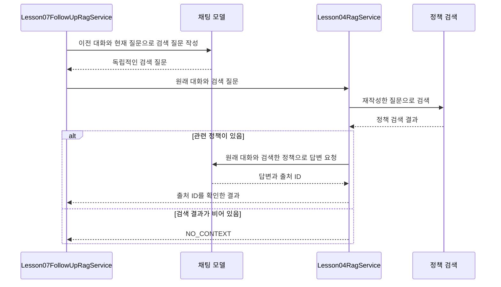

# 10-7. 이전 대화를 참고해 검색 질문 만들기

**이번 목표:** 대상이 생략된 후속 질문을 독립적인 검색 질문으로 바꾸고, 그 질문으로 찾은 정책을 답변에 사용합니다.<br>
07단원의 대화 메시지와 10-4·5의 검색·생성·출처 확인을 배운 뒤 읽는 선택 실습입니다.

## 왜 현재 질문만 검색하면 어려울까?

| 대화 | 내용 |
|---|---|
| 이전 질문 | 미개봉 상품의 반품 기간은? |
| 이전 답변 | 수령 후 7일 이내입니다. |
| 현재 질문 | 그럼 개봉했으면? |
| 검색할 질문의 예 | 개봉한 상품의 반품 조건과 예외는 무엇인가? |

현재 질문에는 반품이라는 대상이 생략되어 있습니다.<br>
이전 대화를 참고해 검색 질문을 명확하게 만드는 작업을 **질문 재작성**이라고 합니다.<br>
메모리에 대화가 있다는 사실만으로 벡터 검색이 그 대화를 자동 참고하지는 않습니다.

이 실습에서는 이전 질문·답변 한 쌍을 직접 전달합니다.<br>
이전 답변은 검색할 대상을 이해하는 데만 쓰고, 실제 정책 답변의 근거는 이번에 검색한 문서로 확인합니다.



## 코드를 순서대로 읽기

[Lesson07FollowUpRagService 전체 코드](../../../labs/10-03-custom-rag/src/main/java/com/example/ailearning/l10rag/lesson07_followup/Lesson07FollowUpRagService.java)는 기존 모듈의 새 패키지에 있습니다.<br>
별도 Controller 없이 테스트에서 Service를 호출합니다.

1. `ChatClient`에 이전 질문·답변과 현재 질문을 전달합니다.
2. `.entity(SearchQuestion.class)`로 검색 질문을 받습니다.<br>
   `SearchQuestion`은 `String question` 하나를 담는 이 실습의 record입니다.
3. 빈 검색 질문이면 중단합니다.
4. 기존 `Lesson04RagService.answerWithSearchQuestion()`에 대화와 검색 질문을 따로 전달합니다.

호출 부분을 발췌하면 다음과 같습니다.

```java
var answer = ragService.answerWithSearchQuestion(conversationQuestion, searchQuestion.question());
```

첫 인자는 **답변 생성에서 읽을 원래 대화**, 두 번째 인자는 **벡터 검색에 사용할 질문**입니다.<br>
모델이 재작성한 문장을 고객이 실제로 한 말처럼 바꿔 넣지 않습니다.<br>
기존 `answer(question)`는 두 인자에 같은 질문을 전달하므로 10-4의 기본 동작은 유지됩니다.

## 실행하고 확인하기

[로컬 테스트](../../../labs/10-03-custom-rag/src/test/java/com/example/ailearning/l10rag/lesson07_followup/Lesson07FollowUpRagLocalModelTest.java)는 질문 재작성과 답변 생성을 고정 응답 두 개로 재현합니다.<br>
실제 임베딩 API 대신 고정 벡터를 쓰지만 `SimpleVectorStore`와 RAG 코드는 실제로 실행합니다.

```bash
./gradlew :Spring-AI-Agent-Learning:labs:10-03-custom-rag:test --tests '*Lesson07FollowUpRagLocalModelTest'
```

출력에서 `searchQuestion`과 `answer`를 확인합니다.<br>
테스트는 임베딩 요청에 재작성한 질문이 들어갔는지, 답변 생성 요청에는 원래 대화와 검색된 정책이 들어갔는지 검사합니다.<br>
질문 재작성이 비면 검색·두 번째 채팅 요청이 발생하지 않는지도 확인합니다.

[실제 OpenAI 테스트](../../../labs/10-03-custom-rag/src/test/java/com/example/ailearning/l10rag/lesson07_followup/Lesson07FollowUpRagOpenAiLiveTest.java)는 루트 `.env`의 채팅·임베딩 설정을 사용합니다.

```bash
./gradlew :Spring-AI-Agent-Learning:labs:10-03-custom-rag:test --tests '*Lesson07FollowUpRagOpenAiLiveTest'
```

앱 시작 시 문서 임베딩, 실행 시 질문 임베딩과 채팅 요청이 발생합니다.<br>
근거를 찾은 정상 흐름에서는 재작성과 답변 생성으로 채팅 요청이 두 번 필요합니다.<br>
재작성은 성공했지만 검색 결과가 없으면 재작성용 채팅 요청 1회와 질문 임베딩까지 실행하고, 답변 생성은 생략합니다.<br>
고정 응답 테스트는 연결 경로를 확인하며, 실제 재작성의 정확성은 Live 결과를 읽고 판단해야 합니다.

## 확인 질문

이전 답변에 “7일”이라고 적혀 있으면 이번 정책 검색도 생략해도 될까요?

<details>
<summary>해설</summary>

아닙니다.<br>
이전 답변은 대상을 이해할 문맥이고, 현재 정책의 근거를 대신하지 않습니다.<br>
재작성한 질문으로 정책을 검색하고 원문의 조건·예외를 확인해야 합니다.

</details>

[10단원 목차](../10-rag.md) · [기본 검색·생성으로 돌아가기](04-custom-generation.md)
