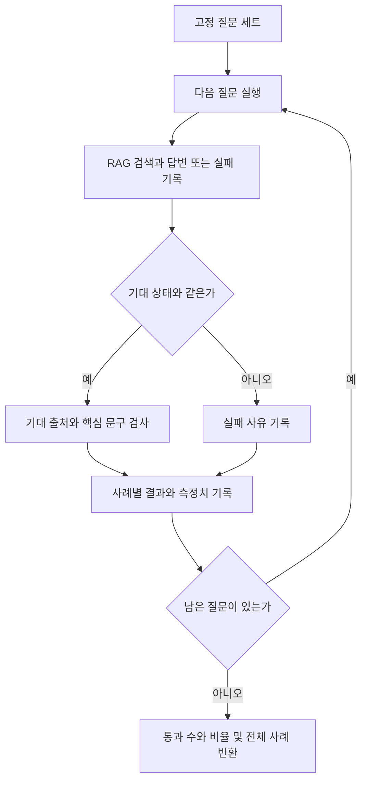
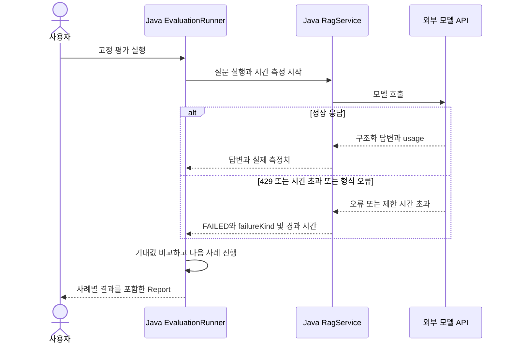

# 11. 평가와 운영 기초: 좋아졌는지 어떻게 확인할까?

예상 시간: 3시간. 선수 지식: 10의 RAG 전체 흐름, HTTP 오류와 Java 예외.
10의 작은 RAG를 이 모듈에 복사했습니다. 이번에는 **고정 질문으로 비교하고 실행 정보를 기록**합니다.
실제 서비스 모니터링 시스템이나 LLM 평가자를 한 번에 추가하지 않습니다.
[공통 그림 기준](../diagram-guide.md)에 따라 평가의 분기는 플로우차트, 호출 실패 전파는 시퀀스로 표시합니다.

## 테스트와 품질 평가는 다르다

로컬 고정 응답 테스트는 코드의 데이터 전달과 실패 처리를 재현합니다.
실제 모델 평가는 동일한 질문 세트를 모델에 보내 결과를 비교합니다. 한 번 답이 맞았다고 모든 입력의 품질이 보장되지는 않습니다.
이번에는 우선 사람이 읽을 수 있는 **규칙 기반 평가**를 만듭니다.

| 확인 항목 | 이번 구현 | 한계 |
|---|---|---|
| 상태 | 기대 상태와 실제 상태 비교 | ANSWERED 자체가 사실성 보장은 아님 |
| 출처 | 기대 ID가 실제 출처 목록에 포함되는지 | 인용과 주장 전체의 일치를 증명하지 못함 |
| 핵심 문구 | 3000, 7일 같은 기대 문자열 포함 | 표현이 달라지면 오판, “7일이 아니다”도 포함 검사 통과 가능 |
| 지연 | System.nanoTime으로 실행 경과 시간 측정 | 프로세스·네트워크·환경에 영향받음 |
| 토큰 | 모델 응답 metadata의 usage 읽기 | 여기서는 채팅 호출만 관찰, 임베딩 사용량·가격을 합산하지 않음 |

문구 검사만으로 평가를 끝내지 말고 답변과 출처 원문을 사람이 읽는 절차도 둡니다.
LLM-as-judge는 추가 평가 방법이지만 이 단원에 필수로 넣지 않습니다.

## 고정 질문 세트부터 읽기

[evaluation-cases.json](../../labs/11-evaluation/src/main/resources/evaluation-cases.json)에 질문·기대 상태·출처·문구가 있습니다.
배송비, 미개봉 반품, 무관한 우주 질문 세 개로 시작합니다. 평가는 서버 내부의 이 고정 목록만 사용합니다.



“모델 접속 실패”와 “연결은 됐지만 잘못된 주장”을 구분할 수 있어야 합니다.
실패했다고 미리 준비한 정답을 성공 결과로 대체하지 않습니다.

## 평가 코드

읽는 순서: evaluation-cases.json → [EvaluationRunner](../../labs/11-evaluation/src/main/java/com/example/ailearning/l11evaluation/EvaluationRunner.java) → [RagService](../../labs/11-evaluation/src/main/java/com/example/ailearning/l11evaluation/RagService.java) → [EvaluationController](../../labs/11-evaluation/src/main/java/com/example/ailearning/l11evaluation/EvaluationController.java).
PolicyLoader·Source·정책 파일은 10에서 배운 것과 같은 역할입니다.

```java
package com.example.ailearning.l11evaluation;

import org.springframework.core.io.ClassPathResource;
import org.springframework.stereotype.Service;
import tools.jackson.databind.ObjectMapper;
import java.io.IOException;
import java.util.ArrayList;
import java.util.List;

@Service
public class EvaluationRunner {
    public record EvaluationCase(String id, String question, String expectedStatus,
                                 List<String> expectedSourceIds, String expectedText) {}
    public record CaseResult(String id, boolean passed, List<String> failures, RagService.Run actual) {}
    public record Report(int total, int passed, double passRate, List<CaseResult> cases) {}
    private final RagService service;
    private final List<EvaluationCase> cases;

    public EvaluationRunner(RagService service, ObjectMapper mapper) throws IOException {
        this.service = service;
        try (var input = new ClassPathResource("evaluation-cases.json").getInputStream()) {
            cases = List.of(mapper.readValue(input, EvaluationCase[].class));
        }
    }

    public Report run() {
        var results = new ArrayList<CaseResult>();
        for (var example : cases) {
            RagService.Run actual = service.answer(example.question());
            var failures = new ArrayList<String>();
            if (!actual.reply().status().equals(example.expectedStatus())) failures.add("상태 불일치");
            var ids = actual.reply().sources().stream().map(Source::id).toList();
            if (!ids.containsAll(example.expectedSourceIds())) failures.add("expected source ID missing");
            if (!actual.reply().answer().contains(example.expectedText())) failures.add("expected text missing");
            results.add(new CaseResult(example.id(), failures.isEmpty(), List.copyOf(failures), actual));
        }
        int passed = (int) results.stream().filter(CaseResult::passed).count();
        return new Report(results.size(), passed, (double) passed / results.size(), List.copyOf(results));
    }
}
```

`Report.passRate`는 이 규칙과 이 세 사례에 대한 비율입니다. 일반적인 답변 정확도나 운영 서비스의 SLA라고 표현하지 않습니다.
사례가 적어 한 건의 차이도 크게 보입니다. 기본 사례는 항상 유지하고 경계·실패·다른 표현을 추가합니다.

## 한 번 호출해서 객체와 사용량을 함께 받기

10의 `.entity(DraftAnswer.class)`를 `.responseEntity(DraftAnswer.class)`로 바꿉니다.
이 Spring AI 타입은 변환한 객체와 원래 ChatResponse를 함께 담습니다. Spring MVC의 HTTP ResponseEntity와는 다른 타입입니다.

```java
var response = client.prompt()
        .system("제공한 정책 근거 안에서만 답하세요.")
        .user(questionAndContext)
        .call().responseEntity(DraftAnswer.class);
DraftAnswer draft = response.entity();
var usage = response.response().getMetadata().getUsage();
```

위 코드는 새 API를 설명하기 위한 부분 예제입니다. `questionAndContext`를 만드는 실제 실행 코드는 RagService에 있습니다.
토큰을 읽으려고 모델을 두 번 호출하지 않습니다.
usage가 없거나 파싱 전에 실패하면 토큰은 null이며, JSON 설정에 따라 필드가 생략될 수 있습니다. 0으로 채워 실제 사용량이 없었다고 표시하지 않습니다.
`elapsedMs`에는 검색과 생성 전체 시간이 포함되지만 토큰 필드는 **채팅 응답에서 보고된 값만** 포함됩니다.

## 실패는 어디서 확인할까?



- RATE_LIMIT: 제공 업체의 429. 사용량·속도·계정 제한을 확인합니다.
- TIMEOUT: SDK/전송 계층에서 확인한 시간 초과.
- UPSTREAM_OR_OUTPUT: 기타 연결 또는 응답 변환 실패. 실제 진단 시 서버 로그·원인을 추가 확인합니다.

이 예제는 실패 원문/키를 HTTP 응답으로 내보내지 않습니다. 모든 라이브러리 로그를 자동 마스킹하는 기능을 구현한 것은 아닙니다.
응답 HTTP가 200이어도 `actual.reply.status=FAILED`이면 성공이 아닙니다.
연결 설정은 응답 생성 옵션과 구분합니다. 실제 적용되는 위치는 다음과 같습니다.

```yaml
spring:
  ai:
    openai:
      chat:
        max-retries: 0
        timeout: 2s
        options:
          model: ${OPENAI_CHAT_MODEL}
```

이 실습의 429/시간 초과 테스트는 설정 파일만 읽는 검사가 아니라 실제 전송 횟수와 대기를 확인합니다.
앞 단원들의 연결 설정도 이 위치로 통일했습니다.
SDK 재시도는 0회, 요청 타임아웃은 2초로 설정했습니다. 자동 재시도가 과금·지연·중복 실행을 늘릴 수 있어 이번에는 끕니다.
실제 모델의 정상 응답도 2초를 넘을 수 있습니다. 상황에 맞게 한도를 조정하고 변경 전후를 기록하세요.

## 실행

키·Chat 모델·임베딩 모델 설정은 [10장](10-rag.md)과 같습니다. 저장소 루트에서:

```bash
./gradlew :Spring-AI-Agent-Learning:labs:11-evaluation:test
./gradlew :Spring-AI-Agent-Learning:labs:11-evaluation:bootRun
curl -sS http://127.0.0.1:8101/api/evaluation/ask \
  -H 'Content-Type: text/plain; charset=UTF-8' --data-raw '미개봉 반품 기간은?'
curl -sS -X POST http://127.0.0.1:8101/api/evaluation/run
```

실제 실행은 시작 시 문서 임베딩, 평가 시 질문 임베딩과 답변 생성 비용이 발생할 수 있습니다.
/run 한 번은 여러 외부 요청을 만들며, 자동으로 주기 실행하지 않습니다. 종료는 Ctrl+C입니다.
실습 전후 보고서를 각각 저장하려면 curl 출력에 `> /tmp/learning11-before.json` 등을 사용하세요.

## 바꿔서 비교하기

1. 같은 질문 세트를 여러 번 실행해 문장 차이와 지연 변동을 기록합니다.
2. “7일”을 “7 일”로 답했을 때 단순 문구 평가의 한계를 설명합니다.
3. 질문에 “반품 담당자의 이름”을 추가하고 정책에 없는 정보의 보류 여부를 확인합니다.
4. threshold나 프롬프트 한 항목만 바꾸고 사례별 결과를 비교합니다. 비율만 보고 어떤 문제가 바뀌었는지 놓치지 않습니다.

[EvaluationContractTest](../../labs/11-evaluation/src/test/java/com/example/ailearning/l11evaluation/EvaluationContractTest.java)는 정상 사례 평가와 usage 기록, 잘못된 주장, 429·형식 오류·타임아웃을 재현합니다.
usage의 10/5 토큰 등은 **테스트 API가 제공하는 고정 값**입니다. 실제 비용이나 품질로 표시하지 않습니다.
2초 설정과 별개로 시간 초과 테스트만 500ms로 줄여 빠르게 검증합니다.

## 확인 질문

1. 통과율이 올랐는데 평가 질문을 바꿨다면 공정한 비교일까요?
2. 토큰 사용량을 읽으려고 모델을 다시 호출해야 할까요?
3. 답변에 출처가 있지만 “30일”이라고 틀리게 말하면 어떤 검증이 추가로 필요한가요?

<details><summary>해설</summary>

같은 고정 세트가 기준이어야 합니다. 같은 응답의 ChatResponse metadata를 읽습니다.
출처 ID 검사만으로 부족하므로 기대 값·원문 대조와 더 다양한 질문 평가가 필요합니다. 실패와 품질 저하를 구분하면 완료입니다.
</details>

보충: [공식 Evaluation](https://docs.spring.io/spring-ai/reference/api/testing.html), [Observability](https://docs.spring.io/spring-ai/reference/observability/index.html).
[이전: 10](10-rag.md) · [학습 지도](../curriculum.md)

[다음: 12. 작은 쇼핑 상담 Agent](12-shopping-agent.md)
