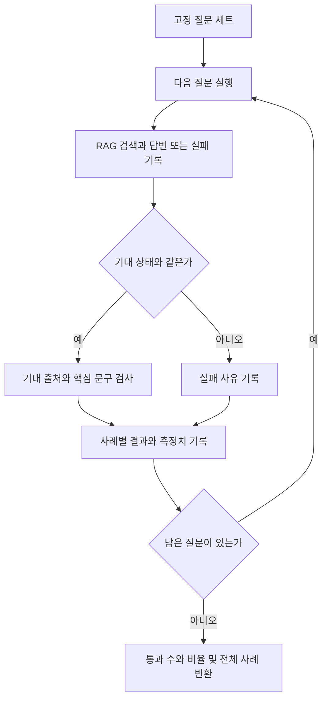

# 11-1. 고정 사례와 품질 평가의 기준

30~45분을 기준으로 한 번에 한 가지 흐름만 읽습니다. 단원 전체 시간은 목차의 기존 예상 시간에 포함됩니다.

**이번 목표:** 코드 계약 테스트와 답변 품질 평가를 구분합니다.

**코드 읽기 안내:** EvaluationRunner의 case별 기대 값 비교가 핵심입니다. 점수가 높아도 사례가 좁으면 실제 품질을 대표하지 못합니다.

## 테스트와 품질 평가는 다르다

로컬 고정 응답 테스트는 코드의 데이터 전달과 실패 처리를 재현합니다.
실제 모델 평가는 동일한 질문 세트를 모델에 보내 결과를 비교합니다. 한 번 답이 맞았다고 모든 입력의 품질이 보장되지는 않습니다.
이번에는 우선 사람이 읽을 수 있는 **규칙 기반 평가**를 만듭니다.

| 확인 항목 | 이번 구현 | 한계 |
|---|---|---|
| 상태 | 기대 상태와 실제 상태 비교 | ANSWERED 자체가 사실성 보장은 아님 |
| 출처 | 기대 ID가 실제 출처 목록에 포함되는지 | 인용과 주장 전체의 일치를 증명하지 못함 |
| 핵심 문구 | 3000, 7일 같은 기대 문자열 포함 | 표현이 달라지면 오판, “7일이 아니다”도 포함 검사 통과 가능 |
| 지연 | System.nanoTime으로 실행 경과 시간 측정 | 프로세스·네트워크·환경에 영향받음 |
| 토큰 | 모델 응답 metadata의 usage 읽기 | 여기서는 채팅 호출만 관찰, 임베딩 사용량·가격을 합산하지 않음 |

문구 검사만으로 평가를 끝내지 말고 답변과 출처 원문을 사람이 읽는 절차도 둡니다.
LLM-as-judge는 추가 평가 방법이지만 이 단원에 필수로 넣지 않습니다.

## 고정 질문 세트부터 읽기

[evaluation-cases.json](../../../labs/11-evaluation/src/main/resources/evaluation-cases.json)에 질문·기대 상태·출처·문구가 있습니다.
배송비, 미개봉 반품, 무관한 우주 질문 세 개로 시작합니다. 평가는 서버 내부의 이 고정 목록만 사용합니다.



“모델 접속 실패”와 “연결은 됐지만 잘못된 주장”을 구분할 수 있어야 합니다.
실패했다고 미리 준비한 정답을 성공 결과로 대체하지 않습니다.

## 평가 코드

읽는 순서: evaluation-cases.json → [EvaluationRunner](../../../labs/11-evaluation/src/main/java/com/example/ailearning/l11evaluation/EvaluationRunner.java) → [RagService](../../../labs/11-evaluation/src/main/java/com/example/ailearning/l11evaluation/RagService.java) → [EvaluationController](../../../labs/11-evaluation/src/main/java/com/example/ailearning/l11evaluation/EvaluationController.java).
PolicyLoader·Source·정책 파일은 10에서 배운 것과 같은 역할입니다.

```java
package com.example.ailearning.l11evaluation;

import org.springframework.core.io.ClassPathResource;
import org.springframework.stereotype.Service;
import tools.jackson.databind.ObjectMapper;
import java.io.IOException;
import java.util.ArrayList;
import java.util.List;

@Service
public class EvaluationRunner {
    public record EvaluationCase(String id, String question, String expectedStatus,
                                 List<String> expectedSourceIds, String expectedText) {}
    public record CaseResult(String id, boolean passed, List<String> failures, RagService.Run actual) {}
    public record Report(int total, int passed, double passRate, List<CaseResult> cases) {}
    private final RagService service;
    private final List<EvaluationCase> cases;

    public EvaluationRunner(RagService service, ObjectMapper mapper) throws IOException {
        this.service = service;
        try (var input = new ClassPathResource("evaluation-cases.json").getInputStream()) {
            cases = List.of(mapper.readValue(input, EvaluationCase[].class));
        }
    }

    public Report run() {
        var results = new ArrayList<CaseResult>();
        for (var example : cases) {
            RagService.Run actual = service.answer(example.question());
            var failures = new ArrayList<String>();
            if (!actual.reply().status().equals(example.expectedStatus())) failures.add("상태 불일치");
            var ids = actual.reply().sources().stream().map(Source::id).toList();
            if (!ids.containsAll(example.expectedSourceIds())) failures.add("expected source ID missing");
            if (!actual.reply().answer().contains(example.expectedText())) failures.add("expected text missing");
            results.add(new CaseResult(example.id(), failures.isEmpty(), List.copyOf(failures), actual));
        }
        int passed = (int) results.stream().filter(CaseResult::passed).count();
        return new Report(results.size(), passed, (double) passed / results.size(), List.copyOf(results));
    }
}
```

`Report.passRate`는 이 규칙과 이 세 사례에 대한 비율입니다. 일반적인 답변 정확도나 운영 서비스의 SLA라고 표현하지 않습니다.
사례가 적어 한 건의 차이도 크게 보입니다. 기본 사례는 항상 유지하고 경계·실패·다른 표현을 추가합니다.


## 여기서 멈춰 확인하기

코드를 닫고 “이번 입력 → 새로 하는 처리 → 확인할 결과”를 한 문장으로 적어 보세요.
설명하기 어렵다면 위 핵심 메서드만 다시 읽습니다. 테스트용 HTTP 서버 구현을 이해해야 다음으로 갈 수 있는 것은 아닙니다.

[이전](../11-evaluation.md) · [다음 소수업](02-usage.md) · [학습 방법](../../learning-guide.md)
