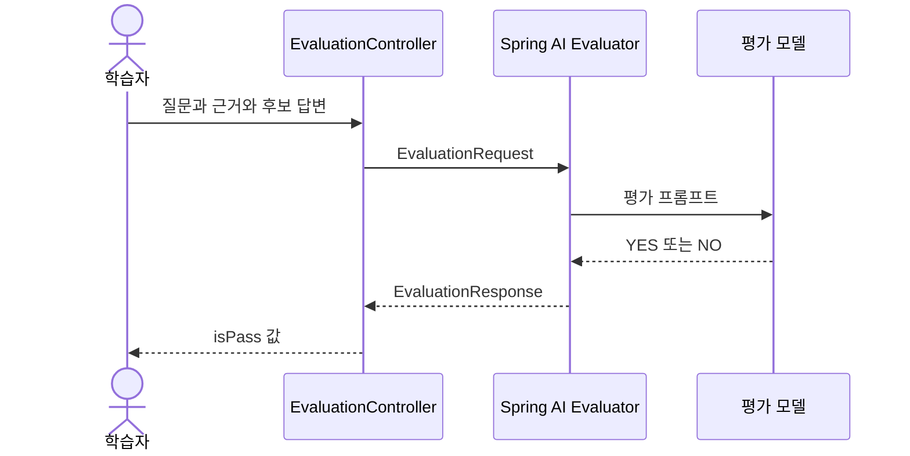

# 11-2. Evaluator로 답변을 평가하는 모델 호출하기

**실행 코드·설정·테스트:** [labs/11-model-evaluation](../../../labs/11-model-evaluation/README.md). 저장소 루트에서 해당 README의 명령으로 실행합니다.

선수 지식: 11-1의 고정 사례·기대 값 평가, 03의 ChatClient.
이번 목표는 **질문·근거·후보 답변을 평가 모델에 전달하고 판정값을 읽는 것**입니다.
이번에는 이미 작성한 후보 답변을 평가합니다.

## 코드의 기대 값과 모델의 판정

11-1에서는 Java가 기대 금액·출처 ID·문구를 비교했습니다.
자유로운 문장의 적절성을 평가하고 싶을 때는 다른 모델 호출로 판단을 요청할 수도 있습니다.
LLM-as-a-judge는 **모델이 다른 답변의 평가자 역할을 맡는 방식**입니다. 사람이 확정한 정답과 같은 의미는 아닙니다.

| 타입 | 역할 |
|---|---|
| `EvaluationRequest` | 평가할 질문·근거·후보 답변을 담음 |
| `RelevancyEvaluator` | 질문·근거에 맞는 답변인지 평가 요청 |
| `FactCheckingEvaluator` | 근거가 후보 답변의 주장을 뒷받침하는지 평가 요청 |
| `EvaluationResponse.isPass()` | 평가 모델 응답을 해석한 통과 여부 |



그림에는 답변을 새로 만드는 호출이 없습니다. 후보 답변은 학습자가 보내며, 평가만 모델을 호출합니다.
두 API 중 하나를 선택해 관련성 또는 사실 일치를 평가합니다.

## Service를 한 메서드씩 읽기

[AnswerEvaluator.java](../../../labs/11-model-evaluation/src/main/java/com/example/ailearning/l11judge/AnswerEvaluator.java) 전체입니다.

```java
package com.example.ailearning.l11judge;

import org.springframework.ai.chat.client.ChatClient;
import org.springframework.ai.chat.evaluation.RelevancyEvaluator;
import org.springframework.ai.chat.evaluation.FactCheckingEvaluator;
import org.springframework.ai.document.Document;
import org.springframework.ai.evaluation.EvaluationRequest;
import org.springframework.stereotype.Service;
import java.util.List;

@Service
public class AnswerEvaluator {
    private final RelevancyEvaluator relevance;
    private final FactCheckingEvaluator facts;

    public AnswerEvaluator(ChatClient.Builder builder) {
        relevance = new RelevancyEvaluator(builder.clone());
        facts = FactCheckingEvaluator.builder(builder.clone()).build();
    }

    public boolean relevance(String question, String context, String answer) {
        var request = new EvaluationRequest(question, List.of(new Document(context)), answer);
        return relevance.evaluate(request).isPass();
    }

    public boolean facts(String context, String answer) {
        var request = new EvaluationRequest(List.of(new Document(context)), answer);
        return facts.evaluate(request).isPass();
    }
}
```

1. `builder.clone()`은 각 평가기가 같은 Builder를 직접 변경하며 간섭하지 않도록 복사합니다.
2. `new Document(context)`는 평가 근거를 문서 형태로 감쌉니다. 벡터 검색·임베딩 호출은 없습니다.
3. `evaluate()`는 평가 프롬프트를 만들어 모델을 호출합니다. 단순한 Java 문자열 비교가 아닙니다.
4. `isPass()`는 평가 응답의 통과 여부입니다. 실제 모델은 같은 답변에도 판정이 달라질 수 있습니다.

`facts()`는 근거와 주장만 사용하므로 질문은 판정 프롬프트에 넣지 않습니다.
Controller는 두 요청을 쉽게 비교하도록 같은 Candidate JSON을 받습니다. question 필드도 유효한 문자열로 전달합니다.
이번 모듈의 API는 학습 편의를 위해 boolean을 반환합니다. 판정 실패·일반적인 NO·평가 형식 오류를 운영 업무에서 모두 같은 이유로 처리해서는 안 됩니다.

## 실행과 비교

먼저 로컬 고정 모델 테스트를 실행합니다.

```bash
./gradlew :Spring-AI-Agent-Learning:labs:11-model-evaluation:test --tests com.example.ailearning.l11judge.EvaluationApiContractTest
./gradlew :Spring-AI-Agent-Learning:labs:11-model-evaluation:bootJar
```

실제 모델은 루트 `.env`의 OPENAI_API_KEY, OPENAI_MODEL을 사용합니다.

```bash
./gradlew :Spring-AI-Agent-Learning:labs:11-model-evaluation:bootRun
```

다른 터미널에서:

```bash
curl -sS http://127.0.0.1:8104/api/evaluate/relevance \
  -H 'Content-Type: application/json' \
  --data-raw '{"question":"미개봉 반품 기간은?","context":"미개봉 상품은 수령 후 7일 이내 반품 가능","answer":"미개봉 상품은 7일 이내 반품할 수 있습니다."}'

curl -sS http://127.0.0.1:8104/api/evaluate/facts \
  -H 'Content-Type: application/json' \
  --data-raw '{"question":"미개봉 반품 기간은?","context":"미개봉 상품은 수령 후 7일 이내 반품 가능","answer":"30일 이내 반품할 수 있습니다."}'
```

첫 요청은 true, 두 번째는 false를 기대하고 관찰하지만 실제 모델의 판정을 보장하지 않습니다.
각 API 요청은 평가 모델을 1회 호출하므로 사용량이 발생합니다. 위 두 요청은 평가 호출 2회입니다.
평가 모델도 근거 안의 악의적 문장이나 표현에 영향받을 수 있어, 고정 사례와 사람의 검토를 대체하지 않습니다.

## 테스트가 확인한 범위

`EvaluationApiContractTest`의 4개 테스트는 로컬 HTTP 서버가 YES·NO·예상 밖 문자열을 돌려줍니다.
질문·근거·주장이 실제 Spring AI 평가 프롬프트에 포함되는지, 응답이 true/false로 변환되는지,
빈 입력이 모델 호출 전에 거부되는지 확인합니다. 평가 모델의 판단 정확도를 검증하는 테스트는 아닙니다.

한 가지 실험: 질문과 근거는 유지한 채 답변만 7일 → 30일로 바꿉니다.
그 뒤 질문만 엉뚱하게 바꿔 relevance와 facts가 어떤 다른 질문을 평가하는지 비교하세요.

확인 질문: Evaluator가 true를 반환하면 사람의 사실 검증이 필요 없을까요?

<details><summary>해설</summary>
아닙니다. 평가자 역시 모델입니다. 실제 질문의 다양한 표현·잘못된 근거·반례를 포함한 평가 세트와 사람 검토를 병행해야 합니다.
</details>

보충: [공식 Evaluation API](https://docs.spring.io/spring-ai/reference/api/testing.html).

[이전](01-cases.md) · [다음](03-usage.md) · [단원 목차](../11-evaluation.md) · [학습 방법](../../learning-guide.md)
