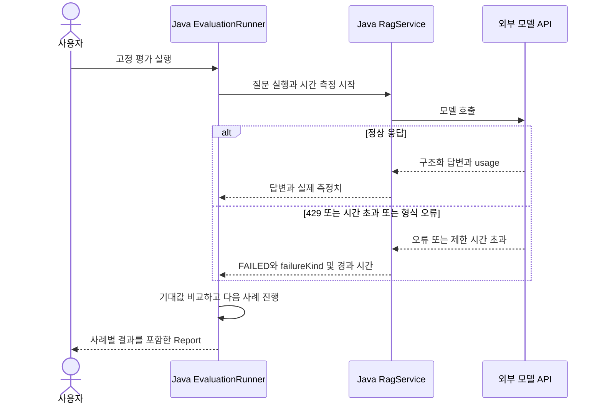

# 11-3. 실패·지연·재시도 관찰

30~45분을 기준으로 한 번에 한 가지 흐름만 읽습니다. 단원 전체 시간은 목차의 기존 예상 시간에 포함됩니다.

**이번 목표:** 잘못된 답변과 요청 실패를 다른 결과로 읽습니다.

**코드 읽기 안내:** SDK 옵션 위치와 관찰된 요청 횟수를 연결하세요. 실패를 그럴듯한 성공 답변으로 바꾸지 않습니다.

## 실패는 어디서 확인할까?



- RATE_LIMIT: 제공 업체의 429. 사용량·속도·계정 제한을 확인합니다.
- TIMEOUT: SDK/전송 계층에서 확인한 시간 초과.
- UPSTREAM_OR_OUTPUT: 기타 연결 또는 응답 변환 실패. 실제 진단 시 서버 로그·원인을 추가 확인합니다.

이 예제는 실패 원문/키를 HTTP 응답으로 내보내지 않습니다. 모든 라이브러리 로그를 자동 마스킹하는 기능을 구현한 것은 아닙니다.
응답 HTTP가 200이어도 `actual.reply.status=FAILED`이면 성공이 아닙니다.
연결 설정은 응답 생성 옵션과 구분합니다. 실제 적용되는 위치는 다음과 같습니다.

```yaml
spring:
  ai:
    openai:
      chat:
        max-retries: 0
        timeout: 2s
        options:
          model: ${OPENAI_CHAT_MODEL}
```

이 실습의 429/시간 초과 테스트는 설정 파일만 읽는 검사가 아니라 실제 전송 횟수와 대기를 확인합니다.
앞 단원들의 연결 설정도 이 위치로 통일했습니다.
SDK 재시도는 0회, 요청 타임아웃은 2초로 설정했습니다. 자동 재시도가 과금·지연·중복 실행을 늘릴 수 있어 이번에는 끕니다.
실제 모델의 정상 응답도 2초를 넘을 수 있습니다. 상황에 맞게 한도를 조정하고 변경 전후를 기록하세요.

## 실행

키·Chat 모델·임베딩 모델 설정은 [10장](../10-rag.md)과 같습니다. 저장소 루트에서:

```bash
./gradlew :Spring-AI-Agent-Learning:labs:11-evaluation:test
./gradlew :Spring-AI-Agent-Learning:labs:11-evaluation:bootRun
curl -sS http://127.0.0.1:8101/api/evaluation/ask \
  -H 'Content-Type: text/plain; charset=UTF-8' --data-raw '미개봉 반품 기간은?'
curl -sS -X POST http://127.0.0.1:8101/api/evaluation/run
```

실제 실행은 시작 시 문서 임베딩, 평가 시 질문 임베딩과 답변 생성 비용이 발생할 수 있습니다.
/run 한 번은 여러 외부 요청을 만들며, 자동으로 주기 실행하지 않습니다. 종료는 Ctrl+C입니다.
실습 전후 보고서를 각각 저장하려면 curl 출력에 `> /tmp/learning11-before.json` 등을 사용하세요.

## 바꿔서 비교하기

1. 같은 질문 세트를 여러 번 실행해 문장 차이와 지연 변동을 기록합니다.
2. “7일”을 “7 일”로 답했을 때 단순 문구 평가의 한계를 설명합니다.
3. 질문에 “반품 담당자의 이름”을 추가하고 정책에 없는 정보의 보류 여부를 확인합니다.
4. threshold나 프롬프트 한 항목만 바꾸고 사례별 결과를 비교합니다. 비율만 보고 어떤 문제가 바뀌었는지 놓치지 않습니다.

[EvaluationContractTest](../../../labs/11-evaluation/src/test/java/com/example/ailearning/l11evaluation/EvaluationContractTest.java)는 정상 사례 평가와 usage 기록, 잘못된 주장, 429·형식 오류·타임아웃을 재현합니다.
usage의 10/5 토큰 등은 **테스트 API가 제공하는 고정 값**입니다. 실제 비용이나 품질로 표시하지 않습니다.
2초 설정과 별개로 시간 초과 테스트만 500ms로 줄여 빠르게 검증합니다.

## 확인 질문

1. 통과율이 올랐는데 평가 질문을 바꿨다면 공정한 비교일까요?
2. 토큰 사용량을 읽으려고 모델을 다시 호출해야 할까요?
3. 답변에 출처가 있지만 “30일”이라고 틀리게 말하면 어떤 검증이 추가로 필요한가요?

<details><summary>해설</summary>

같은 고정 세트가 기준이어야 합니다. 같은 응답의 ChatResponse metadata를 읽습니다.
출처 ID 검사만으로 부족하므로 기대 값·원문 대조와 더 다양한 질문 평가가 필요합니다. 실패와 품질 저하를 구분하면 완료입니다.
</details>

보충: [공식 Evaluation](https://docs.spring.io/spring-ai/reference/api/testing.html), [Observability](https://docs.spring.io/spring-ai/reference/observability/index.html).
[이전: 10](../10-rag.md) · [학습 지도](../../curriculum.md)

[다음: 12. 작은 쇼핑 상담 Agent](../12-shopping-agent.md)

## 여기서 멈춰 확인하기

코드를 닫고 “이번 입력 → 새로 하는 처리 → 확인할 결과”를 한 문장으로 적어 보세요.
설명하기 어렵다면 위 핵심 메서드만 다시 읽습니다. 테스트용 HTTP 서버 구현을 이해해야 다음으로 갈 수 있는 것은 아닙니다.

[이전](02-usage.md) · [단원 목차](../11-evaluation.md) · [학습 방법](../../learning-guide.md)
