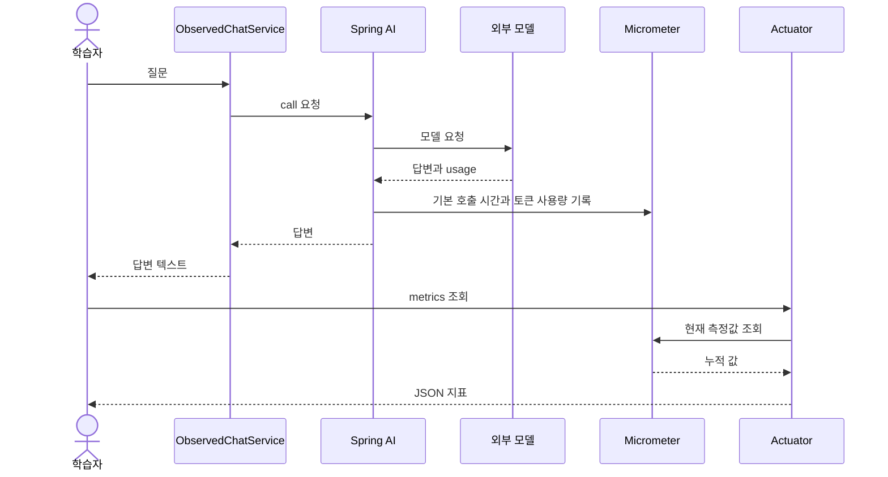

# 11-4. Actuator로 모델 호출과 토큰 지표 관찰하기

**실행 코드·설정·테스트:** [labs/11-observability](../../../labs/11-observability/README.md). 저장소 루트에서 해당 README의 명령으로 실행합니다.

선수 지식: 02의 첫 호출, 11-3의 응답 usage.
이번 목표는 **Service에 계측 코드를 추가하지 않고 Spring AI 기본 지표를 조회**하는 것입니다.

## 답변 품질과 시스템 동작은 다른 질문

평가는 “근거에 맞는 답인가?”를 묻습니다. 관측은 “몇 번 호출했고 얼마나 걸렸나?”를 묻습니다.
답이 맞아도 너무 느릴 수 있고, 빨리 응답했어도 내용은 틀릴 수 있습니다.

| 이름 | 이번에 이해할 의미 |
|---|---|
| Micrometer | 호출 시간·횟수 같은 측정값을 기록하는 Spring 생태계의 계측 기반 |
| Actuator metrics | 측정값을 HTTP로 조회하는 Spring Boot 엔드포인트 |
| 메트릭 | 여러 요청의 횟수·시간·사용량을 집계한 값 |

이번 실행 실습은 **Actuator의 HTTP 엔드포인트에서 메트릭을 조회하는 방법**에 집중합니다.
11-3에서 받은 한 응답의 usage가 여기서는 여러 요청의 누적 지표가 됩니다.

## Java 코드는 첫 호출 그대로

[ObservedChatService](../../../labs/11-observability/src/main/java/com/example/ailearning/l11observe/ObservedChatService.java) 전체입니다.

```java
package com.example.ailearning.l11observe;
import org.springframework.ai.chat.client.ChatClient;
import org.springframework.stereotype.Service;

@Service
public class ObservedChatService {
    private final ChatClient client;
    public ObservedChatService(ChatClient.Builder builder) { client = builder.build(); }

    public String ask(String question) {
        return client
                .prompt()
                .user(question)
                .call()
                .content();
    }
}
```

측정용 변수나 타이머를 직접 추가하지 않았습니다. Spring AI가 모델 호출을 계측하고,
Spring Boot의 Micrometer 연결이 그 측정값을 메트릭으로 기록합니다.
Actuator 의존성은 이미 저장소 루트의 공통 의존성에 포함되어 있습니다.
새로 볼 설정은 `application.yml` 끝의 아래 부분뿐입니다.

```yaml
management:
  endpoints:
    web:
      exposure:
        include: health,metrics
```

학습용 서버는 127.0.0.1에 바인딩합니다. 이 설정으로 프롬프트 본문 로깅을 켜거나 API 키를 노출하는 엔드포인트를 추가하지 않습니다.



그림은 계측 책임을 요약합니다. 측정값 조회는 새로운 Chat 요청을 만들지 않습니다.

## 실행 후 한 번씩 조회하기

저장소 루트에서:

```bash
./gradlew :Spring-AI-Agent-Learning:labs:11-observability:test --tests com.example.ailearning.l11observe.ObservationLocalModelTest
./gradlew :Spring-AI-Agent-Learning:labs:11-observability:bootJar
./gradlew :Spring-AI-Agent-Learning:labs:11-observability:bootRun
```

실제 실행은 루트 `.env`의 OPENAI_API_KEY, OPENAI_MODEL을 사용합니다.
다른 터미널에서 질문을 한 번 보냅니다.

```bash
curl -sS http://127.0.0.1:8105/api/observed-chat \
  -H 'Content-Type: text/plain; charset=UTF-8' --data-raw 'Spring의 DI를 한 문장으로 설명해줘'

curl -sS http://127.0.0.1:8105/actuator/metrics
curl -sS http://127.0.0.1:8105/actuator/metrics/gen_ai.client.operation
curl -sS 'http://127.0.0.1:8105/actuator/metrics/gen_ai.client.token.usage?tag=gen_ai.token.type:total'
```

처음 호출 전에는 아직 모델 지표가 등록되지 않아 개별 지표 조회가 404일 수 있습니다.
먼저 질문을 보낸 다음 확인하세요. 응답의 measurements에서 다음을 봅니다.

| 지표 | 통계 | 읽는 방법 |
|---|---|---|
| `gen_ai.client.operation` | COUNT | 실제 모델 요청 수 |
| 같은 지표 | TOTAL_TIME | 기록된 모델 요청 시간 합계. HTTP 전체 응답 시간과는 다름 |
| `gen_ai.client.token.usage` | COUNT | total 태그를 선택한 토큰 누적 수. 요청 개수가 아님 |

태그 필터를 지정하지 않으면 여러 모델·입출력 종류가 함께 집계될 수 있습니다.
이 버전에는 input·output·total 세 종류가 있으므로 모두 더하면 입력+출력과 total을 중복 합산합니다.
위 명령처럼 `gen_ai.token.type:total`을 선택해서 합계만 읽습니다.
`availableTags`를 읽고 필요할 때 범위를 좁힙니다. 이번에는 한 모델·도구 없는 호출만 관찰합니다.
질문을 한 번 더 보내고 COUNT와 토큰이 증가하는지 비교하세요.
모델을 재시도하거나 도구 루프를 사용한다면 사용자 요청 수와 모델 요청 수가 달라질 수 있습니다.

실제 토큰은 모델 응답에 따라 달라지며 이 값만으로 정확한 청구액을 확정하지 않습니다.
재시작하면 기본 메모리 지표는 초기화됩니다. 장기 보관·대시보드는 후속 운영 학습 범위입니다.

## 테스트와 확인 질문

`ObservationLocalModelTest`의 2개 테스트는 실제 Boot·Spring AI·Micrometer·Actuator와 로컬 모델 HTTP 서버를 사용합니다.
기본 모델 타이머 증가, 고정 usage의 입력 10+출력 5=15 토큰 증가, 지표 조회에 추가 모델 호출이 없음을 확인합니다.
이 수치는 가짜 서버의 고정 검증 값이며 실제 모델 사용량 예측치가 아닙니다.

확인 질문: 토큰 COUNT가 15이면 모델을 15번 호출했다는 뜻인가요?

<details><summary>해설</summary>
아닙니다. 같은 COUNT 통계라도 어느 지표인지에 따라 단위가 다릅니다. 모델 operation의 COUNT는 호출 수이고 token.usage의 COUNT는 토큰 수입니다.
</details>

보충: [공식 Observability](https://docs.spring.io/spring-ai/reference/observability/index.html).

[이전](03-usage.md) · [다음](05-failures.md) · [단원 목차](../11-evaluation.md) · [학습 방법](../../learning-guide.md)
