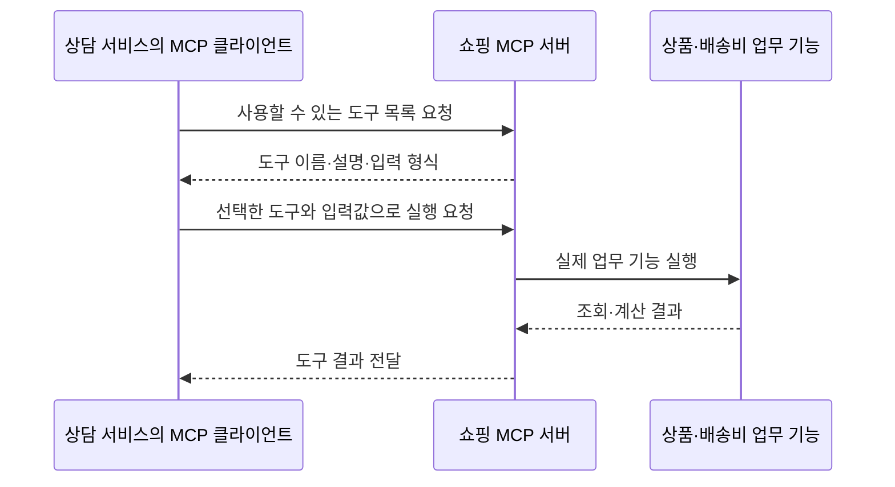

# 11. MCP 도구를 사용하는 Workflow·Agent·하이브리드

## 개념 먼저 이해하기

**MCP(Model Context Protocol)**는 애플리케이션이 외부의 도구와 자료를 정해진 형식으로 발견하고 사용할 수 있게 하는 통신 규약입니다. 어떤 도구가 있는지, 어떤 입력이 필요한지, 실행 결과가 무엇인지를 공통된 약속으로 주고받습니다.

05장의 도구가 상담 애플리케이션 안의 상품 기능이었다면, 이번에는 별도 프로그램인 쇼핑 서비스의 기능을 연결합니다. Spring AI는 도구를 제공하는 쪽과 사용하는 쪽 모두를 만들 수 있도록 지원합니다.

| 용어 | 쉬운 설명 | 이 서비스에서의 역할 |
|---|---|---|
| 통신 규약(protocol) | 프로그램끼리 요청과 결과를 주고받는 약속 | 도구 목록·입력 형식·실행 결과 표현 |
| MCP 서버 | 도구와 자료를 제공하는 프로그램 | 상품 검색과 배송비 계산 기능 제공 |
| MCP 클라이언트 | 서버의 기능을 조회하고 호출하는 부분 | 상담 애플리케이션에서 쇼핑 도구 사용 |



MCP는 **기능을 연결하는 약속**이고, Workflow·Agent는 **다음 행동을 정하는 방식**입니다. MCP로 연결한 같은 도구를 고정 절차에서도, 모델이 선택하는 방식에서도 사용할 수 있습니다. 실제 도구 실행은 서버의 업무 기능이 담당합니다.

기획할 때는 상담 서비스가 사용할 도구의 범위와 필요한 입력, 결과를 확인하면 무엇을 완료로 볼지를 정합니다. 이 단원에서는 상품을 검색하고 배송비 포함 총액을 계산하며, 실제 장바구니를 변경하는 작업은 수행하지 않습니다.

개념 참고: [Spring AI의 MCP 설명](https://docs.spring.io/spring-ai/reference/api/mcp/mcp-overview.html).

## 실습 안내

`SearchConditions`는 상품 검색 조건과 검증 규칙을 담아 [domain 패키지](../../labs/11-00-mcp-workflow-agent/src/main/java/com/example/ailearning/l11mcp/domain)에 모았습니다. 모델 호출과 도구 연결 코드는 기존 단원 패키지에서 읽습니다.

목표는 **외부 서버의 도구를 연결하고, 같은 도구를 사용할 때 Java와 모델의 판단 범위가 어떻게 달라지는지 설명하고 실행하는 것**입니다.
선수 지식은 04 구조화 응답, 05 도구 호출, 06 세 실행 방식입니다. RAG는 MCP의 필수 조건이 아닙니다.

| 순서 | 소수업 | 완료 기준 |
|---|---|---|
| 1 | [MCP는 무엇을 연결할까?](11-mcp-workflow-agent/01-connection.md) | 모델·클라이언트·서버의 역할과 실행 위치 구분 |
| 2 | [모델 없이 MCP 도구 호출](11-mcp-workflow-agent/02-direct-call.md) | MCP 도구 목록을 조회하고 지정한 도구로 배송 정책 받기 |
| 3 | [Workflow: Java가 순서를 정하기](11-mcp-workflow-agent/03-workflow.md) | 검색 결과 전체의 ID를 계산 도구에 전달 |
| 4 | [Agent: 모델이 도구 선택하기](11-mcp-workflow-agent/04-agent.md) | 도구 설명·입력 스키마와 실제 호출 기록 연결 |
| 5 | [하이브리드: Java의 검증 결합](11-mcp-workflow-agent/05-hybrid.md) | 검색 조건·전체 상품 계산·총예산 검증 |
| 6 | [같은 요청으로 비교하고 테스트하기](11-mcp-workflow-agent/06-compare.md) | 실행 기록으로 세 방식의 보장 범위 설명 |

기본 실습은 같은 요청을 비교합니다.

> 음료 중 상품 가격 15,000원 이하인 MALL 상품을 모두 한 개씩 구매할 때 배송비 포함 총액을 알려줘. 총예산은 30,000원이야.

현재 서버의 상품은 허브티 P004(9,900원)와 드립 커피 P005(12,500원)입니다.
빈 데모 장바구니에서 계산하면 상품 합계 22,400원 + 배송비 3,000원 = **25,400원**입니다.
`quoteCart`는 이 계산만 수행하고 실제 장바구니를 변경하지 않습니다. 06장의 상품별 배송비와 달리 이 장에서는 장바구니 전체의 배송비를 계산합니다.

## 실행 코드와 테스트

실행 모듈은 [labs/11-00-mcp-workflow-agent](../../labs/11-00-mcp-workflow-agent/README.md)입니다.
로컬 테스트는 MCP 서버를 자동 실행하고 OpenAI 응답만 고정합니다. 수동 실행은 MCP 서버와 학습 애플리케이션을 각각 실행합니다.

```bash
./gradlew :Spring-AI-Agent-Learning:labs:11-00-mcp-workflow-agent:test --tests '*LocalModelTest' --tests '*UnitTest'
./gradlew :Spring-AI-Agent-Learning:labs:11-00-mcp-workflow-agent:bootJar
```

[이전: 10장 RAG](10-rag.md) · [다음: 12장 평가와 운영](12-evaluation.md) · [전체 교육 계획](../curriculum.md)
