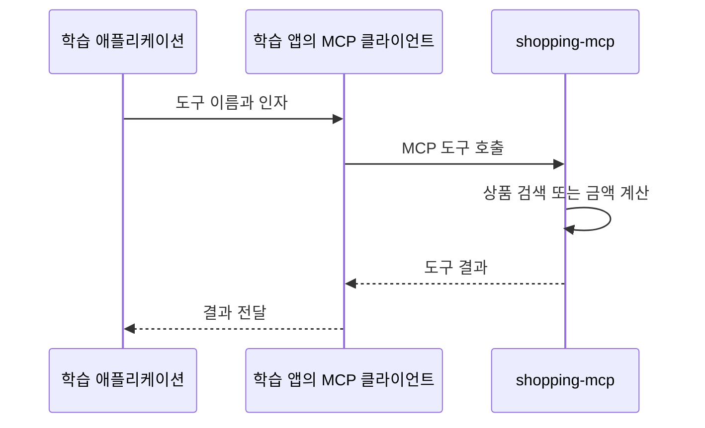

# 11-1. MCP는 무엇을 연결할까?

목표는 **도구를 선택하는 주체와 실행하는 위치를 구분하는 것**입니다.
05장에서는 애플리케이션 안의 Java 메서드를 도구로 제공했습니다. 이 장에서는 다른 애플리케이션인 `shopping-mcp`의 도구를 사용합니다.

| 용어 | 이 실습에서의 역할 |
|---|---|
| MCP | 도구 목록·입력 형식·호출·결과를 주고받는 통신 규약 |
| MCP 서버 | 상품 검색과 계산 도구를 제공하는 `shopping-mcp` |
| MCP 클라이언트 | 학습 애플리케이션 안에서 서버와 통신하는 객체 |
| Streamable HTTP | 이 실습이 MCP 메시지를 HTTP로 주고받는 방식 |
| ToolCallback | Spring AI가 도구의 설명·입력 스키마·실행 방법을 함께 다루는 인터페이스 |

MCP가 Workflow나 Agent의 순서를 결정하는 것은 아닙니다. Workflow는 Java가, Agent는 모델이 다음 도구를 선택합니다. 두 경우 모두 애플리케이션의 MCP 클라이언트가 서버에 호출을 전달합니다.



## 두 애플리케이션 실행

루트 `.env`에 기존 `OPENAI_API_KEY`, `OPENAI_MODEL`을 준비합니다. 명령은 모두 저장소 루트에서 실행합니다.
터미널 두 개에서 각각 실행하세요.

```bash
./gradlew :shopping-mcp:bootRun
```

```bash
./gradlew :Spring-AI-Agent-Learning:labs:11-00-mcp-workflow-agent:bootRun
```

서버 기본 주소는 `http://127.0.0.1:8082`, 학습 API는 `http://127.0.0.1:8106`입니다. 종료는 각 터미널에서 Ctrl+C입니다.

## 클라이언트 설정 읽기

[application.yml](../../../labs/11-00-mcp-workflow-agent/src/main/resources/application.yml)의 MCP 부분입니다.

```yaml
spring:
  ai:
    mcp:
      client:
        name: learning-mcp-client
        type: SYNC
        request-timeout: 3s
        streamable-http:
          connections:
            shopping:
              url: ${LEARNING_MCP_URL:http://127.0.0.1:8082}
              endpoint: /mcp
```

`spring-ai-starter-mcp-client`와 이 설정을 바탕으로 Spring Boot 자동 설정이 `McpSyncClient`를 준비합니다.
`shopping`은 연결 설정의 이름이고 `/mcp`는 MCP 통신 경로입니다. 일반 상품 REST API 주소가 아닙니다.
`request-timeout`은 MCP 요청 한 번의 대기 제한이며 사용자 요청 전체의 제한 시간은 아닙니다.

서버는 기존 [설정](../../../../shopping-mcp/src/main/resources/application.yml)과 [도구 등록](../../../../shopping-mcp/src/main/java/com/example/shopping/mcp/ToolsConfiguration.java)을 그대로 사용합니다. 서버 구현을 이 모듈에 복사하지 않습니다.

## 확인 질문

모델이 `searchProducts`를 선택하면 모델이 직접 MCP 서버에 접속할까요?

<details><summary>해설</summary>
모델은 도구 호출을 요청합니다. 학습 애플리케이션의 Spring AI와 MCP 클라이언트가 서버에 호출을 전달합니다.
</details>


[11장 목차](../11-mcp-workflow-agent.md) · [다음 수업](02-direct-call.md)
