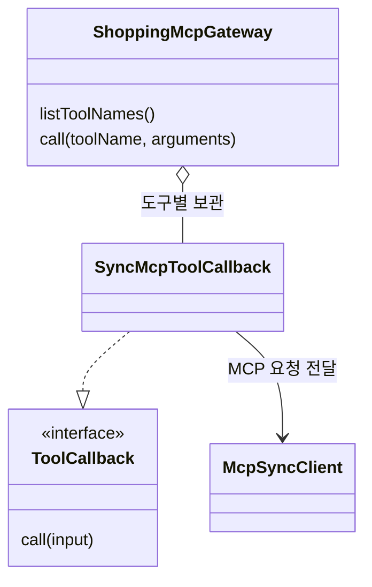

# 11-2. 모델 없이 MCP 도구 호출하기

목표는 **MCP 서버의 도구 목록을 조회하고, 지정한 도구를 직접 호출해 배송 정책을 받는 방법을 익히는 것**입니다.
11-1의 두 서버를 실행한 상태에서 다음 요청을 보냅니다.

```bash
curl http://127.0.0.1:8106/api/mcp/tools
curl http://127.0.0.1:8106/api/mcp/shipping-policy
```

도구 목록에는 `searchProducts`, `quoteCart`, `getCart`, `getShippingPolicy`, `getCoupons`, `getPoints`가 포함됩니다.
배송 정책에는 무료배송 기준 `threshold: 50000`과 기본 배송비 `shippingFee: 3000`이 나옵니다.
이 두 API는 OpenAI를 호출하지 않습니다. 애플리케이션 기동을 위한 모델 설정은 기존처럼 준비되어 있어야 합니다.

## 도구 목록을 실행 가능한 객체로 연결하기

[전체 소스: ShoppingMcpGateway.java](../../../labs/11-mcp-workflow-agent/src/main/java/com/example/ailearning/l11mcp/ShoppingMcpGateway.java)

서버 도구마다 callback 하나를 만들고, 각 callback이 같은 MCP 클라이언트를 통해 호출을 전달합니다.



다음은 생성자에서 실행하는 부분의 발췌입니다. 자동 설정이 전달한 클라이언트로 서버의 도구 목록을 읽습니다.

```java
McpSyncClient mcpClient = mcpClients.getFirst();
for (var tool : mcpClient.listTools().tools()) {
    callbacks.put(tool.name(), new SyncMcpToolCallback(mcpClient, tool));
}
```

`tool`에는 이름·설명·입력 JSON 스키마가 들어 있습니다. `SyncMcpToolCallback`은 이 도구를 호출하는 동작까지 연결합니다.
이 실습은 서버 하나의 원래 도구 이름을 사용하려고 목록에서 직접 callback을 구성합니다. Starter가 제공하는 `SyncMcpToolCallbackProvider`를 사용하는 방식도 있지만 두 방식을 함께 등록하지 않습니다.

직접 호출하는 메서드 전체입니다.

```java
public JsonNode call(String toolName, Map<String, Object> arguments) {
    String response = getToolCallback(toolName)
            .call(objectMapper.writeValueAsString(arguments));
    return readJsonToolResult(response);
}
```

`getShippingPolicy`는 인자가 없으므로 `Map.of()`를 전달합니다. 이 `.call()`은 **도구 호출**이며 `ChatClient.call()`의 모델 호출과 다른 메서드입니다.
`readJsonToolResult()`는 MCP의 `content` 안에 담긴 JSON 텍스트를 꺼내는 보조 코드입니다. 현재 서버의 JSON 텍스트 하나인 결과만 처리하며 이미지나 복수 content를 처리하는 범용 구현은 아닙니다.

## 확인 질문

이 수업의 호출 순서를 모델이 결정했나요?

<details><summary>해설</summary>
아닙니다. Controller가 배송 정책 도구를 지정했습니다. 다음 수업에서 이런 직접 호출을 여러 단계로 연결합니다.
</details>

참고: [Spring AI MCP Client 공식 문서](https://docs.spring.io/spring-ai/reference/api/mcp/mcp-client-boot-starter-docs.html)


[11장 목차](../11-mcp-workflow-agent.md) · [다음 수업](03-workflow.md)
