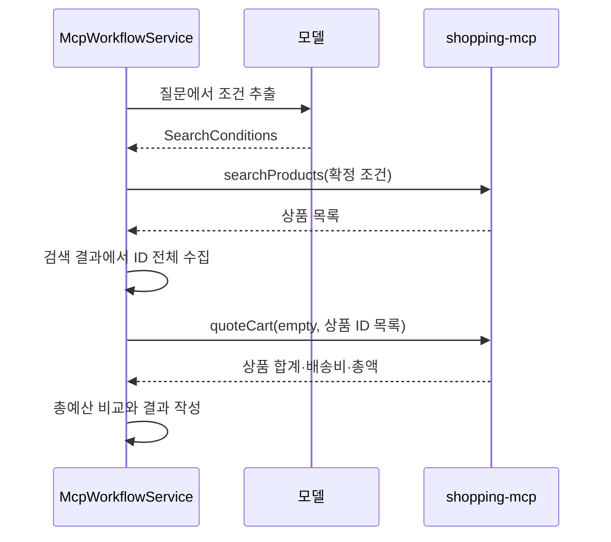

# 11-3. Workflow: Java가 도구 호출 순서를 정하기

목표는 **모델이 추출한 조건을 Java가 받아 검색 → 계산을 정해진 순서로 실행하는 것**입니다.<br>
04단원의 구조화 응답을 사용하는 [SearchConditionExtractor](../../../labs/11-00-mcp-workflow-agent/src/main/java/com/example/ailearning/l11mcp/SearchConditionExtractor.java)가 질문을 `SearchConditions`로 바꿉니다.

| 필드 | 의미 |
|---|---|
| category | 검색할 카테고리 |
| maxPrice | 상품 한 개의 가격 상한 |
| totalBudget | 배송비를 포함한 전체 총예산. 생략 가능 |



## 서비스 전체 코드

이 비교 실습은 `McpToolExecutor`라는 보조 객체로 원격 도구를 실행합니다.<br>
`executeTool(도구 이름, 인자)`를 호출하면 MCP 서버로 요청을 보내고 성공한 호출의 인자·결과를 기록합니다.<br>
호출 시도 횟수도 제한하며, 이 객체는 Spring AI 제공 타입이 아니라 실습에서 작성한 코드입니다.

아래 생성 코드의 인자는 다음 역할을 합니다.

| 인자 | 역할 |
|---|---|
| `shoppingMcpGateway` | 실제 MCP 도구 호출을 전달 |
| `objectMapper` | 도구 인자와 결과를 JSON으로 변환 |
| `maxToolCallAttempts` | 이번 실행의 도구 호출 시도 상한. 기본값 6은 [11-6](06-compare.md)의 설정 설명과 연결 |
| 마지막 `null` | 추가 검색 조건을 강제로 덮어쓰지 않음. 조건 고정이 필요한 Hybrid 방식은 11-5에서 학습 |


[전체 소스: McpWorkflowService.java](../../../labs/11-00-mcp-workflow-agent/src/main/java/com/example/ailearning/l11mcp/McpWorkflowService.java)

```java
package com.example.ailearning.l11mcp;

import com.example.ailearning.l11mcp.tools.McpToolExecutor;
import com.example.ailearning.l11mcp.tools.ShoppingMcpGateway;

import com.example.ailearning.l11mcp.domain.SearchConditions;

import org.springframework.beans.factory.annotation.Value;
import org.springframework.stereotype.Service;
import tools.jackson.databind.JsonNode;
import tools.jackson.databind.ObjectMapper;
import java.util.List;
import java.util.Map;

@Service
public class McpWorkflowService {
    private final SearchConditionExtractor searchConditionExtractor;
    private final ShoppingMcpGateway shoppingMcpGateway;
    private final ObjectMapper objectMapper;
    private final int maxToolCallAttempts;

    public McpWorkflowService(SearchConditionExtractor searchConditionExtractor,
            ShoppingMcpGateway shoppingMcpGateway, ObjectMapper objectMapper,
            @Value("${learning.mcp.max-tool-calls}") int maxToolCallAttempts) {
        this.searchConditionExtractor = searchConditionExtractor;
        this.shoppingMcpGateway = shoppingMcpGateway;
        this.objectMapper = objectMapper;
        this.maxToolCallAttempts = maxToolCallAttempts;
    }

    public McpRunResult run(String question) {
        SearchConditions searchConditions = searchConditionExtractor.extract(question);
        if (!searchConditions.isComplete()) {
            return new McpRunResult("NEEDS_INPUT", "카테고리와 상품 가격 상한을 알려주세요.", List.of());
        }
        McpToolExecutor toolExecutor = new McpToolExecutor(shoppingMcpGateway, objectMapper, maxToolCallAttempts, null);
        JsonNode products = toolExecutor.executeTool("searchProducts", searchConditions.searchArguments());
        List<String> productIds = McpToolExecutor.readProductIds(products);
        if (productIds.isEmpty()) {
            return new McpRunResult("NO_RESULTS", "조건에 맞는 상품이 없습니다.", toolExecutor.toolCalls());
        }
        JsonNode cartQuote = toolExecutor.executeTool("quoteCart",
                Map.of("scenario", "empty", "additionalProductIds", productIds));
        if (!cartQuote.path("valid").asBoolean()) {
            throw new IllegalStateException("장바구니 금액을 계산할 수 없습니다.");
        }
        boolean overBudget = searchConditions.totalBudget() != null
                && cartQuote.path("total").asLong() > searchConditions.totalBudget();
        return new McpRunResult(overBudget ? "OVER_BUDGET" : "COMPLETED",
                "상품 ID: " + productIds + ", 배송비 포함 총액: " + cartQuote.path("total").asLong() + "원",
                toolExecutor.toolCalls());
    }
}
```

`toolExecutor.executeTool()`의 이름과 호출 위치가 코드에 정해져 있습니다.<br>
조건 추출 프롬프트에는 도구 목록을 보내지 않습니다.<br>
`productIds`는 검색 결과에서 얻으므로 상품이 두 개여도 모두 계산에 전달합니다.<br>
상품 ID를 예상값으로 하드코딩하지 않습니다.<br>
`SearchConditions.searchArguments()`는 같은 배송그룹의 재고 있는 상품을 최대 20개 검색합니다.<br>
이 범위는 현재 서버의 계산 조건에 맞춘 실습 범위입니다.

`toolCalls`는 위 보조 객체가 기록한 실제 성공 호출 목록입니다.<br>
조건을 강제로 고정하는 추가 동작은 [11-5](05-hybrid.md)에서 별도로 연결합니다.

## 실행

```bash
curl http://127.0.0.1:8106/api/mcp/workflow \
  -H 'Content-Type: text/plain; charset=UTF-8' \
  --data-binary '1만 5천 원 이하인 음료를 찾고 있어요. 쇼핑몰에서 묶음 배송하는 상품을 종류별로 하나씩 모두 사면 배송비까지 얼마인가요? 총예산은 3만 원이에요.'
```

기본 데이터에서는 `COMPLETED`, 검색·계산 기록 두 개, 총액 25,400원이 나옵니다.<br>
실제 모델이 조건을 다르게 추출하면 결과도 달라지므로 기록의 조건을 함께 확인하세요.<br>
카테고리나 상품 상한이 없으면 `NEEDS_INPUT`, 검색 결과가 없으면 `NO_RESULTS`로 계산을 생략합니다.

## 확인 질문

Workflow에서 모델은 무엇을 판단하고 무엇을 판단하지 않나요?

<details><summary>해설</summary>
질문을 검색 조건으로 해석합니다.<br>
어떤 도구를 어떤 순서로 호출할지는 Java가 정합니다.
</details>


[11단원 목차](../11-mcp-workflow-agent.md) · [다음 수업](04-agent.md)
