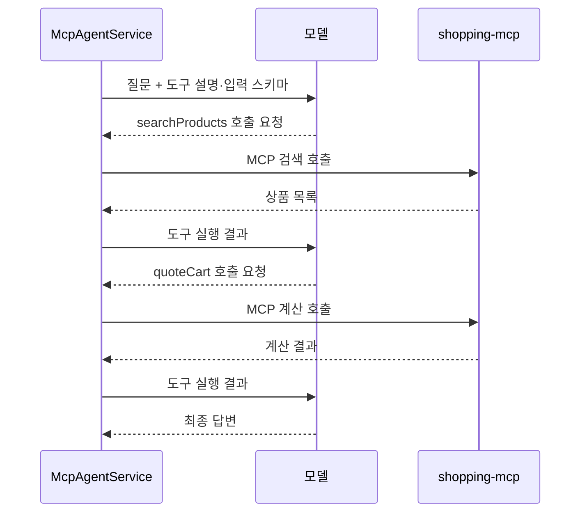

# 11-4. Agent: 모델이 MCP 도구를 선택하기

목표는 **서버의 도구 설명과 입력 스키마를 모델에 제공하고 실제 선택 결과를 확인하는 것**입니다.
11-3과 달리 먼저 조건을 추출하는 단계를 고정하지 않습니다. 질문과 도구 목록을 받은 모델이 필요한 도구와 인자를 선택합니다.



그림은 기본 쇼핑 요청에서 가능한 경로입니다. 모델이 항상 이 순서로 한 번씩 호출한다는 보장은 없습니다. 인사에는 호출이 없을 수도 있습니다.

## 서비스 전체 코드

[전체 소스: McpAgentService.java](../../../labs/11-00-mcp-workflow-agent/src/main/java/com/example/ailearning/l11mcp/McpAgentService.java)

```java
package com.example.ailearning.l11mcp;

import com.example.ailearning.l11mcp.tools.McpToolExecutor;
import com.example.ailearning.l11mcp.tools.ShoppingMcpGateway;

import org.springframework.ai.chat.client.ChatClient;
import org.springframework.beans.factory.annotation.Value;
import org.springframework.stereotype.Service;
import tools.jackson.databind.ObjectMapper;

@Service
public class McpAgentService {
    private static final String MCP_AGENT_INSTRUCTION = """
            TASK:MCP_AGENT
            제공된 MCP 도구 중 필요한 도구와 인자를 선택하세요.
            상품 가격 상한에 맞는 MALL 배송그룹의 재고 있는 상품을 검색하세요.
            모두 구매한다면 검색된 상품 전체를 각 1개씩 계산하세요.
            quoteCart의 scenario는 empty로 지정합니다. 실제 장바구니는 변경하지 않습니다.
            상품 가격, 배송비, 총액은 도구 결과로 확인하고 총예산이 있으면 비교하세요.
            도구가 필요 없는 인사에는 도구 없이 답하세요.
            """;
    private final ChatClient chatClient;
    private final ShoppingMcpGateway shoppingMcpGateway;
    private final ObjectMapper objectMapper;
    private final int maxToolCallAttempts;

    public McpAgentService(ChatClient.Builder builder,
            ShoppingMcpGateway shoppingMcpGateway, ObjectMapper objectMapper,
            @Value("${learning.mcp.max-tool-calls}") int maxToolCallAttempts) {
        this.chatClient = builder.build();
        this.shoppingMcpGateway = shoppingMcpGateway;
        this.objectMapper = objectMapper;
        this.maxToolCallAttempts = maxToolCallAttempts;
    }

    public McpRunResult run(String question) {
        McpToolExecutor toolExecutor = new McpToolExecutor(shoppingMcpGateway, objectMapper, maxToolCallAttempts, null);
        String answer = requestAnswerWithTools(question, toolExecutor);
        return new McpRunResult("ANSWERED", answer, toolExecutor.toolCalls());
    }

    String requestAnswerWithTools(String question, McpToolExecutor toolExecutor) {
        return chatClient
                .prompt()
                .system(MCP_AGENT_INSTRUCTION)
                .user(question)
                .toolCallbacks(toolExecutor.createToolCallbacks())
                .call()
                .content();
    }
}
```

`.toolCallbacks(toolExecutor.createToolCallbacks())`로 검색과 계산 도구를 제공합니다. 서버가 제공하는 쿠폰·적립금까지 모델에 전부 노출하지 않습니다.
`McpToolExecutor`은 서버에서 발견한 도구 설명·스키마를 유지하고, 실행 때 기록과 상한을 추가합니다. 연결별 이름 접두사는 이 실습에서 원래 도구 이름으로 맞추며, 실행은 같은 원격 callback에 전달합니다.

프롬프트의 “모두 계산하세요”는 모델에 대한 지시입니다. 이 단계에는 검색 결과 전체가 실제 계산되었는지 강제하는 Java 검증이 없습니다.
`ANSWERED`는 답변을 받았다는 뜻이며 금액·요청 이행을 검증했다는 뜻은 아닙니다.

## 실행

11-3의 요청에서 URL 끝을 `/agent`로 바꿔 실행합니다. `toolCalls`의 이름·인자·결과를 확인하세요.
고정 모델 테스트는 일부러 “총액은 1원”이라는 잘못된 최종 문장을 반환합니다. 이 단계가 그 문장을 그대로 전달하는 점을 확인하고, 다음 수업에서 Java 검증을 추가합니다.

## 확인 질문

프롬프트에 도구 호출 순서를 자세히 쓰면 Workflow가 되나요?

<details><summary>해설</summary>
지시를 따를지 실제 도구 선택은 여전히 모델이 판단합니다. Java 코드가 순서와 분기를 실행하는 Workflow와는 다릅니다.
</details>


[11장 목차](../11-mcp-workflow-agent.md) · [다음 수업](05-hybrid.md)
