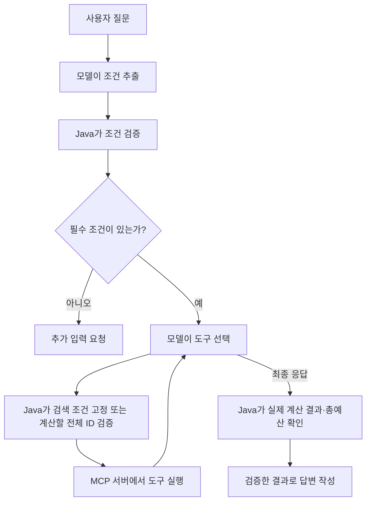

# 11-5. 하이브리드: Java의 검증과 모델의 도구 선택 결합

목표는 **모델의 도구 선택을 활용하면서 Java가 조건과 결과를 검증하는 구조를 실행하는 것**입니다.
하이브리드는 AI 모델 종류가 아니라 책임을 나눈 실행 방식입니다. 06장에서 배운 원리를 MCP 도구에 적용합니다.



## 서비스 전체 코드

[전체 소스: McpHybridService.java](../../../labs/11-00-mcp-workflow-agent/src/main/java/com/example/ailearning/l11mcp/McpHybridService.java)

```java
package com.example.ailearning.l11mcp;

import org.springframework.beans.factory.annotation.Value;
import org.springframework.stereotype.Service;
import tools.jackson.databind.JsonNode;
import tools.jackson.databind.ObjectMapper;
import java.util.List;

@Service
public class McpHybridService {
    private final SearchConditionExtractor conditionExtractor;
    private final McpAgentService agentService;
    private final ShoppingMcpGateway shoppingMcpGateway;
    private final ObjectMapper objectMapper;
    private final int maxToolCalls;

    public McpHybridService(SearchConditionExtractor conditionExtractor, McpAgentService agentService,
            ShoppingMcpGateway shoppingMcpGateway, ObjectMapper objectMapper,
            @Value("${learning.mcp.max-tool-calls}") int maxToolCalls) {
        this.conditionExtractor = conditionExtractor;
        this.agentService = agentService;
        this.shoppingMcpGateway = shoppingMcpGateway;
        this.objectMapper = objectMapper;
        this.maxToolCalls = maxToolCalls;
    }

    public McpRunResult run(String question) {
        SearchConditions conditions = conditionExtractor.extract(question);
        if (!conditions.isComplete()) {
            return new McpRunResult("NEEDS_INPUT", "카테고리와 상품 가격 상한을 알려주세요.", List.of());
        }
        McpToolRun toolRun = new McpToolRun(shoppingMcpGateway, objectMapper, maxToolCalls, conditions);
        agentService.askWithMcpTools(question, toolRun);
        if (toolRun.searchedWithoutResults()) {
            return new McpRunResult("NO_RESULTS", "조건에 맞는 상품이 없습니다.", toolRun.toolCalls());
        }
        JsonNode quote = toolRun.lastQuote();
        if (quote == null || !quote.path("valid").asBoolean()) {
            return new McpRunResult("UNVERIFIED", "전체 상품의 금액 계산을 확인하지 못했습니다.", toolRun.toolCalls());
        }
        long total = quote.path("total").asLong();
        if (conditions.totalBudget() != null && total > conditions.totalBudget()) {
            return new McpRunResult("OVER_BUDGET", "배송비 포함 " + total + "원으로 총예산을 초과합니다.", toolRun.toolCalls());
        }
        // 모델의 최종 문장 대신 실제 MCP 결과로 표시할 금액을 확정한다.
        return new McpRunResult("VERIFIED", "배송비 포함 총액: " + total + "원", toolRun.toolCalls());
    }

}
```

Agent와 같은 `askWithMcpTools()`를 재사용하지만 `McpToolRun`에 `conditions`를 전달합니다. 이 값이 있으면 도구 실행 전 검증을 추가합니다.

| 지점 | Java가 하는 일 | 여전히 모델이 하는 일 |
|---|---|---|
| 검색 전 | 추출·검증한 검색 조건으로 인자를 고정 | 검색 도구를 호출할지 결정 |
| 계산 전 | 검색 결과 전체의 ID인지 확인하고 빈 데모 장바구니로 고정 | 검색 결과를 읽고 계산 도구의 인자를 구성 |
| 응답 전 | 계산 성공·총예산 확인, 실제 금액으로 문장 작성 | 도구 선택 반복과 종료 요청 |

[보조 코드 McpToolRun](../../../labs/11-00-mcp-workflow-agent/src/main/java/com/example/ailearning/l11mcp/McpToolRun.java)의 `restrictArguments()`에서 실제 연결을 확인합니다.
`McpToolRun`의 `new ToolCallback() { ... }`는 인터페이스의 구현 객체를 그 자리에서 만드는 Java 익명 클래스입니다. `getToolDefinition()`은 모델에 보낼 도구 정보를, `call()`은 실제 실행을 담당합니다. `call()`에서 검사 → 원격 호출 → 결과 기록 순서를 추가합니다.

검색 ID와 계산 ID의 집합·개수가 모두 같아야 하므로 일부 누락·중복·새 ID를 거부합니다.
이는 이 실습의 “검색 결과 모두 한 개씩 구매” 정책입니다. 부분 추천 서비스라면 다른 정책이 필요합니다.

`VERIFIED`는 고정한 검색 조건과 전체 ID 계산, 서버 계산 성공, 총예산 검사를 통과했다는 뜻입니다.
사용자 의도를 처음 추출한 모델 판단의 정확성이나 상품 품질까지 보장하지 않습니다.
검색을 실제 실행한 결과가 비었으면 `NO_RESULTS`입니다. 빈 장바구니를 계산해 `valid=true`, `total=0`을 받아도 구매 성공으로 표시하지 않습니다. 검색 자체를 하지 않았거나, 비어 있지 않은 검색 결과의 전체 금액을 확인하지 못하면 `UNVERIFIED`, 총예산을 넘으면 `OVER_BUDGET`입니다.

로컬 회귀 테스트는 실제 MCP 서버를 사용해 빈 검색 뒤 계산 생략과 빈 장바구니 계산 두 경로를 확인합니다.

## 실행과 비교

11-3의 URL 끝을 `/hybrid`로 바꿉니다. 총예산을 30,000원에서 20,000원으로만 바꾸면 기본 상품 총액 25,400원은 같지만 결과는 `OVER_BUDGET`이 됩니다.
코드 수정이 아니므로 서버를 재시작할 필요는 없습니다. 같은 입력을 두 번 비교한 뒤 총예산을 원래대로 돌려보세요.

## 확인 질문

모델이 최종 답변에 “1원”이라고 써도 검증 결과의 금액이 1원이 될까요?

<details><summary>해설</summary>
아닙니다. 이 서비스는 모델 문장 대신 실제 MCP 계산 결과의 total로 최종 문장을 만듭니다.
</details>


[11장 목차](../11-mcp-workflow-agent.md) · [다음 수업](06-compare.md)
