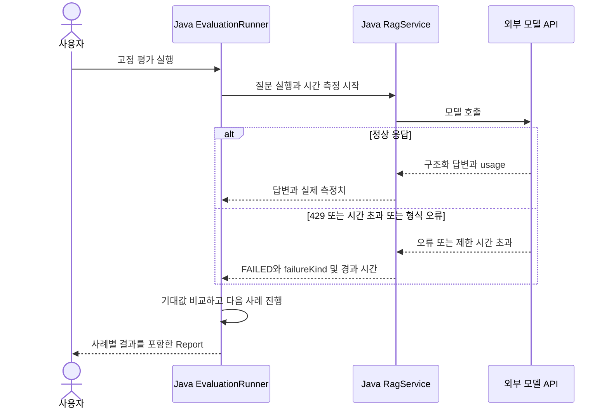

# 12-5. 실패·지연·재시도 관찰

**실행 코드·설정·테스트:** [labs/12-00-evaluation](../../../labs/12-00-evaluation/README.md). 저장소 루트에서 해당 README의 명령으로 실행합니다.

**이번 목표:** 잘못된 답변과 요청 실패를 다른 결과로 읽습니다.

**코드 읽기 안내:** SDK 옵션 위치와 관찰된 요청 횟수를 연결하세요. 실패를 그럴듯한 성공 답변으로 바꾸지 않습니다.

## 실패는 어디서 확인할까?



- RATE_LIMIT: 제공 업체의 429. 사용량·속도·계정 제한을 확인합니다.
- TIMEOUT: SDK/전송 계층에서 확인한 시간 초과.
- UPSTREAM_OR_OUTPUT: 기타 연결 또는 응답 변환 실패. 실제 진단 시 서버 로그·원인을 추가 확인합니다.

이 예제는 실패 원문/키를 HTTP 응답으로 내보내지 않습니다. 모든 라이브러리 로그를 자동 마스킹하는 기능을 구현한 것은 아닙니다.
응답 HTTP가 200이어도 `actual.reply.status=FAILED`이면 성공이 아닙니다.
연결 설정은 응답 생성 옵션과 구분합니다. 실제 적용되는 위치는 다음과 같습니다.

```yaml
spring:
  ai:
    openai:
      base-url: https://api.openai.com/v1
      max-retries: 0
      timeout: 2s
      chat:
        options:
          model: ${OPENAI_MODEL}
```

이 실습의 429/시간 초과 테스트는 설정 파일만 읽는 검사가 아니라 실제 전송 횟수와 대기를 확인합니다.
02 보충 5와 같은 공통 연결 설정을 사용합니다.
SDK 재시도는 0회, 요청 타임아웃은 2초로 설정했습니다. 자동 재시도가 과금·지연·중복 실행을 늘릴 수 있어 이번에는 끕니다.
실제 모델의 정상 응답도 2초를 넘을 수 있습니다. 상황에 맞게 한도를 조정하고 변경 전후를 기록하세요.

## 실행

키·Chat 모델·임베딩 모델 설정은 [10장](../10-rag.md)과 같습니다. 저장소 루트에서:

```bash
./gradlew :Spring-AI-Agent-Learning:labs:12-00-evaluation:test --tests com.example.ailearning.l12evaluation.EvaluationLocalModelTest
./gradlew :Spring-AI-Agent-Learning:labs:12-00-evaluation:bootRun
curl -sS http://127.0.0.1:8101/api/evaluation/ask \
  -H 'Content-Type: text/plain; charset=UTF-8' --data-raw '미개봉 반품 기간은?'
curl -sS -X POST http://127.0.0.1:8101/api/evaluation/run
```

실제 실행은 시작 시 문서 임베딩, 평가 시 질문 임베딩과 답변 생성 비용이 발생할 수 있습니다.
/run 한 번은 여러 외부 요청을 만들며, 자동으로 주기 실행하지 않습니다. 종료는 Ctrl+C입니다.

## 로컬 서버로 실패와 요청 횟수 확인하기

외부 API에서 실제 429를 발생시키는 대신 위 로컬 테스트를 실행하고 다음 메서드의 검증문을 읽습니다.
고정 서버의 응답과 요청 기록으로 실패를 반복해서 확인할 수 있습니다.

| 테스트 메서드 | 확인할 것 |
|---|---|
| `호출_제한은_실패로_기록하고_자동으로_재시도하지_않는다` | 429가 `RATE_LIMIT`으로 기록되고, 평가 전체 채팅 요청이 2회(각 생성 질문당 1회)이며 추가 재시도가 없는지 |
| `느린_응답은_시간_초과로_기록하고_자동으로_재시도하지_않는다` | 느린 응답이 `TIMEOUT`으로 기록되고 자동 재시도가 없는지 |
| `형식_오류를_실패로_기록하고_내부_예외는_노출하지_않는다` | 형식 오류가 실패로 기록되고 내부 예외 원문이 API 결과에 노출되지 않는지 |

먼저 원래 설정으로 테스트를 실행합니다. 그다음 테스트의 타임아웃 설정 위치와 요청 횟수 검증문을 찾아
대기 시간과 재시도가 서로 다른 설정임을 설명해 보세요. 실제 서버의 정상 지연과 로컬 테스트의 인위적인 지연도 구분합니다.

[EvaluationLocalModelTest](../../../labs/12-00-evaluation/src/test/java/com/example/ailearning/l12evaluation/EvaluationLocalModelTest.java)는 정상 사례 평가와 usage 기록, 잘못된 주장, 429·형식 오류·타임아웃을 재현합니다.
usage의 10/5 토큰 등은 **테스트 API가 제공하는 고정 값**입니다. 실제 비용이나 품질로 표시하지 않습니다.
2초 설정과 별개로 시간 초과 테스트만 500ms로 줄여 빠르게 검증합니다.

## 02·05장의 보충 실습을 다시 실행하기

RAG 평가 코드에 제약 처리를 추가하지 않고 앞에서 완성한 독립 모듈을 활용합니다.

| 실습 | 12장에서 확인할 것 |
|---|---|
| [05 보충 5: 도구 호출 횟수 제한](../05-tool-calling/05-tool-call-limits.md) | `TOOL_LIMIT`·`finishReason`을 모델 품질 실패나 통신 오류와 구분 |
| [02 보충 5: 모델 요청 타임아웃과 재시도](../02-first-call/05-model-timeout-retry.md) | 같은 질문·같은 429 응답에서 재시도 0회와 1회의 실제 HTTP 요청 수 비교 |

아래 명령은 로컬 고정 서버만 사용하며 실제 OpenAI API를 호출하지 않습니다.

```bash
./gradlew :Spring-AI-Agent-Learning:labs:05-05-tool-call-limits:test --tests '*ToolLimitLocalModelTest'
./gradlew :Spring-AI-Agent-Learning:labs:02-05-model-timeout-retry:test --tests '*LocalModelTest'
```

평가 기록에는 답변 품질, 도구 상한 도달, 통신 실패를 서로 다른 결과로 남깁니다. 서비스에서 질문 한 번을 처리했더라도 SDK가 재시도하면 실제 HTTP 요청은 여러 번일 수 있습니다. `chatCalls` 같은 서비스 계수를 HTTP 요청 수로 해석하지 말고, 이 실습에서는 로컬 서버의 요청 목록과 비교하세요.

## 확인 질문

1. 429 응답은 어떤 실패 종류로 기록되며, SDK가 다시 요청했는지는 무엇으로 확인하나요?
2. 타임아웃과 재시도 횟수는 각각 무엇을 제한하나요?
3. HTTP 200과 `actual.reply.status=FAILED`가 함께 올 수 있는 이유는 무엇인가요?

<details><summary>해설</summary>

429는 `RATE_LIMIT`으로 기록합니다. 재시도 여부는 로컬 서버가 받은 실제 요청 수로 확인합니다.
타임아웃은 요청의 대기 시간, 재시도 횟수는 실패 후 추가 시도 수를 제한합니다.
평가 API는 여러 사례의 결과를 정상적으로 반환하되, 개별 모델 요청 실패는 본문의 `FAILED`로 표현합니다.
</details>

보충: [공식 Evaluation](https://docs.spring.io/spring-ai/reference/api/testing.html), [Observability](https://docs.spring.io/spring-ai/reference/observability/index.html).


`RagService`는 실패 응답과 별도로 서버 로그에 실패 단계(`RETRIEVE`, `CHAT_OR_OUTPUT`)와 예외 타입을 남깁니다. 질문·검색 문서·모델 응답·예외 메시지는 로그에 넣지 않습니다. `failureKind`는 API에서 실패 종류를 비교하기 위한 값이고 서버 로그는 실패 위치를 찾는 단서입니다.

## 여기서 멈춰 확인하기

HTTP 200 응답이라도 `FAILED`인 경우와 답변 내용만 틀린 경우를 구분해 보세요.

[이전](04-actuator.md) · [다음](../12-evaluation.md) · [단원 목차](../12-evaluation.md) · [학습 방법](../../learning-guide.md)
