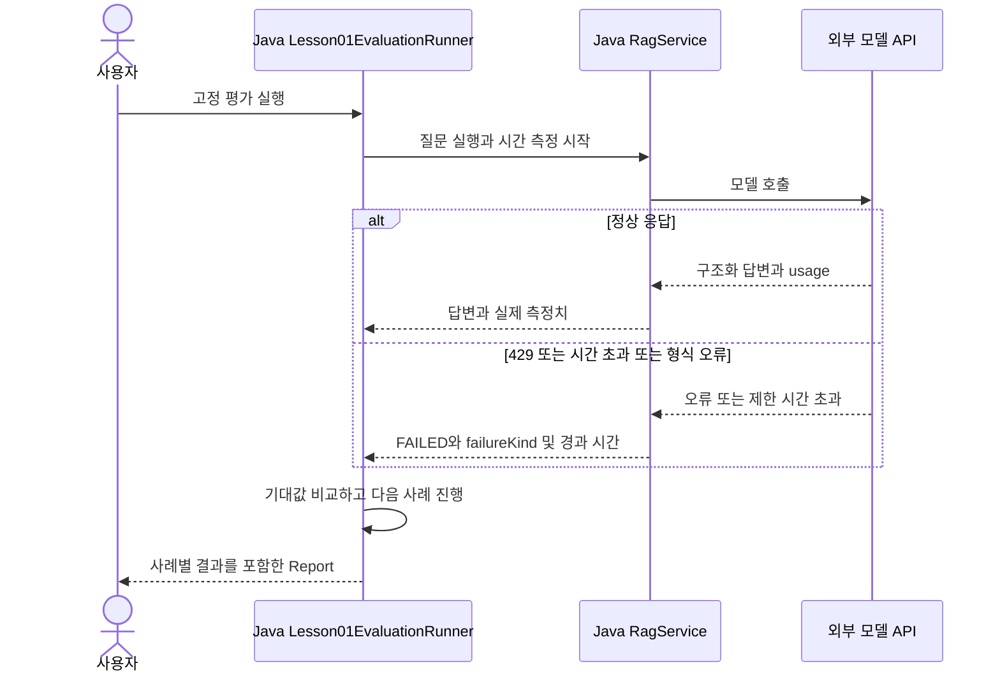

# 12-5. 실패·지연·재시도 관찰

**실행 코드·설정·테스트:** [labs/12-00-evaluation](../../../labs/12-00-evaluation/README.md).<br>
저장소 루트에서 해당 README의 명령으로 실행합니다.

**이번 목표:** 잘못된 답변과 요청 실패를 다른 결과로 읽습니다.

**코드 읽기 안내:** SDK 옵션 위치와 관찰된 요청 횟수를 연결하세요.<br>
실패를 그럴듯한 성공 답변으로 바꾸지 않습니다.

## 앞에서 배운 기능을 RAG 평가에 결합하기

12-1은 준비된 답변의 규칙 검사, 12-3은 검색 없는 채팅 사용량 조회였습니다.<br>
여기서는 [Lesson01EvaluationRunner](../../../labs/12-00-evaluation/src/main/java/com/example/ailearning/l12evaluation/lesson01_cases/Lesson01EvaluationRunner.java)가 실제 RAG를 호출한 뒤 같은 Lesson01RuleBasedEvaluator로 결과를 비교합니다.<br>
[RagService](../../../labs/12-00-evaluation/src/main/java/com/example/ailearning/l12evaluation/RagService.java)는 `.responseEntity(...)`로 구조화 답변과 사용량을 함께 읽고 전체 검색·생성 시간과 실패 종류를 보관합니다.<br>
이 통합 실행은 usage-only 프로필 없이 시작합니다.

## 구조화 답변과 원래 응답을 함께 받기

12-3은 답변 텍스트와 사용량을 읽었습니다.<br>
여기서는 답변 가능 여부·본문·출처 ID를 담은 `UnverifiedAnswer` 객체도 필요합니다.<br>
[RagService.requestGroundedAnswer()](../../../labs/12-00-evaluation/src/main/java/com/example/ailearning/l12evaluation/RagService.java)는 `.call().responseEntity(UnverifiedAnswer.class)`로 구조화 객체와 원래 모델 응답을 함께 받습니다.

| 메서드 | 결과 | 사용하는 이유 |
|---|---|---|
| `.content()` | 답변 문자열 | 답변 텍스트만 필요할 때 |
| `.entity(UnverifiedAnswer.class)` | 변환한 객체 | 답변의 필드를 사용할 때 |
| `.chatResponse()` | 원래 ChatResponse | 답변과 사용량 등 메타데이터를 읽을 때 |
| `.responseEntity(UnverifiedAnswer.class)` | 변환한 객체와 ChatResponse를 함께 담은 Spring AI의 `ResponseEntity<ChatResponse, UnverifiedAnswer>` | 구조화 답변과 사용량이 모두 필요할 때 |

이 Spring AI 응답 객체는 Spring MVC의 HTTP 상태·헤더·본문을 담는 `ResponseEntity`와 다른 타입입니다.

`RequestMetrics`는 [이 실습의 RagService](../../../labs/12-00-evaluation/src/main/java/com/example/ailearning/l12evaluation/RagService.java) 안에 정의한 측정값 보관 클래스입니다.<br>
사용자 요청마다 새로 만들며 채팅 요청 시도 수와 응답의 입력·출력 토큰을 모읍니다.<br>
Spring AI가 제공하는 응답 타입과 구분해서 읽으세요.

다음은 [RagService.requestGroundedAnswer()](../../../labs/12-00-evaluation/src/main/java/com/example/ailearning/l12evaluation/RagService.java)의 응답 처리 발췌입니다.<br>
`answerResponse`는 해당 메서드에서 `chatClient.prompt()...call().responseEntity(UnverifiedAnswer.class)`로 받은 결과이며, `requestMetrics`는 현재 요청에서 새로 만든 계측 객체입니다.

```java
var tokenUsage = answerResponse.response().getMetadata().getUsage();
if (tokenUsage != null && tokenUsage.getTotalTokens() > 0) {
    requestMetrics.inputTokens = tokenUsage.getPromptTokens();
    requestMetrics.outputTokens = tokenUsage.getCompletionTokens();
}
return answerResponse.entity();
```

`response()`는 사용량을 읽을 원래 응답, `entity()`는 출처 검사에 전달할 구조화 답변입니다.<br>
두 값은 같은 모델 응답에서 읽으므로 사용량을 얻으려고 모델을 다시 호출하지 않습니다.

사용량이 없거나 보고된 전체 토큰이 양수가 아니면 입력·출력 토큰 필드는 초기값 `null`을 유지합니다.<br>
응답 변환 전에 실패한 경우도 사용량을 읽지 못할 수 있으며, 이를 사용량 0이라고 해석하지 않습니다.

## 토큰 수와 경과 시간의 측정 범위 구분하기

`RagService.answer()`는 검색 전에 `System.nanoTime()`을 기록하고, 정상·실패 결과를 반환할 때 경과 시간을 계산합니다.<br>
같은 클래스의 실제 측정값 생성 메서드입니다.

```java
private RagMetrics createMetricsSnapshot(long startedAtNanos, RequestMetrics requestMetrics, String failureKind) {
    long elapsedMs = (System.nanoTime() - startedAtNanos) / 1_000_000;
    return new RagMetrics(elapsedMs, requestMetrics.chatRequestAttempts,
            requestMetrics.inputTokens, requestMetrics.outputTokens, failureKind);
}
```

| 측정값 | 포함하는 범위 |
|---|---|
| `elapsedMs` | 이번 `answer()`의 질문 임베딩·검색·필요한 채팅 생성과 응답 검증까지의 경과 시간. 단위 ms |
| `inputTokens`, `outputTokens` | 해당 채팅 응답이 보고한 토큰 수. 질문 임베딩 사용량은 포함하지 않음 |
| `chatCalls` | 샘플이 ChatClient 호출을 시도한 수. SDK 내부 HTTP 재시도 수와는 다름 |

서버 시작 시 문서 적재 시간은 위 `elapsedMs`에 포함하지 않습니다.<br>
검색 결과가 없어 채팅 생성을 생략해도 질문 임베딩·검색 시간은 측정되며, 이 경우 채팅 토큰 값은 확인된 값으로 채워지지 않습니다.

## 고정 질문 세트와 평가 보고서 연결하기

[evaluation-cases.json](../../../labs/12-00-evaluation/src/main/resources/evaluation-cases.json)은 평가 입력과 기대 기준을 담습니다.<br>
현재는 배송비, 미개봉 반품 기간, 정책과 무관한 질문의 세 사례입니다.

| 질문 | 기대 업무 상태 | 기대 출처 | 필수 문구 |
|---|---|---|---|
| 배송비는 얼마인가요? | `ANSWERED` | `shipping` | `3000` |
| 미개봉 반품 기간은? | `ANSWERED` | `return-sealed` | `7일` |
| 우주 여행 비용은? | `NO_CONTEXT` | 없음 | 빈 문자열 |

`Lesson01EvaluationRunner`는 파일을 읽어 각 질문을 `RagService.answer()`에 전달하고, 실제 상태·출처·답변을 12-1의 `Lesson01RuleBasedEvaluator`로 검사합니다.<br>
사례별 결과에는 실패 사유와 실제 답변·측정값을 함께 담습니다.<br>
무관한 질문의 빈 필수 문구는 문구 검사로는 제한하지 않는다는 의미이며, 기대 상태와 출처 조건은 별도로 검사합니다.

| 보고서 필드 | 해석 |
|---|---|
| `total` | 평가한 사례 수 |
| `passed` | 정해 둔 규칙을 모두 통과한 사례 수 |
| `passRate` | `passed / total`. 예를 들어 세 사례 중 둘이면 약 0.67 |
| `cases` | 각 사례의 `passed`, `failures`, 실제 결과 `actual` |

이 통과율은 **이 질문 세트와 이 규칙에 대한 비율**입니다.<br>
운영 서비스 전체의 정답률이나 가용성을 뜻하지 않습니다.<br>
사례가 적으면 한 건의 차이도 크게 보이므로 기본 사례를 유지하면서 경계 조건과 다른 질문 표현을 추가합니다.<br>
연결 실패를 준비된 정답으로 대체하지 않고 실패 상태와 원인을 기록해야 비교가 가능합니다.

## 실패는 어디서 확인할까?



- RATE_LIMIT: 제공 업체의 429.<br>
  사용량·속도·계정 제한을 확인합니다.
- TIMEOUT: SDK/전송 계층에서 확인한 시간 초과.
- UPSTREAM_OR_OUTPUT: 기타 연결 또는 응답 변환 실패.<br>
  실제 진단 시 서버 로그·원인을 추가 확인합니다.

이 예제는 실패 원문/키를 HTTP 응답으로 내보내지 않습니다.<br>
모든 라이브러리 로그를 자동 마스킹하는 기능을 구현한 것은 아닙니다.<br>
응답 HTTP가 200이어도 `actual.reply.status=FAILED`이면 성공이 아닙니다.<br>
연결 설정은 응답 생성 옵션과 구분합니다.<br>
실제 적용되는 위치는 다음과 같습니다.

```yaml
spring:
  ai:
    openai:
      base-url: https://api.openai.com/v1
      max-retries: 0
      timeout: 5s
      chat:
        options:
          model: ${OPENAI_MODEL}
```

이 실습의 429/시간 초과 테스트는 설정 파일만 읽는 검사가 아니라 실제 전송 횟수와 대기를 확인합니다.<br>
02 보충 5와 같은 공통 연결 설정을 사용합니다.<br>
SDK 재시도는 0회, 요청 타임아웃은 교육 샘플의 기본값인 5초로 설정했습니다.<br>
자동 재시도가 과금·지연·중복 실행을 늘릴 수 있어 이번에는 끕니다.<br>
실제 환경의 응답 시간이 5초를 넘는다면 상황에 맞게 한도를 조정하고 변경 전후를 기록하세요.

## 실행

키·Chat 모델·임베딩 모델 설정은 [10단원](../10-rag.md)과 같습니다.<br>
저장소 루트에서:

```bash
./gradlew :Spring-AI-Agent-Learning:labs:12-00-evaluation:test --tests com.example.ailearning.l12evaluation.lesson01_cases.Lesson01EvaluationLocalModelTest
./gradlew :Spring-AI-Agent-Learning:labs:12-00-evaluation:bootRun
curl -sS http://127.0.0.1:8101/api/evaluation/ask \
  -H 'Content-Type: text/plain; charset=UTF-8' --data-raw '미개봉 반품 기간은?'
curl -sS -X POST http://127.0.0.1:8101/api/evaluation/run
```

실제 실행은 시작 시 문서 임베딩, 평가 시 질문 임베딩과 답변 생성 비용이 발생할 수 있습니다.<br>
/run 한 번은 여러 외부 요청을 만들며, 자동으로 주기 실행하지 않습니다.<br>
종료는 Ctrl+C입니다.

## 로컬 서버로 실패와 요청 횟수 확인하기

외부 API에서 실제 429를 발생시키는 대신 위 로컬 테스트를 실행하고 다음 메서드의 검증문을 읽습니다.<br>
고정 서버의 응답과 요청 기록으로 실패를 반복해서 확인할 수 있습니다.

| 테스트 메서드 | 확인할 것 |
|---|---|
| `호출_제한은_실패로_기록하고_자동으로_재시도하지_않는다` | 429가 `RATE_LIMIT`으로 기록되고, 평가 전체 채팅 요청이 2회(각 생성 질문당 1회)이며 추가 재시도가 없는지 |
| `느린_응답은_시간_초과로_기록하고_자동으로_재시도하지_않는다` | 느린 응답이 `TIMEOUT`으로 기록되고 자동 재시도가 없는지 |
| `형식_오류를_실패로_기록하고_내부_예외는_노출하지_않는다` | 형식 오류가 실패로 기록되고 내부 예외 원문이 API 결과에 노출되지 않는지 |

먼저 원래 설정으로 테스트를 실행합니다.<br>
그다음 테스트의 타임아웃 설정 위치와 요청 횟수 검증문을 찾아
대기 시간과 재시도가 서로 다른 설정임을 설명해 보세요.<br>
실제 서버의 정상 지연과 로컬 테스트의 인위적인 지연도 구분합니다.

[Lesson01EvaluationLocalModelTest](../../../labs/12-00-evaluation/src/test/java/com/example/ailearning/l12evaluation/lesson01_cases/Lesson01EvaluationLocalModelTest.java)는 정상 사례 평가와 usage 기록, 잘못된 주장, 429·형식 오류·타임아웃을 재현합니다.<br>
usage의 10/5 토큰 등은 **테스트 API가 제공하는 고정 값**입니다.<br>
실제 비용이나 품질로 표시하지 않습니다.<br>
기본 요청 타임아웃은 5초이며, 이 로컬 테스트 클래스는 `spring.ai.openai.timeout=500ms`로 덮어써 느린 응답을 빠르게 검증합니다.

## 02·05단원의 보충 실습을 다시 실행하기

RAG 평가 코드에 제약 처리를 추가하지 않고 앞에서 완성한 독립 모듈을 활용합니다.

| 실습 | 12단원에서 확인할 것 |
|---|---|
| [05 보충 5: 도구 호출 횟수 제한](../05-tool-calling/05-tool-call-limits.md) | `TOOL_LIMIT`·`finishReason`을 모델 품질 실패나 통신 오류와 구분 |
| [02 보충 5: 모델 요청 타임아웃과 재시도](../02-first-call/05-model-timeout-retry.md) | 같은 질문·같은 429 응답에서 재시도 0회와 1회의 실제 HTTP 요청 수 비교 |

아래 명령은 로컬 고정 서버만 사용하며 실제 OpenAI API를 호출하지 않습니다.

```bash
./gradlew :Spring-AI-Agent-Learning:labs:05-05-tool-call-limits:test --tests '*ToolLimitLocalModelTest'
./gradlew :Spring-AI-Agent-Learning:labs:02-05-model-timeout-retry:test --tests '*LocalModelTest'
```

평가 기록에는 답변 품질, 도구 상한 도달, 통신 실패를 서로 다른 결과로 남깁니다.<br>
서비스에서 질문 한 번을 처리했더라도 SDK가 재시도하면 실제 HTTP 요청은 여러 번일 수 있습니다.<br>
`chatCalls` 같은 서비스 계수를 HTTP 요청 수로 해석하지 말고, 이 실습에서는 로컬 서버의 요청 목록과 비교하세요.

## 확인 질문

1. 모델 API가 HTTP 429를 반환했을 때, 재시도 설정과 실제 HTTP 요청 기록으로 재시도 여부를 어떻게 확인하나요?
2. 타임아웃과 재시도 횟수는 각각 무엇을 제한하나요?
3. 모델 호출·응답 처리의 실패와, 응답은 받았지만 내용이 틀린 경우를 왜 구분해 관찰해야 하나요?

<details>
<summary>해설</summary>

1. 설정에서 HTTP 429가 재시도 대상인지와 추가 시도 허용 횟수를 확인한 뒤, 로컬 서버에 기록된 실제 HTTP 요청 수를 비교합니다.<br>
   최초 요청 1회에 추가 요청이 있었다면 재시도가 일어난 것입니다.<br>
   Service 호출 횟수만으로는 SDK의 내부 재시도를 확인할 수 없습니다.
2. 타임아웃은 해당 요청의 대기 시간, 재시도 횟수는 실패 후 추가 시도 수를 제한합니다.<br>
   Workflow 전체 시간 제한과는 다릅니다.
3. 호출·응답 처리 실패는 연결 설정·요청 기록·예외와 처리 단계를 확인해야 하고, 내용 오류는 질문·근거·답변의 일치도를 평가해야 합니다.<br>
   두 경우를 섞으면 재시도나 타임아웃 조정으로 답변 품질까지 해결할 수 있다고 오해하기 쉽습니다.<br>
   HTTP 성공 여부만으로 답변의 정확성을 판단할 수 없습니다.

</details>

보충: [공식 Evaluation](https://docs.spring.io/spring-ai/reference/api/testing.html), [Observability](https://docs.spring.io/spring-ai/reference/observability/index.html).


`RagService`는 실패 응답과 별도로 서버 로그에 실패 단계(`RETRIEVE`, `CHAT_OR_OUTPUT`)와 예외 타입을 남깁니다.<br>
질문·검색 문서·모델 응답·예외 메시지는 로그에 넣지 않습니다.<br>
`failureKind`는 API에서 실패 종류를 비교하기 위한 값이고 서버 로그는 실패 위치를 찾는 단서입니다.

[이전](04-actuator.md) · [다음](../12-evaluation.md) · [단원 목차](../12-evaluation.md) · [학습 방법](../../learning-guide.md)
