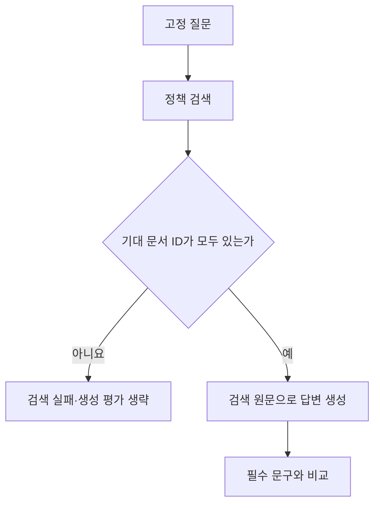

# 12-7. 검색 결과와 답변을 따로 평가하기

**이번 목표:** 필요한 정책을 찾지 못한 경우와, 정책을 찾았지만 답변이 틀린 경우를 구분합니다.<br>
12-1의 규칙 기반 평가와 10단원의 RAG를 배운 뒤 읽는 선택 실습입니다.

## 같은 질문에서도 실패 원인은 다르다

고객 질문은 “미개봉 반품 기간은?”으로 고정합니다.<br>
사람이 원문을 읽고 기대 문서 ID는 `return-sealed`, 필수 답변 문구는 `7일`로 정합니다.

| 검색 결과 | 답변 | 이번 검사의 판단 |
|---|---|---|
| 배송비 정책만 검색 | 생성하지 않음 | 필요한 문서가 없어 검색 검사 실패 |
| 미개봉 반품 정책 검색 | 반품은 30일 이내 | 검색 통과, 답변 문구 검사 실패 |
| 미개봉 반품 정책 검색 | 수령 후 7일 이내 | 두 검사 통과 |

검색한 문서 목록과 모델이 답변에 인용한 출처 목록은 다를 수 있습니다.<br>
이번에는 **모델이 답변하기 전의 검색 결과**부터 확인합니다.



## 구현과 결과 읽기

[Lesson07RagStageEvaluationService](../../../labs/12-00-evaluation/src/main/java/com/example/ailearning/l12evaluation/lesson07_stages/Lesson07RagStageEvaluationService.java)는 기존 정책 검색을 재사용하는 별도 Service입니다.<br>
12-5의 계측·오류 처리 흐름에 조건을 더하지 않습니다.<br>
실행은 테스트에서 직접 호출합니다.

```java
var result = service.evaluate(
        "미개봉 반품 기간은?", List.of("return-sealed"), "7일");
System.out.println(result);
```

| 결과 필드 | 의미 |
|---|---|
| `retrievedIds` | 실제 검색된 문서 ID |
| `retrievalPassed` | 기대한 문서 ID가 모두 검색됐는지 |
| `generationEvaluated` | 답변 생성과 문구 검사를 실행했는지 |
| `answer` | 생성한 답변. 생성을 생략하면 null |
| `generationFailures` | 필수 문구 누락 사유 |

`generationFailures`가 비어 있어도 생성 검사를 통과한 것은 아닐 수 있습니다.<br>
검색 실패로 생략한 경우에는 `generationEvaluated=false`도 함께 읽습니다.<br>
필요한 ID가 없는 검색을 정상 검색이라고 놓고 프롬프트만 조정하는 실수를 피하기 위한 구분입니다.

`evaluate()`는 `retrievedIds.containsAll(expectedSourceIds)`를 채팅 호출 전에 검사합니다.<br>
10-4는 문서를 하나라도 찾으면 생성 단계로 넘어가지만, 이 평가에서는 **다른 문서만 찾은 경우에도** 필요한 근거를 놓친 것으로 판단합니다.

## 실행과 테스트

[로컬 테스트](../../../labs/12-00-evaluation/src/test/java/com/example/ailearning/l12evaluation/lesson07_stages/Lesson07RagStageEvaluationLocalModelTest.java)는 위 세 경우를 실제 벡터 저장소와 고정 모델 응답으로 실행합니다.<br>
오검색 사례에서는 문서 적재 후 질문의 테스트 벡터를 배송비 쪽으로 지정합니다.<br>
그 사례는 채팅 요청이 0회인지 확인합니다.<br>
정상 검색 뒤 오답을 낸 사례는 반품 정책이 실제 채팅 요청에 들어갔는지와, 답변에 `7일`이 빠졌다고 판정하는지를 함께 확인합니다.<br>
이 설정은 실제 모델의 오검색 성능을 측정하는 것이 아니라, 오검색이 발생했을 때 평가가 이를 구분하는지 확인하기 위한 것입니다.

```bash
./gradlew :Spring-AI-Agent-Learning:labs:12-00-evaluation:test --tests '*Lesson07RagStageEvaluationLocalModelTest'
```

[실제 모델 테스트](../../../labs/12-00-evaluation/src/test/java/com/example/ailearning/l12evaluation/lesson07_stages/Lesson07RagStageEvaluationOpenAiLiveTest.java)는 루트 `.env`의 OpenAI 채팅·임베딩 설정을 사용합니다.<br>
문서 적재·질문 임베딩·답변 생성에 실제 API 사용량이 발생합니다.

```bash
./gradlew :Spring-AI-Agent-Learning:labs:12-00-evaluation:test --tests '*Lesson07RagStageEvaluationOpenAiLiveTest'
```

이 실습은 문서 ID 포함과 필수 문자열 포함만 검사합니다.<br>
정책의 최신성, 답변의 조건·예외 전체, 문장의 의미를 보장하지 않습니다.<br>
“7일이 아니라 30일”도 문자열 검사를 통과할 수 있다는 12-1의 한계는 그대로입니다.<br>
실제 모델 테스트는 생성 결과와 문구 검사 결과를 출력하며, 표현 차이를 사실 오류라고 단정하지 않습니다.<br>
모델·검색·변환 중 예외가 발생하면 테스트가 실패하며, 운영 오류 분류는 12-5의 주제입니다.

## 확인 질문

검색 단계에서 필요한 정책을 못 찾았고 생성 검사를 생략했다면, 답변 오류가 없었다고 집계해도 될까요?

<details>
<summary>해설</summary>

안 됩니다.<br>
검색 검사는 실패했고 답변 검사는 미실행입니다.<br>
생성 실패 목록이 비어 있다는 이유로 전체 통과로 세면 안 됩니다.

</details>

[12단원 목차](../12-evaluation.md) · [기본 평가로 돌아가기](01-cases.md)
