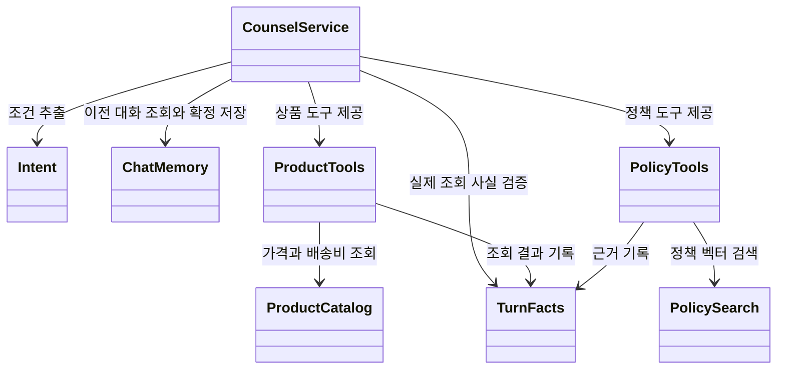
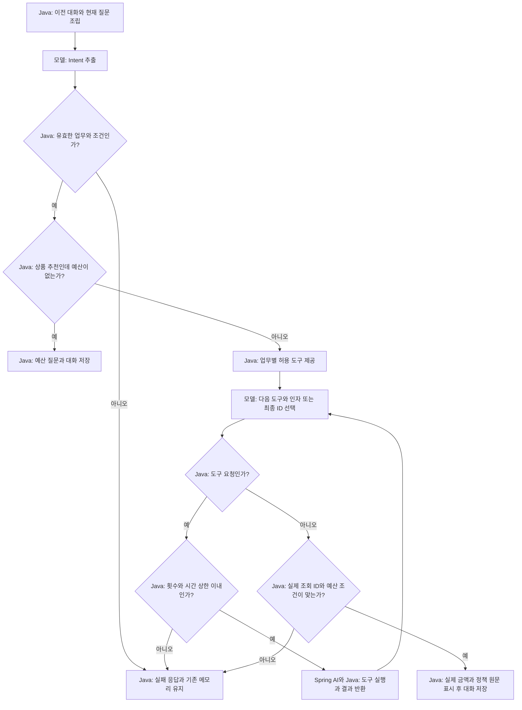

# 12-1. 통합하기 전에 책임 지도 그리기

**실행 코드·설정·테스트:** [labs/12-shopping-agent](../../../labs/12-shopping-agent/README.md). 저장소 루트에서 해당 README의 명령으로 실행합니다.

30~45분을 기준으로 한 번에 한 가지 흐름만 읽습니다. 단원 전체 시간은 목차의 기존 예상 시간에 포함됩니다.

**이번 목표:** 기존 개념이 어느 클래스에 연결되는지 찾습니다.

**코드 읽기 안내:** 새 추상화부터 읽지 말고 상품·정책·대화라는 세 데이터의 출처를 먼저 확인합니다.

## 1. 무엇을 연결할까요?

“배송비 포함 3만원 이하 음료를 추천하고 미개봉 반품 기간도 알려줘.”
이어서 “생활용품으로만 바꿔줘”, “예산을 4만원으로 바꿔줘”라고 묻습니다.

| 이미 배운 개념 | 복습 단원 | 이번 코드의 역할 |
|---|---|---|
| 구조화 응답 | 04 | `Intent`로 업무·조건 추출, `Selection`으로 최종 ID 선택 |
| Tool Calling | 05 | `ProductTools`, `PolicyTools`를 모델에 제공 |
| Workflow와 Agent·상한 | 06 | 바깥 순서와 검증은 Java, 안쪽 도구 선택은 모델 |
| 대화 메모리 | 07 | 이전 user/assistant를 다음 프롬프트에 포함 |
| Advisor | 08 | 자동 도구 루프를 복습. 이번 메모리는 저장 시점을 직접 제어 |
| 임베딩·RAG | 09~10 | `PolicySearch`가 검색한 실제 정책만 근거로 사용 |
| 평가와 실패 관찰 | 11 | 정상·실패 시나리오와 요청별 실행 기록 확인 |

이 예제는 **혼합 구조**입니다. 추출 → 도구 선택 → 검증 → 저장이라는 바깥 Workflow는 Java가 고정합니다.
도구 선택 구간에서는 모델이 상품 검색·배송비·정책 중 다음 행동을 선택합니다.
프롬프트에 순서를 적어서 바깥 흐름을 강제하는 방식이 아닙니다.

## 2. 구조와 실행 흐름

[그림 공통 기준](../../diagram-guide.md)에 따라 클래스 그림은 책임, 흐름 그림은 결정 주체를 표현합니다.
화살표의 의존 관계와 실행 순서를 혼동하지 마세요.

`TurnFacts`는 **이번 요청에서 실제로 확인한 결과**입니다. 대화 메모리와 다릅니다.
메모리는 이전 대화를 재사용하고, `TurnFacts`는 이번 답변의 상품 ID·출처 ID를 검사합니다.
도구 객체와 이 기록은 요청마다 새로 만들므로 다른 요청의 조회 사실을 섞지 않습니다.

그림의 정상 결과에는 확인된 결과 없음도 포함합니다. 검증되지 않은 상품 선택은 실패로 보류합니다.
모든 모델 요청과 도구 실행에는 시간·횟수 검사가 적용됩니다. 그림은 도구 진입 검사만 대표로 표시했습니다.

## 3. 코드 읽는 순서

실행 모듈: [12-shopping-agent](../../../labs/12-shopping-agent/README.md).
패키지: `com.example.ailearning.l12shopping`. 다른 단원이나 기존 쇼핑 서비스의 코드를 import하지 않습니다.

1. [ProductCatalog](../../../labs/12-shopping-agent/src/main/java/com/example/ailearning/l12shopping/ProductCatalog.java): 05와 같은 상품·배송비 규칙.
2. [PolicySearch](../../../labs/12-shopping-agent/src/main/java/com/example/ailearning/l12shopping/PolicySearch.java)와 같은 폴더의 `PolicyLoader`, `Source`: 09~10의 문서 적재·검색.
3. [Intent](../../../labs/12-shopping-agent/src/main/java/com/example/ailearning/l12shopping/Intent.java)와 [TurnFacts](../../../labs/12-shopping-agent/src/main/java/com/example/ailearning/l12shopping/TurnFacts.java): 추출한 조건과 실제 사실 구분.
4. [ProductTools](../../../labs/12-shopping-agent/src/main/java/com/example/ailearning/l12shopping/ProductTools.java), [PolicyTools](../../../labs/12-shopping-agent/src/main/java/com/example/ailearning/l12shopping/PolicyTools.java): 실행과 기록.
5. [CounselService](../../../labs/12-shopping-agent/src/main/java/com/example/ailearning/l12shopping/CounselService.java): 아래 핵심 메서드, 이후 `chat()`의 저장·실패 처리.
6. [RunState](../../../labs/12-shopping-agent/src/main/java/com/example/ailearning/l12shopping/support/RunState.java)와 같은 폴더의 `CountedChatModel`: 06의 상한·실제 모델 요청 계수 복습.
7. [CounselController](../../../labs/12-shopping-agent/src/main/java/com/example/ailearning/l12shopping/CounselController.java): 07과 같은 쿠키 세션 소유자와 대화 ID.

## 여기서 멈춰 확인하기

코드를 닫고 “이번 입력 → 새로 하는 처리 → 확인할 결과”를 한 문장으로 적어 보세요.
설명하기 어렵다면 위 핵심 메서드만 다시 읽습니다. 테스트용 HTTP 서버 구현을 이해해야 다음으로 갈 수 있는 것은 아닙니다.

[이전](../12-shopping-agent.md) · [다음](02-intent.md) · [단원 목차](../12-shopping-agent.md) · [학습 방법](../../learning-guide.md)
