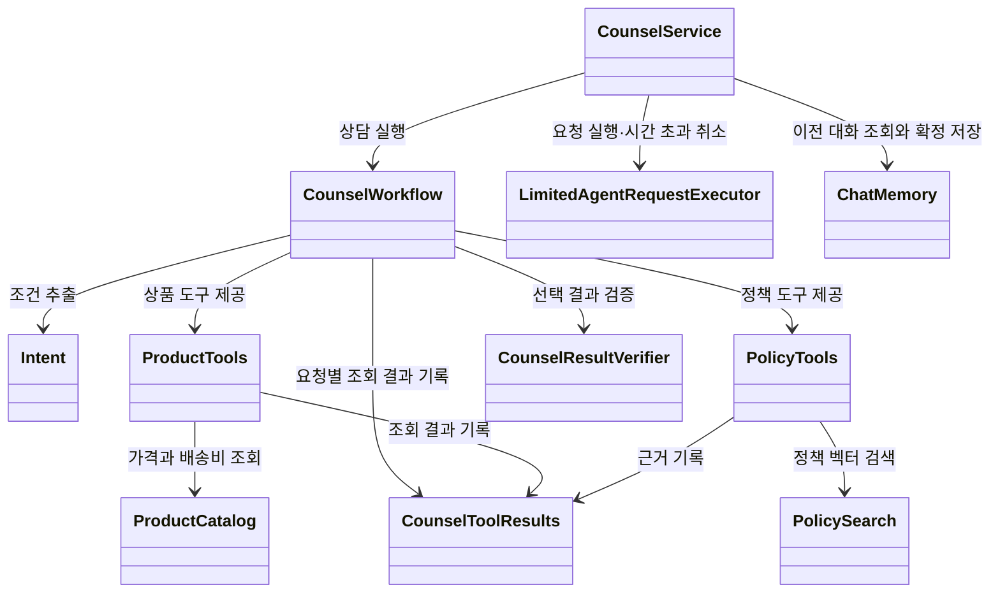
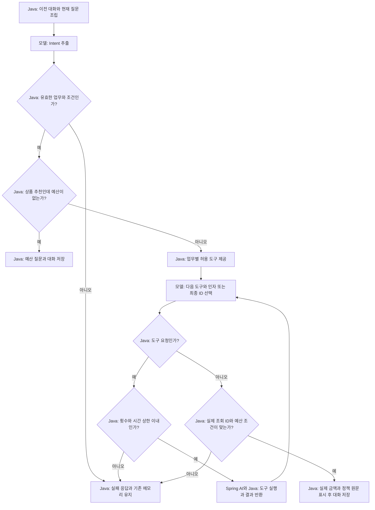

# 13-1. 통합하기 전에 책임 지도 그리기

**실행 코드·설정·테스트:** [labs/13-00-shopping-agent](../../../labs/13-00-shopping-agent/README.md). 저장소 루트에서 해당 README의 명령으로 실행합니다.

**이번 목표:** 상품 추천·정책 안내·후속 질문을 함께 처리하도록 모델의 판단, 도구 실행, 결과 검증, 대화 저장의 책임과 처리 흐름을 설계합니다.

**코드 읽기 안내:** 새 추상화부터 읽지 말고 상품·정책·대화라는 세 데이터의 출처를 먼저 확인합니다.

## 1. 무엇을 연결할까요?

“배송비 포함 3만원 이하 음료를 추천하고 미개봉 반품 기간도 알려줘.”
이어서 “생활용품으로만 바꿔줘”, “예산을 4만원으로 바꿔줘”라고 묻습니다.

| 이미 배운 개념 | 복습 단원 | 이번 코드의 역할 |
|---|---|---|
| 구조화 응답 | 04 | `Intent`로 업무·조건 추출, `CandidateEvidenceSelection`으로 최종 ID 선택 |
| Tool Calling | 05 | `ProductTools`, `PolicyTools`를 모델에 제공 |
| Workflow와 Agent | 06 | 바깥 순서와 검증은 Java, 안쪽 도구 선택은 모델 |
| 대화 메모리 | 07 | 이전 user/assistant를 다음 프롬프트에 포함 |
| Advisor | 08 | 자동 도구 루프를 복습. 이번 메모리는 저장 시점을 직접 제어 |
| 임베딩·RAG | 09~10 | `PolicySearch`가 검색한 실제 정책만 근거로 사용 |
| 평가와 실패 관찰 | 12 | 정상·실패 시나리오와 요청별 실행 기록 확인 |

이 예제는 **혼합 구조**입니다. 추출 → 도구 선택 → 검증 → 저장이라는 바깥 Workflow는 Java가 고정합니다.
도구 선택 구간에서는 모델이 상품 검색·배송비·정책 중 다음 행동을 선택합니다.
프롬프트에 순서를 적어서 바깥 흐름을 강제하는 방식이 아닙니다.

## 2. 구조와 실행 흐름

처음에는 그림에서 `CounselWorkflow` → 상품·정책 도구 → `CounselToolResults` → `CounselResultVerifier`의 경로를 따라가세요. `CounselService`의 저장은 두 번째 읽기, `LimitedAgentRequestExecutor`와 횟수·시간 제한은 세 번째 읽기에서 연결합니다. 클래스 전체를 먼저 암기할 필요는 없습니다.

[그림 공통 기준](../../diagram-guide.md)에 따라 클래스 그림은 책임, 흐름 그림은 결정 주체를 표현합니다.
화살표의 의존 관계와 실행 순서를 혼동하지 마세요.

`CounselToolResults`는 **이번 요청에서 도구가 조회한 결과를 모아 두는 객체**입니다. 대화 메모리와 다릅니다.
메모리는 이전 대화를 재사용하고, `CounselToolResults`는 이번 답변의 상품 ID·출처 ID를 `CounselResultVerifier`가 검사할 수 있게 보관합니다.
도구 객체와 이 기록은 요청마다 새로 만들므로 다른 요청의 조회 사실을 섞지 않습니다.

그림의 정상 결과에는 확인된 결과 없음도 포함합니다. 검증되지 않은 상품 선택은 실패로 보류합니다.
모든 모델 요청과 도구 실행에는 시간·횟수 검사가 적용됩니다. 그림은 도구 진입 검사만 대표로 표시했습니다.

## 3. 코드 읽는 순서

실행 모듈: [13-00-shopping-agent](../../../labs/13-00-shopping-agent/README.md).
패키지: `com.example.ailearning.l13shopping`.

1. [ProductCatalog](../../../labs/13-00-shopping-agent/src/main/java/com/example/ailearning/l13shopping/domain/ProductCatalog.java): 05와 같은 상품·배송비 규칙.
2. [PolicySearch](../../../labs/13-00-shopping-agent/src/main/java/com/example/ailearning/l13shopping/policy/PolicySearch.java), [PolicyLoader](../../../labs/13-00-shopping-agent/src/main/java/com/example/ailearning/l13shopping/policy/PolicyLoader.java), [PolicySearchResult](../../../labs/13-00-shopping-agent/src/main/java/com/example/ailearning/l13shopping/policy/PolicySearchResult.java): 09~10의 문서 적재·검색.
3. [Intent](../../../labs/13-00-shopping-agent/src/main/java/com/example/ailearning/l13shopping/domain/Intent.java), [CounselToolResults](../../../labs/13-00-shopping-agent/src/main/java/com/example/ailearning/l13shopping/workflow/CounselToolResults.java), [CandidateEvidenceSelection](../../../labs/13-00-shopping-agent/src/main/java/com/example/ailearning/l13shopping/workflow/CandidateEvidenceSelection.java): 추출한 조건·실제 조회 사실·모델이 선택한 ID 구분.
4. [ProductTools](../../../labs/13-00-shopping-agent/src/main/java/com/example/ailearning/l13shopping/tools/ProductTools.java), [PolicyTools](../../../labs/13-00-shopping-agent/src/main/java/com/example/ailearning/l13shopping/tools/PolicyTools.java): 도구 실행과 결과 기록.
5. [CounselWorkflow](../../../labs/13-00-shopping-agent/src/main/java/com/example/ailearning/l13shopping/workflow/CounselWorkflow.java): 다음 [13-2](02-intent.md)의 `processCounselRequest()`, [CounselResultVerifier](../../../labs/13-00-shopping-agent/src/main/java/com/example/ailearning/l13shopping/workflow/CounselResultVerifier.java)의 검증을 읽고, [13-4](04-conversation.md)에서 `CounselService.chat()`의 저장·실패 처리를 확인합니다.
6. **두 번째 읽기:** [CounselService](../../../labs/13-00-shopping-agent/src/main/java/com/example/ailearning/l13shopping/CounselService.java)는 대화 저장을 맡습니다. **세 번째 읽기:** [LimitedAgentRequestExecutor](../../../labs/13-00-shopping-agent/src/main/java/com/example/ailearning/l13shopping/support/LimitedAgentRequestExecutor.java)는 요청 전체의 대기와 시간 초과 취소를 맡습니다. [RunState](../../../labs/13-00-shopping-agent/src/main/java/com/example/ailearning/l13shopping/support/RunState.java)와 같은 폴더의 `CountedChatModel`은 전체 요청의 모델 요청 횟수 제한과 실행 내역 기록을 보조합니다. 도구 호출 상한은 Spring AI 설정을 사용하며, 도구 횟수는 `RunState`에서 응답 trace용으로 셉니다. 기본 기능은 [05 보충 도구 제한](../05-tool-calling/05-tool-call-limits.md)과 [02 보충 타임아웃·재시도](../02-first-call/05-model-timeout-retry.md)에서 확인합니다.
7. [CounselController](../../../labs/13-00-shopping-agent/src/main/java/com/example/ailearning/l13shopping/CounselController.java): 07과 같은 쿠키 세션 소유자와 대화 ID.

## 확인 질문

이전 대화와 이번 요청의 실제 조회 결과는 각각 무엇에 사용하며, 왜 서로 구분해 관리해야 하나요?

해설

이전 대화는 후속 질문의 의도와 유지할 조건을 해석하는 문맥이고, 이번 조회 결과는 선택한 상품·정책이 실제로 확인됐는지 검증하는 근거입니다. 과거 답변을 이번에 조회한 사실로 취급하면 현재 확인하지 않은 ID나 금액을 확인된 사실로 잘못 취급할 수 있습니다. 예제는 대화 메모리와 요청별 `CounselToolResults`를 구분해 이 역할을 나눕니다.

[이전](../13-shopping-agent.md) · [다음](02-intent.md) · [단원 목차](../13-shopping-agent.md) · [학습 방법](../../learning-guide.md)
