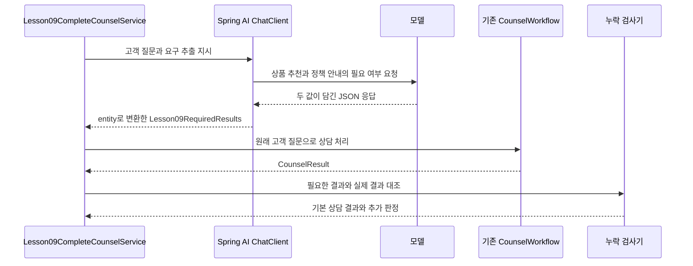

# 13-9. 복합 요청에서 빠진 결과 확인하기

**이번 목표:** 금액·ID 검증을 통과한 결과라도 고객이 요청한 결과 종류가 빠지면 누락으로 표시합니다.<br>
13-3의 검증 한계를 읽은 뒤 진행하는 선택 실습입니다.

## 값이 맞는 것과 필요한 결과가 모두 있는 것은 다르다

“3만원 이하 음료를 추천하고 미개봉 반품 기간도 알려줘”에는 두 요구가 있습니다.

| 필요한 결과 | 기본 상담 결과의 확인 위치 |
|---|---|
| 상품 추천 | `offers`에 검증된 상품 금액 정보가 있는지 |
| 정책 안내 | `sources`에 조회한 정책 근거가 있는지 |

기본 검증은 선택한 값이 실제 조회 결과와 맞는지 검사합니다.<br>
상품만 유효하면 `VERIFIED`가 될 수 있지만, 추가 검사에서는 정책 안내가 빠졌음을 표시합니다.<br>
기존 상태를 덮어쓰지 않고 기본 상담 결과와 추가 판정을 함께 반환합니다.

## 먼저 누락 확인 규칙만 실행하기

[Lesson09RequiredResults](../../../labs/13-00-shopping-agent/src/main/java/com/example/ailearning/l13shopping/lesson09_completeness/Lesson09RequiredResults.java)는 필요한 결과 두 종류를 담는 record입니다.<br>
두 값이 모두 false인 요청은 이번 실습 범위 밖으로 거부합니다.

```java
var requiredResults = new Lesson09RequiredResults(true, true);
var result = new Lesson09ResultCompletenessChecker().check(requiredResults, counselResult);
System.out.println(result.status());
System.out.println(result.missingResults());
```

위는 [객체 단위 테스트](../../../labs/13-00-shopping-agent/src/test/java/com/example/ailearning/l13shopping/lesson09_completeness/Lesson09ResultCompletenessCheckerUnitTest.java)에서 `counselResult`를 준비한 후 실행하는 발췌입니다.<br>
상품만 있는 `VERIFIED` 결과라면 출력은 `MISSING_RESULTS`, `[정책 안내]`입니다.

[Lesson09ResultCompletenessChecker](../../../labs/13-00-shopping-agent/src/main/java/com/example/ailearning/l13shopping/lesson09_completeness/Lesson09ResultCompletenessChecker.java)는 모델 없이 Java로 검사합니다.

| 추가 판정 | 의미 |
|---|---|
| `BASE_RESULT_NOT_VERIFIED` | 기본 상담이 보류·결과 없음 등으로 끝남. 그 결과를 유지 |
| `MISSING_RESULTS` | 기본 검증은 통과했지만 필요한 상품 또는 정책 결과가 없음 |
| `COMPLETE` | 기본 검증을 통과했고 `requiredResults`에 표시된 결과 종류가 모두 있음 |

`COMPLETE`도 이 두 결과 종류의 존재 검사까지만 통과했다는 뜻입니다.<br>
정책이 질문에 정확히 답하는지, 추천이 최선인지, 여러 정책 요청을 모두 처리했는지까지 보장하지 않습니다.

## 다음으로 모델의 요구 추출과 연결하기

[Lesson09CompleteCounselService](../../../labs/13-00-shopping-agent/src/main/java/com/example/ailearning/l13shopping/lesson09_completeness/Lesson09CompleteCounselService.java)는 위 검사기를 기존 상담에 연결합니다.



첫 모델 호출은 필요한 결과를 추출할 뿐, 도구를 실행하지 않습니다.<br>
그 뒤 기존 Workflow가 조건 추출·도구 선택·금액과 ID 검증을 수행합니다.<br>
마지막에 Java 검사기가 필요한 결과의 누락을 확인합니다.<br>
필요한 결과를 모델이 잘못 추출하면 누락 검사도 잘못 판단할 수 있으므로 추출 결과 자체의 평가가 필요합니다.

기본 상담·HTTP API·대화 저장은 변경하지 않습니다.<br>
이 선택 실습은 Service를 직접 호출하는 단일 요청이며, 후속 대화·부분 결과 저장·누락된 작업의 자동 재실행은 추가하지 않습니다.

## 실행과 테스트

```bash
./gradlew :Spring-AI-Agent-Learning:labs:13-00-shopping-agent:test --tests '*Lesson09ResultCompletenessCheckerUnitTest' --tests '*Lesson09CompleteCounselLocalModelTest'
```

단위 테스트는 상품만 요청한 경우, 복합 요청의 정책 누락, 두 결과의 존재, 기본 상담 보류와 처리 범위 밖 요청을 확인합니다.<br>
[로컬 모델 테스트](../../../labs/13-00-shopping-agent/src/test/java/com/example/ailearning/l13shopping/lesson09_completeness/Lesson09CompleteCounselLocalModelTest.java)는 요구 추출을 고정 응답으로 실행하고, 기존 Workflow는 Mockito 대역으로 정책이 빠진 결과를 반환하게 합니다.<br>
기존 도구 흐름은 13-4 테스트가 검증하며, 이 테스트가 실제 도구 실행까지 재검증하는 것은 아닙니다.

두 테스트에서 고객은 상품 추천과 반품 기간을 함께 묻고, 상담 결과에는 상품 추천만 담깁니다.<br>
Java 검사기는 모델이 추출한 요구를 기준으로 결과를 확인합니다.<br>
모델이 정책 안내도 필요하다고 표시하면 `MISSING_RESULTS`가 나옵니다.<br>
모델이 정책 안내 요구를 놓치면 검사기는 상품 추천만 확인해 `COMPLETE`를 반환합니다.<br>
고객은 반품 기간도 물었으므로, 실제 질문을 기준으로 보면 잘못된 완료 판정입니다.

[실제 모델 테스트](../../../labs/13-00-shopping-agent/src/test/java/com/example/ailearning/l13shopping/lesson09_completeness/Lesson09CompleteCounselOpenAiLiveTest.java)는 대역 없이 요구 추출과 기존 도구 상담을 함께 실행합니다.

```bash
./gradlew :Spring-AI-Agent-Learning:labs:13-00-shopping-agent:test --tests '*Lesson09CompleteCounselOpenAiLiveTest'
```

루트 `.env`의 OpenAI 채팅·임베딩 설정이 필요하며 API 사용량이 발생합니다.<br>
기본 상담에 필요한 호출 외에, 필요한 결과를 추출하는 채팅 요청이 한 번 추가됩니다.<br>
출력에서 `status`, `missingResults`, `counselResult`를 함께 확인합니다.

## 확인 질문

상품과 정책이 모두 있는 `COMPLETE` 결과라면 모든 고객 요구를 정확하게 처리했다고 보장할까요?

<details>
<summary>해설</summary>

아닙니다.<br>
모델이 추출한 두 결과 종류가 존재하는지만 확인합니다.<br>
요구 추출의 정확성, 정책의 적합성과 여러 세부 요청의 충족 여부는 추가 평가 대상입니다.

</details>

[13단원 목차](../13-shopping-agent.md) · [기본 검증으로 돌아가기](03-verify.md)
