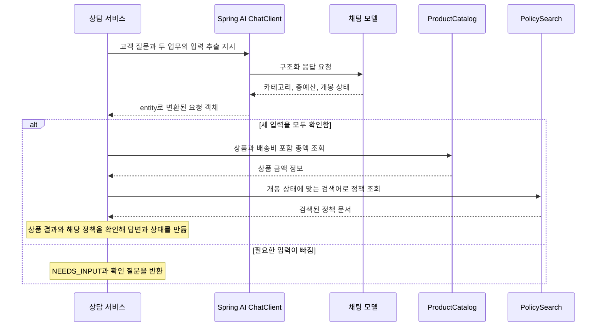

# 13-10. 상품 추천과 반품 안내를 한 질문에서 처리하기

**이번 목표** 한 질문에서 두 업무에 필요한 값을 추출하고, 상품 추천과 반품 정책 조회를 각각 실행해 한 답변으로 돌려줍니다.

> 3만원 이하 음료를 추천하고 미개봉 반품 기간도 알려줘.

[13-9](09-result-completeness.md)에서는 모델이 정책 안내 요구를 놓치면 상품만 있어도 검사기가 `COMPLETE`를 반환했습니다.<br>
이번 실습의 Workflow는 **상품 추천과 반품 안내를 함께 받는 용도**로 정해 둡니다.<br>
모델은 각 업무를 실행하는 데 필요한 값을 추출합니다.<br>
그중 하나라도 빠지면 Java가 부족한 정보를 다시 묻습니다.

## 모델이 찾아낼 값과 Java가 확인할 결과

| 고객이 요청한 일 | 모델이 추출할 입력 | Java가 조회·확인할 결과 |
|---|---|---|
| 3만원 이하 음료 추천 | `category`는 `음료`, `totalBudget`은 `30000` | 카탈로그에서 상품을 찾아 배송비 포함 총액이 예산 안인 상품 추천 |
| 미개봉 상품 반품 기간 안내 | `returnCondition`은 `SEALED` | 정책을 검색하고 미개봉 정책 문서(`return-sealed`)의 내용을 답변에 사용 |

이 실습은 질문에 배송비 언급이 없으면 명시된 금액을 배송비 포함 예산으로 사용합니다.<br>
반품 조건은 `SEALED`(미개봉)와 `OPENED`(개봉)를 지원합니다.

## 한 질문을 처리하는 흐름



1. [Lesson10ShoppingAndReturnService](../../../labs/13-00-shopping-agent/src/main/java/com/example/ailearning/l13shopping/lesson10_shoppingandreturn/Lesson10ShoppingAndReturnService.java)의 `answer()`에서 `.call().entity(...)`를 찾으세요.<br>
   Spring AI가 모델의 JSON 응답을 [요청 record](../../../labs/13-00-shopping-agent/src/main/java/com/example/ailearning/l13shopping/lesson10_shoppingandreturn/Lesson10ShoppingAndReturnRequest.java)로 변환합니다.<br>
   예를 들어 모델 응답에 `returnCondition`이 빠지면 `null`이 들어오고 서비스는 “반품할 상품을 개봉했는지 알려주세요.”라고 답합니다.
2. `recommendProductWithinBudget()`는 기존 카탈로그로 상품을 조회하고 배송비를 더한 뒤 예산에 맞는 상품 중 총액이 가장 낮은 상품을 고릅니다.<br>
   `findMatchingReturnPolicy()`는 기존 벡터 검색을 사용하고, 검색 결과에서 개봉 상태에 해당하는 문서 ID를 찾습니다.<br>
   예를 들어 미개봉 반품 질문에 배송비 문서만 검색되면 반품 근거를 찾지 못한 것으로 처리합니다.
3. 두 조회 결과를 얻으면 `COMPLETE`와 함께 상품의 가격·배송비·총액, 해당 정책 문장을 반환합니다.<br>
   한쪽 조회 결과가 빠지면 `MISSING_RESULTS`로 표시하고, 확인한 결과와 확인하지 못한 항목을 함께 안내합니다.

이 실습에서 Java는 두 조회를 모두 실행하도록 순서를 정합니다.<br>
모델이 다른 유효한 값으로 잘못 추출하는 경우도 있으므로, 추출 정확도는 별도의 질문 사례로 평가해야 합니다.

## 같은 질문으로 13-9와 비교하기

| 실습 | 모델 응답과 결과 |
|---|---|
| 13-9 기존 사례 | 정책 안내가 필요 없다고 표시합니다. 상품 추천만 담긴 상담 결과가 `COMPLETE`가 됩니다. |
| 13-10 누락 사례 | 카테고리와 예산만 추출합니다. `NEEDS_INPUT`으로 개봉 여부를 다시 묻습니다. |
| 13-10 정상 사례 | 세 값을 모두 추출합니다. 상품 추천과 미개봉 정책을 조회한 뒤 `COMPLETE`를 반환합니다. |

[로컬 테스트](../../../labs/13-00-shopping-agent/src/test/java/com/example/ailearning/l13shopping/lesson10_shoppingandreturn/Lesson10ShoppingAndReturnLocalModelTest.java)는 채팅·임베딩 응답을 고정하고 실제 카탈로그와 벡터 저장소를 사용합니다.<br>
위 두 사례에 더해, 다른 문서만 검색되거나 배송비를 더한 총액이 예산을 넘는 경우도 확인합니다.<br>
저장소 루트에서 다음 명령을 실행하세요. 로컬 실행에는 API 키가 필요 없습니다.

```bash
./gradlew :Spring-AI-Agent-Learning:labs:13-00-shopping-agent:test \
  --tests '*Lesson09CompleteCounselLocalModelTest' \
  --tests '*Lesson10ShoppingAndReturnLocalModelTest'
```

13-10 정상 사례에서 확인할 답변입니다.

```text
추천 상품은 허브티입니다. 상품가 12000원, 배송비 3000원, 총 15000원입니다.
미개봉 상품은 수령 후 7일 이내 반품할 수 있습니다.
```

실제 채팅·임베딩 모델로 확인하려면 루트 `.env`에 OpenAI 설정을 넣고 [Live 테스트](../../../labs/13-00-shopping-agent/src/test/java/com/example/ailearning/l13shopping/lesson10_shoppingandreturn/Lesson10ShoppingAndReturnOpenAiLiveTest.java)를 별도로 실행하세요. API 사용량이 발생합니다.

```bash
./gradlew :Spring-AI-Agent-Learning:labs:13-00-shopping-agent:test --tests '*Lesson10ShoppingAndReturnOpenAiLiveTest'
```

[이전: 13-9 결과 누락 확인](09-result-completeness.md) · [13단원 목차](../13-shopping-agent.md)
