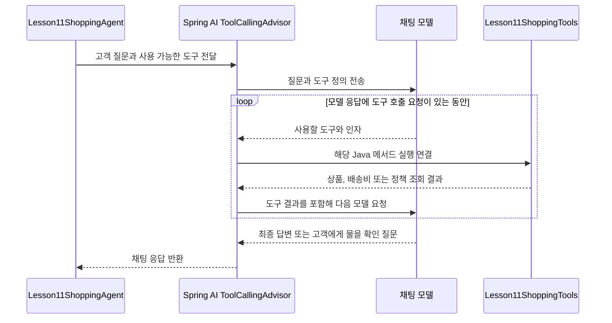

# 13-11. 모델이 질문하고 도구를 선택하는 쇼핑 Agent

**이번 목표** 로컬 Java 도구를 모델에 제공하고, 상품 추천·반품 안내·추가 질문 중 어떤 동작이 필요한지 모델이 선택하는 흐름을 구현합니다.

> 3만원 이하 음료를 추천하고 미개봉 반품 기간도 알려줘.

[13-10 Workflow 실습](10-shopping-and-return.md)에서는 Java가 상품 조회와 정책 조회를 모두 실행하도록 순서를 정했습니다.<br>
이번 실습에서는 같은 서비스가 상품과 정책을 함께 묻는 질문도, 정책만 묻는 질문도 받습니다.<br>
모델은 고객의 요청과 도구 설명을 읽고 어떤 도구를 호출할지, 고객에게 무엇을 더 물어볼지 결정합니다.

## 모델에 제공하는 도구

[Lesson11ShoppingTools](../../../labs/13-00-shopping-agent/src/main/java/com/example/ailearning/l13shopping/lesson11_agent/Lesson11ShoppingTools.java)의 `@Tool`은 Java 메서드를 모델이 요청할 수 있는 도구로 등록하는 데 사용합니다.<br>
Spring AI는 도구의 이름·설명·입력 형식을 모델에 전달합니다.

| 도구 | 입력 | Java에서 조회하는 값 |
|---|---|---|
| `searchProducts` | 상품 종류와 가격 상한을 선택적으로 전달 | 조건에 맞는 상품 ID·이름·상품가 |
| `calculateShipping` | 상품 ID | 상품가·배송비·배송비 포함 총액 |
| `searchReturnPolicy` | 개봉 상태를 포함한 반품 검색어 | 반품 정책 문장과 출처 |

상품 검색의 상한은 상품가에 적용됩니다.<br>
고객의 예산에 맞는지를 판단할 때 모델은 배송비 조회 결과의 총액을 사용합니다.

## 한 요청 안에서 필요한 도구 호출하기

다음은 첫 질문 한 번을 처리하는 경로입니다. 상품을 찾고, 찾은 상품의 배송비를 알아본 뒤, 반품 정책을 조회하는 순서는 로컬 테스트에서 관찰하는 한 가지 예입니다.



[Lesson11ShoppingAgent.answer()](../../../labs/13-00-shopping-agent/src/main/java/com/example/ailearning/l13shopping/lesson11_agent/Lesson11ShoppingAgent.java)의 핵심입니다.

```java
return chatClient
        .prompt()
        .system(SHOPPING_AGENT_INSTRUCTIONS)
        .messages(previousMessages)
        .user(customerQuestion)
        .tools(shoppingTools)
        .call()
        .content();
```

`.tools(shoppingTools)`에서 사용할 도구를 제공합니다.<br>
`.call()`은 `ToolCallingAdvisor`를 포함한 처리 순서를 준비하고, `.content()`는 이를 실행해 최종 응답의 텍스트를 가져옵니다.<br>
그 사이 `ToolCallingAdvisor`는 모델의 도구 요청을 Java 메서드에 연결하고, 조회 결과를 모델에게 다시 전달합니다.<br>
모델은 돌아온 총액과 반품 기간을 근거로 답변을 작성합니다. [Spring AI Tool Calling](https://docs.spring.io/spring-ai/reference/api/tools.html) · [08-7 호출 경계](../08-advisors/07-tool-loop-order.md)

## 고객에게 확인하고 다음 메시지에서 이어가기

고객이 “음료 추천해 주고 반품 기간도 알려줘.”라고 하면, 모델은 “배송비 포함 예산은 얼마인가요? 반품할 상품은 개봉했나요?”라고 되물을 수 있습니다.<br>
이 확인 질문은 현재 `answer()` 호출의 반환값입니다.<br>
고객이 “배송비 포함 3만원이고, 개봉하지 않았어요.”라고 답하면 호출자가 앞의 두 메시지를 함께 넘겨 두 번째 `answer()`를 호출합니다.

```java
String firstQuestion = "음료 추천해 주고 반품 기간도 알려줘.";
String clarification = shoppingAgent.answer(firstQuestion, List.of());

List<Message> previousMessages = List.of(
        new UserMessage(firstQuestion),
        new AssistantMessage(clarification));
String answer = shoppingAgent.answer("배송비 포함 3만원이고, 개봉하지 않았어요.", previousMessages);
```

두 번째 호출에서 `.messages(previousMessages)`는 앞선 고객 질문과 모델의 확인 질문을, `.user(...)`는 이번 고객 답변을 전달합니다.<br>
모델은 이 세 메시지에서 `음료`, `3만원`, `미개봉`을 연결해서 도구를 요청할 수 있습니다.<br>
앞선 메시지는 이 예제의 호출자가 보관합니다.

## 세 사례 실행하기

저장소 루트에서 [로컬 모델 테스트](../../../labs/13-00-shopping-agent/src/test/java/com/example/ailearning/l13shopping/lesson11_agent/Lesson11ShoppingAgentLocalModelTest.java)를 실행합니다. 실제 API 키는 필요 없습니다.

```bash
./gradlew :Spring-AI-Agent-Learning:labs:13-00-shopping-agent:test --tests '*Lesson11ShoppingAgentLocalModelTest'
```

| 사례 | 확인할 내용 |
|---|---|
| 상품 추천과 미개봉 반품 기간 | 상품 검색·배송비·정책 결과가 모델에 전달됩니다. 콘솔에는 허브티의 총액 15,000원과 수령 후 7일 이내라는 반품 조건이 함께 나옵니다. |
| 고객에게 확인한 뒤 조회 | 첫 호출은 확인 질문을 반환합니다. 다음 요청에는 앞선 두 메시지와 고객의 새 답변이 순서대로 들어가고, 이후 상품과 정책을 조회합니다. |
| 미개봉 반품 기간만 질문 | 모델에 돌아간 도구 결과는 반품 정책 하나입니다. |

테스트에서는 채팅·임베딩 응답을 고정하고, Spring AI의 도구 실행과 실제 실습용 카탈로그·벡터 저장소를 연결합니다.<br>
테스트는 고정된 모델 응답을 바탕으로 다음 요청에 담긴 도구 결과와 사용자에게 반환된 답변을 각각 확인합니다.<br>
실제 모델이 질문이나 도구를 적절히 선택하는지는 별도의 모델 평가에서 확인할 수 있습니다.

MCP 도구 연결은 후속 실습으로 확장할 수 있습니다. [11단원 MCP 실습](../11-mcp-workflow-agent.md)

[이전: 13-10 복합 요청 Workflow](10-shopping-and-return.md) · [13단원 목차](../13-shopping-agent.md)
