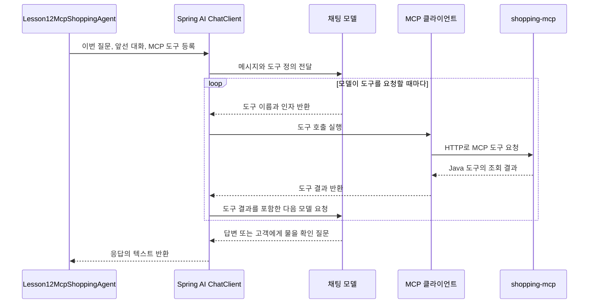

# 13-12. 쇼핑 Agent에 기존 MCP 서버 연결하기

**이번 목표** `shopping-mcp`의 도구를 `ChatClient`에 연결하고, 복합 요청과 확인 질문 이후의 대화를 MCP 도구로 처리합니다.

[13-11](11-model-led-shopping-agent.md)에서는 Agent와 Java 조회 도구가 한 애플리케이션에 있었습니다.<br>
13-12에서는 같은 고객 질문을 사용하고, 도구가 필요한 시점에는 별도 `shopping-mcp` 서버에 조회를 요청합니다.<br>
모델은 사용할 도구와 인자를 결정하고, Spring AI의 MCP 클라이언트는 그 요청을 서버에 전달합니다.

## 도구가 실행되는 위치

| 고객 요청을 처리하는 데 필요한 일 | `shopping-mcp`의 도구 | 반환값 |
|---|---|---|
| 조건에 맞는 상품 찾기 | `searchProducts` | 상품 ID, 상품명, 상품가 |
| 상품 한 개의 배송비 포함 총액 확인 | `quoteCart` | 상품가 합계, 배송비, 총액 |
| 개봉 상태에 맞는 반품 기준 확인 | `getReturnPolicy` | 정책 문장과 출처 ID |

상품과 배송비 계산에는 기존 서버의 상품 데이터와 배송 기준을 사용합니다.<br>
`quoteCart`에 `scenario: "empty"`와 상품 ID 하나를 주면 빈 가상 장바구니에 그 상품만 추가했을 때의 총액을 계산합니다.<br>
반품 정책은 이 실습에서 서버의 `shopping.mcp.return-policy.enabled=true`로 열어 주는 조회 도구입니다. [반품 정책 도구 소스](../../../../shopping-mcp/src/main/java/com/example/shopping/mcp/ReturnPolicyTools.java)

## 모델이 도구를 선택한 뒤 생기는 일

MCP 클라이언트는 `application.yml`에 적힌 서버 주소와 `/mcp` 경로로 연결해 도구 이름·설명·입력 형식을 가져옵니다.<br>
[애플리케이션의 도구 필터](../../../labs/13-12-mcp-shopping-agent/src/main/java/com/example/ailearning/l13mcpshopping/McpShoppingAgentApplication.java)는 위의 세 도구를 Agent에 제공합니다.<br>
[Agent 코드](../../../labs/13-12-mcp-shopping-agent/src/main/java/com/example/ailearning/l13mcpshopping/lesson12_mcpagent/Lesson12McpShoppingAgent.java)는 앞선 대화와 이번 질문을 구성하고, `.tools(mcpToolProvider)`에서 원격 도구를 등록합니다.<br>
`mcpToolProvider`는 Spring AI가 준비한 `ToolCallbackProvider`입니다. 서버에서 찾은 도구를 `ChatClient`가 호출할 수 있는 형태로 제공합니다. [Spring AI MCP 클라이언트](https://docs.spring.io/spring-ai/reference/api/mcp/mcp-client-boot-starter-docs.html) · [Spring AI Tool Calling](https://docs.spring.io/spring-ai/reference/api/tools.html)

```java
return chatClient
        .prompt()
        .system(MCP_SHOPPING_AGENT_INSTRUCTIONS)
        .messages(previousMessages)
        .user(customerQuestion)
        .tools(mcpToolProvider)
        .call()
        .content();
```

고객의 요청 하나에서 도구 조회가 여러 번 필요할 수 있습니다.<br>
예를 들어 모델은 상품 검색 결과에서 고른 ID로 배송비 포함 총액을 조회하고, 반품 정책도 별도로 요청합니다.



모델이 예산이나 개봉 여부를 물으면 현재 `answer()`가 확인 질문을 반환합니다.<br>
호출자는 앞선 고객 질문과 모델의 확인 질문을 `previousMessages`에 넣고, 고객의 새 답변으로 다음 `answer()`를 호출합니다.<br>
두 번째 호출에서 모델이 조회에 필요한 정보를 확인하면 MCP 도구를 요청할 수 있습니다.

## 같은 세 질문을 실행하기

[로컬 테스트](../../../labs/13-12-mcp-shopping-agent/src/test/java/com/example/ailearning/l13mcpshopping/lesson12_mcpagent/Lesson12McpShoppingAgentLocalModelTest.java)는 실제 `shopping-mcp`를 로컬 임의 포트에서 시작하고, 채팅 모델만 고정 응답 서버로 연결합니다.<br>
저장소 루트에서 다음 명령을 실행합니다. API 키와 서버 수동 실행은 필요 없습니다.

```bash
./gradlew :Spring-AI-Agent-Learning:labs:13-12-mcp-shopping-agent:test --tests '*Lesson12McpShoppingAgentLocalModelTest'
```

| 고객 질문 | 콘솔에서 볼 답변과 테스트가 확인하는 동작 |
|---|---|
| “3만원 이하 음료를 추천하고 미개봉 반품 기간도 알려줘.” | 상품 검색·견적·반품 정책 결과가 모델에 전달됩니다. 허브티 컬렉션은 상품가 9,900원과 배송비 3,000원을 합해 총 12,900원이며, 반품 기간은 수령 후 7일 이내입니다. |
| “음료 추천해 주고 반품 기간도 알려줘.” | 첫 호출에서 예산과 개봉 여부를 묻습니다. “배송비 포함 3만원이고, 개봉하지 않았어요.”라는 답을 받으면 앞선 대화와 함께 전달해 조회를 이어갑니다. |
| “미개봉 반품 기간만 알려줘.” | 모델에 다시 전달되는 도구 결과는 `getReturnPolicy`의 결과 하나입니다. |

테스트는 MCP 서버에서 조회한 값과 답변을 각각 확인합니다.<br>
이 실습의 실행 결과는 고정된 모델 선택으로 확인한 것이며, 실제 모델의 선택 정확도는 별도 평가 대상입니다.

[실습 실행 안내](../../../labs/13-12-mcp-shopping-agent/README.md) · [이전: 13-11 로컬 도구 Agent](11-model-led-shopping-agent.md) · [13단원 목차](../13-shopping-agent.md)
