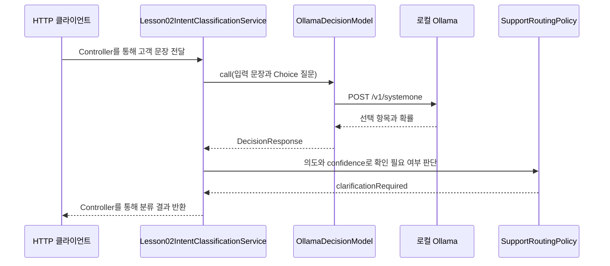

# 15. Ollama: 내 PC의 모델로 고객 요청 판단하기

## 이번 수업의 목표

내 PC에서 Ollama를 실행하고 고객 메시지의 의도·상담원 연결 요청·시급성을 판단합니다.<br>
모델이 반환한 판단값과 실제 업무 처리를 구분하며, 여러 질문과 주문 정보를 한 요청으로 전달하는 방법까지 익힙니다.<br>
선수 지식은 04단원의 record·JSON과 생성자 주입입니다.<br>
14단원의 Jev 예제를 읽었다면 같은 업무를 외부 서비스와 로컬 모델로 처리하는 차이를 비교할 수 있습니다.

## Ollama와 의사결정 모델은 무엇일까?

**Ollama**는 모델 파일을 내려받아 내 PC에서 모델을 실행하는 프로그램입니다.<br>
**의사결정 모델**은 답변 문장을 작성하는 대신, 개발자가 제시한 선택지나 평가 기준에 대한 판단값을 반환합니다.<br>
예를 들어 “주문한 텀블러가 아직 안 왔어요”라는 문장을 읽고 `ORDER_DELIVERY`를 선택합니다.<br>
그 뒤 배송 조회를 실제로 수행하려면 별도 Java 코드나 도구 연결이 필요합니다.

| 용어·기능 | 뜻 | 쇼핑 상담 예 |
|---|---|---|
| 로컬 추론 | 다운로드한 모델을 내 PC의 연산 자원으로 실행 | 고객 메시지를 로컬 Ollama에 전달 |
| Choice | 순서가 없는 항목 중 하나를 선택 | 상품 검색·주문 배송·반품 교환·기타 |
| Yes/No | 어떤 조건이 참일 확률을 반환 | 사람 상담원 연결을 요청했는가? |
| Score | 낮음부터 높음까지 순서가 있는 기준을 평가 | 일반 문의 → 현재 문제 → 즉시 확인 필요 |
| 항목별 확률 | 각 선택지나 단계에 모델이 부여한 확률 | 주문 배송 0.9, 나머지 합계 0.1 |
| confidence | 선택·점수 판단의 확률 분포가 얼마나 집중됐는지 나타내는 값 | 이 예제는 낮으면 확인 대상으로 보류 |

확률과 confidence는 실제 정답률을 보장하지 않습니다.<br>
작은 모델의 한국어 판단은 실제 고객 문의로 확인해야 하며, 낮은 confidence를 업무 처리 성공으로 간주하지 않습니다.<br>
로컬 API에는 키가 필요하지 않지만 모델 다운로드에는 인터넷·디스크가, 모델 실행에는 메모리와 연산 자원이 필요합니다.

기본 모델 `d1-omni:600m`은 가벼운 의사결정 API 실습을 위해 선택했으며 **한국어 최적화 모델이 아닙니다.**<br>
기반 모델의 [공식 지원 언어 15개](https://huggingface.co/LiquidAI/LFM2.5-Encoder-350M)에 한국어는 포함되지 않습니다.<br>
아래 한국어 Live 예제는 실제 판단 품질을 함께 확인하는 테스트이며, 모델 다운로드·API 연결 성공과 한국어 분류의 정확성을 구분해 결과를 읽습니다.

## 14단원과 무엇이 달라질까?

| 비교 | 14단원 Jev | 15단원 Ollama |
|---|---|---|
| 모델 실행 위치 | 외부 TypeSafe 서비스 | 내 PC의 Ollama 서버 |
| Java 호출 방식 | 커뮤니티 `TypeSafeClient` | Spring AI `DecisionModel`·`DecisionPrompt` |
| 참·거짓 질문 | `Noul` | `YesNoQuestion` — Ollama로 보낼 때 `noul`로 변환 |
| 연결 설정 | API 키와 외부 주소 | 로컬 주소와 다운로드한 모델 이름 |
| 기본 실습 | 세 가지 질문을 각각 호출 | 같은 세 가지 질문을 각각 호출 |
| 이어지는 실습 | — | 질문 세 개를 한 요청으로 전송, 이름 붙은 주문 정보 입력 |

여러 질문과 필드 입력은 Ollama만의 독점 기능이 아니라 이번 `DecisionModel` API로 배울 수 있는 기능입니다.<br>
이 단원은 일반 채팅의 `.entity(...)`로 분류하는 예제가 아니라 **의사결정 전용 `/v1/systemone` API**를 사용합니다.

## Spring이 준비하는 객체

루트 빌드는 Spring AI **2.1.0**, Spring Boot **4.2.0**, Java **21**을 사용합니다.<br>
[실습 build.gradle](../../labs/15-00-ollama-decisions/build.gradle)에 `spring-ai-starter-model-ollama`를 추가합니다.<br>
[application.yml](../../labs/15-00-ollama-decisions/src/main/resources/application.yml)의 `spring.ai.model.decision: ollama`와 연결 설정을 읽어 Starter가 `OllamaDecisionModel`을 준비합니다.<br>
서비스는 이 객체를 `DecisionModel` 타입으로 생성자 주입받습니다.

```yaml
spring:
  ai:
    model:
      chat: none
      embedding: none
      decision: ollama
    ollama:
      base-url: ${OLLAMA_BASE_URL:http://127.0.0.1:11434}
      init:
        pull-model-strategy: never
      decision:
        model: ${OLLAMA_DECISION_MODEL:d1-omni:600m}
```

위는 모델 설정만 발췌한 코드입니다.<br>
`chat`·`embedding`은 이 실습에서 사용하지 않으므로 끄고 의사결정 기능만 켭니다.<br>
`pull-model-strategy: never`는 앱 시작 시 모델을 자동 다운로드하지 않는다는 뜻입니다.<br>
먼저 다음 설치 수업에서 직접 준비합니다.

## 고객 질문 한 번의 처리

아래는 의도 분류 API의 처리 순서입니다.<br>
모델은 의도를 선택하고, 확인 질문이 필요한지는 Java 정책이 결정합니다.



## 학습 순서

| 순서 | 소주제 | 실행할 내용 |
|---|---|---|
| 1 | [설치·서버 시작과 중지](15-ollama-decisions/01-install-and-run.md) | Ollama 설치 → 서버 시작 → 모델 다운로드 → decision 지원 확인 |
| 2 | [Choice: 쇼핑 의도 분류](15-ollama-decisions/02-customer-decisions.md) | 선택지와 설명을 전달하고 항목별 확률 읽기 |
| 3 | [Yes/No: 상담원 연결 요청](15-ollama-decisions/03-yes-no.md) | 참일 확률을 읽고 Java가 안내 방식 선택 |
| 4 | [Score: 상담 시급성](15-ollama-decisions/04-score.md) | 연속 점수·대표 단계·서비스 우선순위 구분 |
| 5 | [여러 질문을 한 번에 보내기](15-ollama-decisions/05-multiple-questions.md) | 한 고객 메시지에 질문 세 개를 한 요청으로 전송 |
| 6 | [주문 정보와 함께 판단하기](15-ollama-decisions/06-fields-input.md) | 문장 대신 이름 붙은 필드를 입력으로 전달 |

모든 실습은 [15-00-ollama-decisions](../../labs/15-00-ollama-decisions/README.md) 한 모듈에서 실행합니다.<br>
각 소주제는 해당 Service와 테스트로 연결되며, 기본 세 Service는 뒤 소주제의 코드를 사용하지 않습니다.

## 시작·실행·중지

저장소 루트에서 실행합니다.<br>
Ollama 프로그램 설치는 [15-1](15-ollama-decisions/01-install-and-run.md)을 먼저 진행하세요.

```bash
./Spring-AI-Agent-Learning/labs/15-00-ollama-decisions/ollamaShell/start.sh
ollama pull d1-omni:600m
ollama show d1-omni:600m
./gradlew :Spring-AI-Agent-Learning:labs:15-00-ollama-decisions:bootRun
```

앱 실행 후 다른 터미널에서 요청합니다.

```bash
curl -sS http://127.0.0.1:8115/api/ollama/intent   -H 'Content-Type: text/plain; charset=UTF-8'   --data-raw '3만원 이하의 텀블러를 추천해 주세요.'
```

응답의 `predictedIntent`·`probabilities`·`clarificationRequired`를 확인합니다.<br>
모델의 값은 달라질 수 있습니다.<br>
실습 종료 시 Spring 앱 터미널에서 Ctrl+C를 누르고 Ollama도 중지합니다.

```bash
./Spring-AI-Agent-Learning/labs/15-00-ollama-decisions/ollamaShell/stop.sh
```

중지 스크립트는 시작 스크립트가 만든 프로세스만 종료합니다.<br>
앱·OS 서비스로 시작한 Ollama의 중지 방법은 [15-1](15-ollama-decisions/01-install-and-run.md#5-서버-중지하기)에 있습니다.

## 테스트로 확인하는 범위

아래 명령은 Ollama 설치나 실제 모델 없이 고정 응답 서버로 실행합니다.

```bash
./gradlew :Spring-AI-Agent-Learning:labs:15-00-ollama-decisions:test --tests '*LocalModelTest' --tests '*SupportRoutingPolicyUnitTest' :Spring-AI-Agent-Learning:labs:15-00-ollama-decisions:bootJar
```

실제 로컬 모델은 Ollama와 모델을 준비한 뒤 별도 클래스로 확인합니다.

```bash
./gradlew :Spring-AI-Agent-Learning:labs:15-00-ollama-decisions:test --tests '*LiveTest'
```

Live 테스트는 실제 판단값을 출력하고 명확한 문의의 의도·상대적인 시급성 등을 확인합니다.<br>
고정 응답 테스트 통과는 연결·변환·분기 검증이며 한국어 판단 품질의 근거가 아닙니다.

기본 모델로 실행한 한국어 Live 테스트는 **5개 중 4개 통과·1개 실패**였습니다.<br>
주문 정보와 반품 문의를 함께 판단하는 사례에서 기대 분류와 달랐으며, [실제 추론 검증 기록](../verification/15-ollama-and-ai21-upgrade.md#실제-로컬-설치추론-검증-추가)에 결과와 언어별 비교를 남겼습니다.

## 확인 질문

1. 일반 채팅 모델만 다운로드하면 이 단원의 의사결정 API를 사용할 수 있나요?
2. `question("intent", ...)`의 이름과 `getChoice("intent")`의 이름을 맞추는 이유는 무엇인가요?
3. 질문 세 개를 한 요청으로 보낸 결과가 곧 세 가지 업무를 실행했다는 뜻인가요?

<details>
<summary>해설</summary>

1. 아닙니다.<br>
   `/v1/systemone`을 처리하는 Ollama 버전과 `decision` 기능을 지원하는 모델이 필요합니다.
2. 여러 질문의 답 중 어떤 답을 읽을지 식별하기 위해서입니다.<br>
   입력 문장과 질문 이름은 서로 다른 역할입니다.
3. 아닙니다.<br>
   의도·상담원 요청·시급성 판단만 반환합니다.<br>
   실제 조회·연결·주문 변경은 별도의 업무 코드가 수행해야 합니다.

</details>

## 참고 자료

- [Spring AI Ollama Decision Models](https://docs.spring.io/spring-ai/reference/api/decision/ollama-decision.html): 모델 조건·자동 구성·지원 입력.
- [Ollama Decision](https://docs.ollama.com/capabilities/decision): 전용 API와 선택·참거짓·점수의 프로토콜.
- [d1-omni:600m](https://ollama.com/library/d1-omni:600m): 사용할 모델과 다운로드 정보.

[이전: 14단원 Jev](14-jev.md) · [전체 교육 계획](../curriculum.md)
