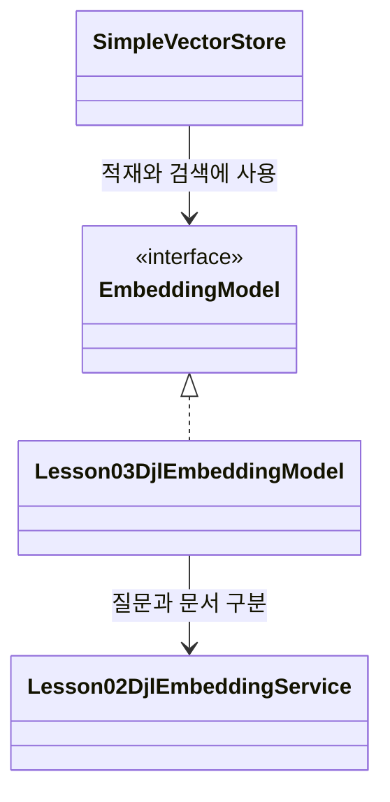

# 16-3. DJL 임베딩을 Spring AI에 연결하기

**이번 목표:** Spring AI의 `EmbeddingModel`을 구현해 질문과 문서의 임베딩을 DJL 서비스로 연결합니다.

[16단원으로 돌아가기](../16-djl-embeddings.md)

## 왜 연결 코드가 필요할까?

09단원의 `SimpleVectorStore`는 Spring AI의 `EmbeddingModel`을 사용합니다.<br>
앞 소주제에서 만든 DJL 서비스에는 `embedQuery()`·`embedDocument()`가 있으므로 두 API 사이를 연결해야 합니다.

이처럼 서로 다른 API를 연결하는 객체를 **어댑터(adapter)**라고 합니다.<br>
Spring AI가 `EmbeddingModel` 인터페이스를 제공하고, 이번 수업에서는 그 구현체인 [Lesson03DjlEmbeddingModel](../../../labs/16-00-djl-embeddings/src/main/java/com/example/ailearning/l16djl/lesson03_springai/Lesson03DjlEmbeddingModel.java)을 직접 작성합니다.<br>
이 클래스는 이 교재의 코드이며 Spring AI가 제공하는 DJL 구현체가 아닙니다.

| 호출 | 어댑터가 연결하는 대상 | 모델 입력 |
|---|---|---|
| 문자열 임베딩 `embed("배송비")` | `call()` → DJL 서비스의 `embedQuery()` | `query: 배송비` |
| 문서 임베딩 `embed(document)` | DJL 서비스의 `embedDocument()` | `passage: 문서 본문` |
| 저장소의 문서 일괄 임베딩 | 각 문서를 위 문서 임베딩으로 전달 | 문서마다 `passage: ` |
| `dimensions()` | 설정한 모델의 차원 수 반환 | 추론 없이 384 반환 |

`EmbeddingModel`의 문자열용 기본 메서드는 내부에서 `call()`을 호출합니다.<br>
문서 일괄 처리도 별도로 연결해, 검색 대상 문서를 질문용 접두어로 임베딩하지 않도록 합니다.<br>
이 어댑터는 설정된 한 모델로 문장을 하나씩 처리합니다.



## 연결 코드 읽기

아래는 어댑터의 문서용 메서드를 발췌한 코드입니다.<br>
문서 목록을 받아 `embed(Document)`에 하나씩 전달합니다.

```java
@Override
public float[] embed(Document document) {
    return embeddingService.embedDocument(document.getText());
}

@Override
public List<float[]> embed(List<Document> documents, EmbeddingOptions options,
        BatchingStrategy batchingStrategy) {
    return documents.stream()
            .map(this::embed)
            .toList();
}
```

`this::embed`는 같은 클래스의 `embed(Document)`를 각 문서에 적용하는 메서드 참조입니다.<br>
문자열 요청을 처리하는 `call()`과 생성자를 포함한 전체 코드는 [어댑터 소스](../../../labs/16-00-djl-embeddings/src/main/java/com/example/ailearning/l16djl/lesson03_springai/Lesson03DjlEmbeddingModel.java)에서 확인합니다.

## 모델 없이 연결 검증하기

[어댑터 단위 테스트](../../../labs/16-00-djl-embeddings/src/test/java/com/example/ailearning/l16djl/lesson03_springai/Lesson03DjlEmbeddingModelUnitTest.java)는 DJL 서비스가 고정 벡터를 반환하도록 설정합니다.<br>
실제 `SimpleVectorStore`의 적재·검색을 실행한 뒤 문서는 `embedDocument()`, 질문은 `embedQuery()`로 전달됐는지 확인합니다.

```bash
./gradlew :Spring-AI-Agent-Learning:labs:16-00-djl-embeddings:test --tests '*Lesson03DjlEmbeddingModelUnitTest'
```

이 테스트는 API 연결 경로의 검증입니다.<br>
실제 모델의 숫자 계산과 검색 결과는 다음 소주제에서 확인합니다.

## 확인 질문

같은 문장이라도 질문을 임베딩하는 메서드와 문서를 임베딩하는 메서드를 나눈 이유는 무엇일까요?

<details>
<summary>해설</summary>

E5가 검색 질문과 검색 대상 문서를 구분하도록 각각 `query: `와 `passage: `를 붙이기 위해서입니다.<br>
저장소의 문서 일괄 적재에서도 이 구분이 유지되어야 합니다.

</details>

[Spring AI EmbeddingModel 설명](https://docs.spring.io/spring-ai/reference/api/embeddings.html) · [다음: 정책 검색](04-search.md)
