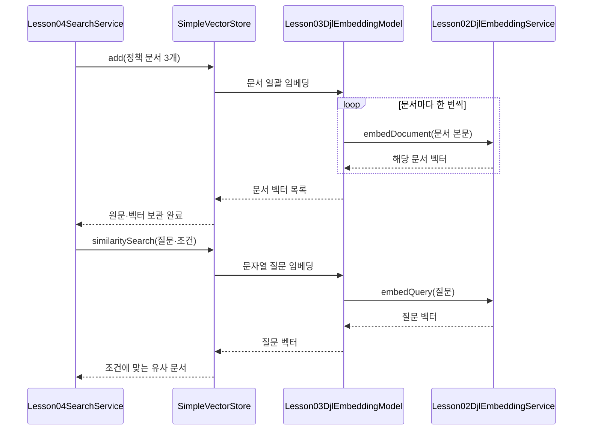

# 16-4. 로컬 모델로 정책 문서 검색하기

**이번 목표:** 로컬 E5 벡터를 사용해 문서를 적재·검색하고, 09단원과 같은 기준으로 결과를 검증합니다.

[16단원으로 돌아가기](../16-djl-embeddings.md)

## 문서를 넣고 질문하기

09단원의 세 정책 문서를 사용합니다.<br>
[PolicyDocuments](../../../labs/16-00-djl-embeddings/src/main/java/com/example/ailearning/l16djl/PolicyDocuments.java)에 배송비·미개봉 반품·개봉 반품 원문과 분류가 있습니다.

[Lesson04SearchService](../../../labs/16-00-djl-embeddings/src/main/java/com/example/ailearning/l16djl/lesson04_search/Lesson04SearchService.java)는 Spring에서 주입받은 `EmbeddingModel`로 메모리 저장소를 만듭니다.<br>
아래는 생성자 전체입니다.

```java
public Lesson04SearchService(EmbeddingModel embeddingModel) {
    policyVectorStore = SimpleVectorStore.builder(embeddingModel)
            .build();
    policyVectorStore.add(PolicyDocuments.createDocuments());
}
```

이 모듈에는 OpenAI Starter 대신 직접 만든 `Lesson03DjlEmbeddingModel` 빈이 있으므로 이 객체가 주입됩니다.<br>
문서 적재 시에는 `passage: ` 입력으로 벡터를 만들고, 질문 검색 시에는 `query: ` 입력으로 같은 모델을 실행합니다.



문서를 저장한 뒤 질문을 검색하는 두 시점을 구분합니다.<br>
저장소는 앱 메모리에만 있으므로 재시작하면 문서를 다시 임베딩합니다.

## 실행과 결과 읽기

저장소 루트에서 기본 프로필로 실행합니다.<br>
앞 소주제의 서버가 실행 중이면 Ctrl+C로 종료한 뒤 시작합니다.

```bash
./gradlew :Spring-AI-Agent-Learning:labs:16-00-djl-embeddings:bootRun
```

검색 요청은 URL 인코딩을 curl에 맡겨 한글로 작성할 수 있습니다.

```bash
curl -sS -G http://127.0.0.1:8116/api/search \
  --data-urlencode 'query=운송 요금' \
  --data-urlencode 'topK=2' \
  --data-urlencode 'threshold=0.0'
```

`keywordHits`는 원문에 검색어가 그대로 포함되는지 비교한 결과입니다.<br>
`vectorHits`는 벡터 유사도 순서와 조건으로 선택한 결과입니다.<br>
이 예제에서 “운송 요금”은 원문에 없지만 관련된 배송비 문서를 벡터 검색으로 찾는지 확인합니다.

| 필드 | 읽는 방법 |
|---|---|
| `id` | 어느 정책 문서를 찾았는지 확인 |
| `text` | 실제 정책 원문과 질문의 관련성 확인 |
| `category` | 배송·반품 중 요청한 분류인지 확인 |
| `score` | 이 모델 안에서 후보를 비교하는 유사도 값. 정답 확률이 아님 |

OpenAI에서 사용하던 유사도 하한을 로컬 모델에 그대로 적용하지 않습니다.<br>
먼저 `threshold=0.0`에서 점수와 순위를 확인하고 업무 질문으로 기준을 정합니다.

## 09단원 방식으로 검증하기

[Lesson04SearchDjlLiveTest](../../../labs/16-00-djl-embeddings/src/test/java/com/example/ailearning/l16djl/lesson04_search/Lesson04SearchDjlLiveTest.java)는 실제 로컬 모델과 HTTP API로 다음을 검사합니다.

| 검증 | 확인하는 결과 |
|---|---|
| 배송비 질문 | 검색 결과가 있으며 첫 문서 ID가 `shipping` |
| 다른 표현인 “운송 요금” | 문자열 검색은 비어 있고 벡터 검색은 배송비 문서 선택 |
| 반품 분류·topK=1 | 결과 한 개이며 `category=returns` |
| `threshold=1.0`인 서로 다른 문장 | 현재 정책 데이터에서 결과 없음 |
| 잘못된 topK=0 | HTTP 400 |

```bash
./gradlew :Spring-AI-Agent-Learning:labs:16-00-djl-embeddings:test --tests '*Lesson04SearchDjlLiveTest'
```

고정된 실수 배열 전체나 정확한 소수점 점수는 비교하지 않습니다.<br>
콘솔에 검색 결과를 출력하고, 문서 ID·개수·분류를 검증합니다.<br>
이 테스트 통과는 세 정책과 몇 가지 질문에 대한 결과이며 일반적인 한국어 검색 품질을 보장하지 않습니다.

## 비교 실험

먼저 위 요청의 `vectorHits`와 점수를 기록합니다.<br>
같은 요청에서 `threshold`만 `0.8`로 높여 남는 문서를 비교한 다음, 다시 `0.0`으로 돌립니다.<br>
검색 조건만 바꾸므로 앱 재시작이나 문서 재적재는 필요하지 않습니다.<br>
모델이나 정책 본문을 바꾸는 경우에는 재시작해 문서 벡터부터 다시 준비합니다.

## 확인 질문

왜 모델을 교체하면 문서를 다시 임베딩해야 하며, 검색의 유사도 하한도 다시 검토해야 할까요?

<details>
<summary>해설</summary>

모델마다 벡터가 표현하는 공간과 점수 분포가 다르기 때문입니다.<br>
문서와 질문을 같은 모델로 표현해야 비교할 수 있고, 적절한 점수 기준도 업무 데이터로 다시 확인해야 합니다.

</details>

[09단원 검색 실험 복습](../09-embeddings-search/03-search.md) · [16단원 목차](../16-djl-embeddings.md)
