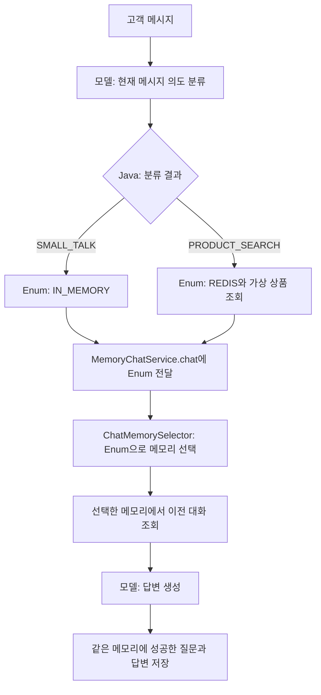

# 07-03. 의도에 따라 Runtime ChatMemory 선택하기

**목표:** 분류한 대화 의도를 저장소 Enum으로 바꾸고, `chat(storage, ...)`의 Enum 파라미터로 요청마다 메모리를 선택합니다.
선수 지식은 04장의 구조화 응답, 07장의 직접 메모리 조회·저장, 07-02의 Redis 연결입니다. 다른 실습 모듈을 import하지 않는 독립 앱입니다.

## 07-02와 무엇이 다른가?

| 예제 | 선택 시점 | 메모리 구성 |
|---|---|---|
| 07-02-Redis-Selection | YAML 설정으로 앱 시작 시 선택 | 선택한 저장소 하나만 사용 |
| 07-03-runtime-memory | 고객 메시지의 의도를 분류한 후 요청마다 선택 | InMemory와 Redis 메모리를 함께 준비 |

07-03은 시작할 때 Redis에도 연결합니다. 간단한 대화만 보내더라도 Redis Stack이 실행되어 있어야 합니다.

| 분류 결과 | 예시 고객 요청 | 전달할 Enum |
|---|---|---|
| `SMALL_TALK` | “안녕하세요.”, “오늘 기분이 좋아요.” | `MemoryStorage.IN_MEMORY` |
| `PRODUCT_SEARCH` | “3만원 안에서 음료 선물을 추천해 주세요.” | `MemoryStorage.REDIS` |

의도는 모델이 현재 메시지를 읽고 분류하고, 저장소 매핑은 Java의 고정 정책입니다. 고객이 메시지에 저장소 이름이나 도구 호출 방법을 적지 않습니다.
상품 추천은 작은 가상 상품 목록을 Java로 조회해 모델에 제공합니다. 실제 재고·배송비·벡터 검색을 구현한 예제는 아닙니다.

## 먼저 읽을 코드와 실행 흐름



1. [MemoryStorage](src/main/java/com/example/ailearning/l07runtime/MemoryStorage.java): 저장소 선택지 두 개
2. [ChatMemorySelector](src/main/java/com/example/ailearning/l07runtime/ChatMemorySelector.java): Enum으로 실제 메모리 선택
3. [MemoryChatService](src/main/java/com/example/ailearning/l07runtime/MemoryChatService.java): 선택한 한 메모리로 조회·저장
4. [ConversationService](src/main/java/com/example/ailearning/l07runtime/ConversationService.java): 의도 분류 → Enum 매핑 → 채팅 실행
5. [IntentClassifier](src/main/java/com/example/ailearning/l07runtime/IntentClassifier.java): 모델 응답을 분류 record로 변환
6. [MemoryConfiguration](src/main/java/com/example/ailearning/l07runtime/MemoryConfiguration.java): 두 메모리의 생성과 주입

### Enum을 파라미터로 전달하는 부분

다음은 `ConversationService.chat()`의 발췌입니다. 이 `switch`가 저장소 선택 정책입니다.

```java
ChatIntent intent = intentClassifier.classify(question);
MemoryStorage storage = switch (intent) {
    case SMALL_TALK -> MemoryStorage.IN_MEMORY;
    case PRODUCT_SEARCH -> MemoryStorage.REDIS;
};
List<Product> products = intent == ChatIntent.PRODUCT_SEARCH ? productCatalog.findAll() : List.of();
String answer = chatService.chat(storage, conversationId, question, products);
```

`ChatMemorySelector.select()`는 아래와 같습니다. `@Qualifier`는 같은 `ChatMemory` 타입인 두 빈의 이름을 구분해 생성자로 주입합니다. 생성자와 필드는 전체 소스에서 확인합니다.

```java
public ChatMemory select(MemoryStorage storage) {
    return switch (Objects.requireNonNull(storage, "저장소를 지정하세요.")) {
        case IN_MEMORY -> inMemoryChatMemory;
        case REDIS -> redisChatMemory;
    };
}
```

호출 예시는 `chatService.chat(MemoryStorage.REDIS, conversationId, question, products)`입니다.
`MemoryChatService`는 파라미터를 받아 **한 번 선택한 `selectedMemory`**로 이전 대화를 읽고 새 질문·답변을 저장합니다. 저장소를 매번 새로 만들지 않습니다.

## 실행

새 모듈을 IntelliJ에서 사용하려면 루트 Gradle 프로젝트를 다시 동기화합니다. 모든 명령은 저장소 루트 기준입니다.

기존 Docker Desktop을 실행하고 [runShell 실행·종료 안내](runShell/README.md)의 스크립트로 Redis Stack을 준비합니다. 기본 Redis 포트는 16380으로 07-02의 16379와 구분합니다. 일반 Redis만으로는 Spring AI의 RedisJSON·검색 인덱스 기능을 사용할 수 없습니다.

```bash
bash Spring-AI-Agent-Learning/labs/07-03-runtime-memory/runShell/start-redis.sh
```

루트 `.env`에 `OPENAI_API_KEY`, `OPENAI_MODEL`을 준비한 뒤 앱을 시작합니다.

```bash
CHAT_MEMORY_REDIS_URL=redis://127.0.0.1:16380 ./gradlew :Spring-AI-Agent-Learning:labs:07-03-runtime-memory:bootRun
```

[application.yml](src/main/resources/application.yml)에 메시지 창 6개, Redis URI·전용 인덱스·키 접두사·TTL 24시간을 설정했습니다. 운영에서는 인증·TLS URI와 스키마 생성 정책도 환경에 맞춥니다.

다른 터미널에서 같은 쿠키와 대화 ID로 다음 요청들을 순서대로 보냅니다.

```bash
curl -sS -c /tmp/learning07-runtime.cookies -b /tmp/learning07-runtime.cookies \
  http://127.0.0.1:8109/api/chat/demo \
  -H 'Content-Type: text/plain; charset=UTF-8' --data-raw '안녕하세요.'
curl -sS -c /tmp/learning07-runtime.cookies -b /tmp/learning07-runtime.cookies \
  http://127.0.0.1:8109/api/chat/demo \
  -H 'Content-Type: text/plain; charset=UTF-8' --data-raw '3만원 안에서 음료 선물을 추천해 주세요.'
curl -sS -c /tmp/learning07-runtime.cookies -b /tmp/learning07-runtime.cookies \
  http://127.0.0.1:8109/api/chat/demo \
  -H 'Content-Type: text/plain; charset=UTF-8' --data-raw '오늘 기분이 좋아요.'
curl -sS -c /tmp/learning07-runtime.cookies -b /tmp/learning07-runtime.cookies \
  http://127.0.0.1:8109/api/chat/demo \
  -H 'Content-Type: text/plain; charset=UTF-8' --data-raw '음료 선물 추천 예산을 4만원으로 바꿔 주세요.'
```

응답은 `intent`, `storage`, `answer`입니다. 분류 결과와 Java가 전달한 Enum을 학습용 응답에서 확인합니다.
예상 저장소는 `IN_MEMORY → REDIS → IN_MEMORY → REDIS`입니다. 실제 모델이 의도를 다르게 분류할 가능성은 남아 있습니다.
한 요청은 의도 분류와 답변 생성으로 모델을 두 번 호출하며 비용이 발생합니다. 분류 메시지는 대화 메모리에 저장하지 않습니다.
앱은 Ctrl+C로 종료합니다. 실습 후에는 아래 스크립트로 Redis만 중지합니다. 컨테이너와 데이터 볼륨은 다음 실습에서 재사용합니다.

```bash
bash Spring-AI-Agent-Learning/labs/07-03-runtime-memory/runShell/stop-redis.sh
```

## 모델 API 없이 검증

Redis Stack을 실행한 상태에서:

```bash
CHAT_MEMORY_REDIS_URL=redis://127.0.0.1:16380 ./gradlew :Spring-AI-Agent-Learning:labs:07-03-runtime-memory:test --tests '*IntentMemoryRedisLiveTest'
./gradlew :Spring-AI-Agent-Learning:labs:07-03-runtime-memory:bootJar
```

[IntentMemoryRedisLiveTest](src/test/java/com/example/ailearning/l07runtime/IntentMemoryRedisLiveTest.java)는 실제 Redis와 고정 응답 모델 서버를 사용합니다. OpenAI 키나 API 사용량은 필요하지 않습니다.
고정 접속·모델 설정은 `application-test.yml`, 실행 시 정해지는 모델 대역의 주소만 `@DynamicPropertySource`에 둡니다. 테스트는 운영의 메모리 설정을 다시 조립하지 않습니다.

- 네 번의 요청에서 Enum 선택·저장소 분리·각 저장소의 이전 대화 재전달을 검사합니다.
- 분류가 비면 답변 생성이나 저장을 진행하지 않습니다.
- 답변이 비면 해당 질문을 저장하지 않고 다른 저장소의 기존 대화도 유지합니다.

테스트는 실제 선택·저장·전송 데이터를 확인합니다. 모델의 의도 분류 정확도나 추천 품질을 검증한 것은 아닙니다. 실제 모델의 분류와 문장은 `bootRun` 후 별도로 확인합니다.

## 예제의 경계

같은 대화 ID라도 저장소가 다르면 문맥이 분리됩니다. 다시 상품 추천을 요청하면 Redis의 상품 대화가 이어지지만, 일반 대화에서 말한 이름·예산이 Redis로 자동 전달되지는 않습니다.
분류기는 현재 메시지만 읽습니다. “그걸로 해줘” 같은 모호한 후속 질문의 맥락 분류·확인 질문은 이 예제에 포함하지 않습니다.

서버 세션으로 소유자를 구분하며 로그인 인증을 대신하지 않습니다. TTL·Redis 영속화·세션 재시작 뒤 사용자 재연결과 다중 서버의 동시 업데이트는 별도 운영 설계가 필요합니다.
이 예제에서는 한 서버의 채팅 메서드를 직렬 처리합니다. 조회 후 저장하는 구조가 여러 서버의 갱신 충돌까지 해결하지는 않습니다.

## 확인 질문

1. `MemoryStorage.REDIS`를 전달하면 어떤 시점에 실제 Redis 메모리가 선택되나요?
2. InMemory에 저장한 인사 대화가 Redis의 상품 추천 문맥에 포함되나요?

<details>
<summary>해설</summary>

1. 요청 처리 중 `MemoryChatService.chat()`이 `ChatMemorySelector.select(storage)`를 호출할 때 선택합니다. 미리 생성한 두 빈 중 하나를 반환하고, 그 객체로 조회와 저장을 수행합니다.
2. 자동으로 포함되지 않습니다. 의도별 메모리는 별도 저장소이므로 조회하는 목록도 다릅니다. 공통 사용자 정보가 필요하면 별도 정책으로 관리해야 합니다.

</details>

[07장 목차](../../docs/lessons/07-chat-memory.md) · [07-02 시작 시 선택](../07-02-Redis-Selection/README.md)
