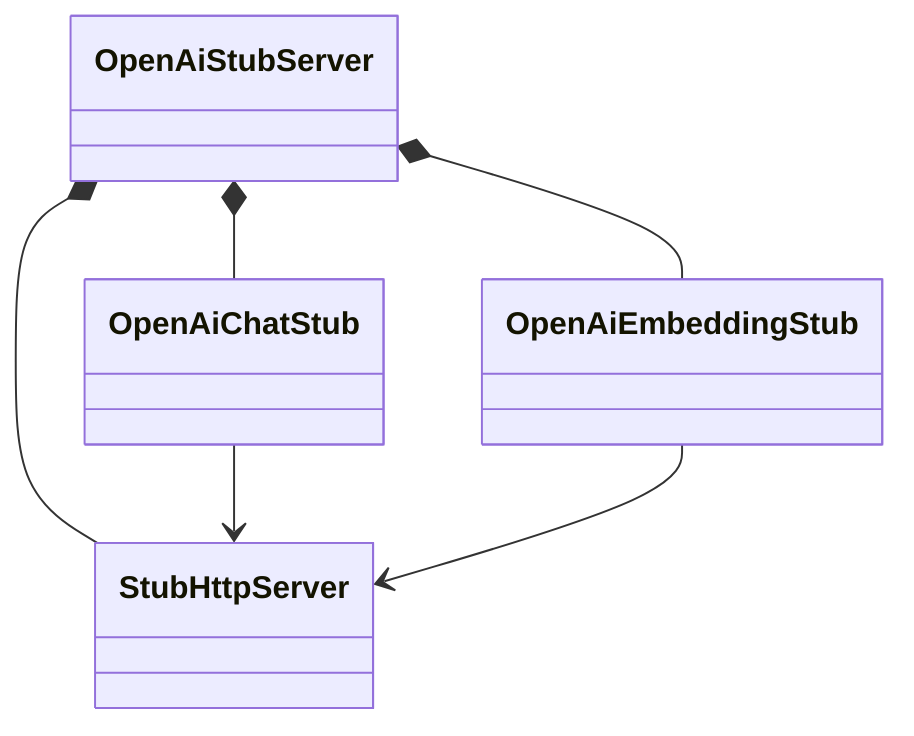

# 학습용 공통 테스트 도구

로컬 HTTP 모델 서버와 결과 출력을 제공합니다. 실제 모델을 호출하거나 답변 내용을 판단하지 않습니다.
각 실습은 `testImplementation project(':Spring-AI-Agent-Learning:test-support')`로만 참조합니다.
실행 JAR과 Live 테스트의 모델 연결에는 포함되지 않습니다.

## 04장에서 먼저 읽을 코드

[04장 로컬 테스트](../labs/04-structured-output/src/test/java/com/example/ailearning/l04structured/StructuredOutputLocalModelTest.java)의 `MODEL`은 테스트들이 공유하는 서버입니다.

```java
private static final OpenAiStubServer MODEL = new OpenAiStubServer();
```

각 테스트는 채팅 응답으로 돌려줄 문자열을 지정합니다. 아래는 테스트 본문의 발췌입니다.

```java
MODEL
        .chat()
        .setResponseText("{\"category\":\"음료\",\"maxPrice\":15000}");
```

`chat()`은 채팅용 대역을 반환하고, `setResponseText()`는 문자열을 assistant 메시지에 담습니다.
먼저 테스트의 입력·응답 지정·assertion을 읽고, 내부 동작이 궁금하면 [OpenAiChatStub](src/main/java/com/example/ailearning/testsupport/OpenAiChatStub.java)의 같은 메서드를 따라갑니다.
OpenAI 응답 본문의 필드 구조는 [OpenAiResponseBody](src/main/java/com/example/ailearning/testsupport/OpenAiResponseBody.java)의 JSON 예시로 확인합니다.

공유 서버에는 이전 테스트의 설정·요청 기록이 남습니다. 각 테스트 시작 전 `MODEL.chat().resetResponsesAndRequests()`로 채팅 상태를 비운 뒤 필요한 응답을 지정합니다.
이 초기화는 채팅 사용량 설정과 임베딩 설정·기록을 유지합니다.

## 기능별 역할



| 코드 | 책임 |
|---|---|
| `OpenAiStubServer` | 공유 HTTP 서버에 두 대역을 연결하고 주소 제공·종료 담당 |
| `OpenAiChatStub` | 채팅 응답·오류·지연·사용량 설정, 채팅 요청 기록 |
| `OpenAiEmbeddingStub` | 텍스트별 테스트 벡터 함수 적용, 임베딩 요청 기록 |
| `StubHttpServer` | HTTP 수신·기록·응답 전송 |
| `ChatResponseSettings` | 채팅 설정 변경·초기화·요청별 스냅샷 |
| `SequentialChatResponder` | 응답 순서·소진 시 실패 처리 |
| `OpenAiResponseBody` | OpenAI 응답 JSON 생성 |
| `AnthropicStubServer` | 다중 제공 업체 실습의 Anthropic 응답·기록 |
| `TestNamePrinter` | 테스트 시작 시 빈 줄과 이름을 한 번 출력 |
| `TestOutput` | 이름을 반복하지 않고 실제 결과 출력 |

채팅과 임베딩은 같은 서버 주소를 사용하지만 설정과 기록은 각 객체에서 관리합니다.
채팅 요청은 시작 시 설정을 스냅샷으로 읽어 응답 생성·지연 중 설정 변경의 영향을 받지 않습니다.
토큰 수는 `TokenUsage`의 `input`·`output`으로 구분합니다. 임베딩 usage는 프로토콜 확인용 고정 3토큰입니다.

## 후속 단원에서 사용하는 설정

단원별 응답 값·조건 분기·도구 순서·벡터 값은 각 테스트에 둡니다.
채팅 메시지 생성 함수는 `OpenAiChatStub`의 static 메서드입니다.

| 사용 코드 | 역할·연결 단원 |
|---|---|
| `MODEL.chat().setResponseText(...)` | 고정 문장·JSON 문자열 지정. 04장 |
| `MODEL.chat().setResponseMessage(...)` | assistant 메시지 직접 지정. 채팅 실습 |
| `MODEL.chat().setResponseSequence(...)` | 요청마다 다음 메시지 반환. 소진되면 실패. 05·08장 |
| `MODEL.chat().setResponseFunction(request -> ...)` | 요청에 따른 분기. 06·11·12·13장 |
| `MODEL.chat().setHttpStatus(...)`, `setResponseDelay(...)` | 오류·시간 초과 재현. 08·12·13장 |
| `MODEL.chat().setTokenUsage(input, output)` | 채팅 사용량 고정값 지정 |
| `MODEL.chat().getRequests()` | 채팅 요청·메시지·호출 횟수 확인 |
| `MODEL.embeddings().setVectorFunction(text -> ...)` | 테스트용 벡터 함수 지정. 09장 이후 관련 실습 |
| `MODEL.embeddings().getRequests()` | 문서 적재·질문 임베딩 요청 확인 |

임베딩 설정은 문서 초기 적재보다 먼저 필요하므로 해당 단원은 `createModelServer()`에서 지정합니다.
도구 호출 메시지는 모델이 도구를 판단한 결과를 흉내 낼 뿐 실제 도구 실행은 애플리케이션이 담당합니다.
각 채팅 메서드의 주석에는 용도와 사용 단원을 명시했습니다. 임베딩 클래스와 메서드도 같은 기준으로 설명합니다.

## 실행과 결과 출력

`getBaseUrl()`은 OpenAI에는 `/v1`을 포함하고 Anthropic에는 서버 주소만 반환합니다.
각 테스트 클래스는 공유 서버를 준비하고 `@AfterAll`에서 닫습니다. 인증 헤더는 검증용으로 조회할 수 있지만 출력하지 않습니다.
[TestNamePrinter](src/main/java/com/example/ailearning/testsupport/TestNamePrinter.java)의 `printTestName(TestInfo)` 한 곳에서 이름 선택과 제목 형식을 관리합니다. 각 클래스의 `@BeforeEach`에서 한 번 호출하며, JUnit이 전달한 `TestInfo`에서 메서드명을 읽습니다. `@DisplayName` 대신 실제 Java 메서드명을 출력합니다.

```java
@BeforeEach
void 테스트_이름_출력(TestInfo testInfo) {
    TestNamePrinter.printTestName(testInfo);
}
```

출력 형식은 다음과 같습니다. 제목 앞에는 빈 줄이 있습니다.

```text

===== [ 상품을_검색한다 ] ======
요청: GET /api/tools/direct
응답 HTTP 200: ...
```

[TestOutput](src/main/java/com/example/ailearning/testsupport/TestOutput.java)은 `new TestOutput()`으로 준비하고 이름 없이 결과만 출력합니다. 결과 출력에 테스트 이름·TestInfo를 전달하지 않습니다. 출력 검증에는 `new TestOutput(printStream)`으로 별도 스트림을 주입할 수 있으며 assertion을 대신하지 않습니다.

```bash
./gradlew :Spring-AI-Agent-Learning:test-support:test
```

외부 API 키 없이 텍스트·순차 응답·usage·임베딩·오류·초기화·설정 변경·서버 격리를 검증합니다.
