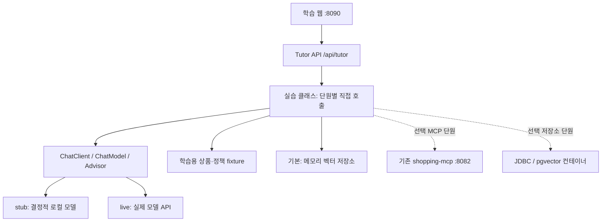

# 프로젝트 구성과 클라이언트 분리 결정

## 1. 현재 저장소에서 확인한 사실

| 현재 위치 | 실제 역할 | Tutor 설계에 주는 의미 |
|---|---|---|
| `chatbot-client/…/ChatProxy.java` | 동기 `/api/chat` 프록시, 쿠키 전달, scenario와 revision 요청 | SSE·caseId·실습 진단 계약은 새로 필요 |
| `chatbot-client/…/static/app.js` | 상품 카드, 활성 검색 조건, 탭 conversationId와 revision | 화면 표현 참고 가능, 학습 상태와는 분리 필요 |
| `shopping-agent/…/conversation/TaskStateStore.java` | 업무·조건 중심 단기 상태 | Spring AI ChatMemory 자체를 배우는 예제로 오해하지 않도록 비교 |
| `shopping-agent/…/ChatDtos.java` | 상품·배송·업무 결과 전용 DTO | Tutor의 프롬프트·검색 문서·실습 결과 DTO와 목적이 다름 |
| `shopping-mcp` | 불변 상품, 장바구니, 배송 견적, 혜택을 Streamable HTTP로 노출 | MCP 통합 실습에서 재사용하기 적합 |
| `integration-tests` | 세 서비스의 Mock/로컬 OpenAI Stub 통합 테스트 | Stub 원리는 참고하되 Tutor 전용 fixture와 테스트 태스크를 소유 |

위 `…` 경로는 해당 모듈의 `src/main/java/com/example/shopping` 아래를 뜻한다. 현재 소스 위치는 [저장소 구성 문서](../../docs/ARCHITECTURE.md), [기존 테스트](../../docs/TESTING.md)와 함께 확인한다.

## 2. 선택지 비교와 권고

| 선택지 | 장점 | 비용/한계 | 판단 |
|---|---|---|---|
| 기존 chatbot-client에 Tutor 모드 추가 | 화면과 실행 서비스 수 절약 | 업무 API에 학습 필드 혼입, SSE 프록시 확장, 회귀 범위 증가 | 초기 학습 프로젝트에는 비권장 |
| 동일 저장소의 독립 Tutor + 내장 웹 | 단독 실행·수업별 격리·한 모듈에서 추적 용이 | 단순 채팅 UI 일부 중복 | **권장** |
| 별도 저장소 + 별도 프런트엔드 | 완전한 릴리스 독립성 | 빌드·환경·fixture 중복, 초급자 진입 비용 | 외부 공개 배포 시 재검토 |

공유 후보는 원화 표시, 안전한 DOM 생성, 상품 카드 CSS 같은 작은 단위다. 초기에는 필요한 표현만 참고하고 프런트 공통 패키지나 범용 SDK를 먼저 만들지 않는다. 기존 프록시·DTO·조건 reducer를 Tutor에 의존시키지 않는다.

## 3. 실행 구조



8090은 제안 포트다. 테스트는 임의 포트로 실행하고, 사용 중인 8080~8082 서비스의 생명주기에 관여하지 않는다. 기본 과정은 기존 agent/client/MCP나 외부 DB 없이 실행되어야 한다.

## 4. 구현 시 생성할 디렉터리

```text
Spring-AI-Tutor/
  docs/                         # 현재 생성한 설계 문서
  build.gradle                  # 이후 구현, 루트 BOM 상속
  src/main/java/com/example/shopping/tutor/
    TutorApplication.java
    config/                     # stub/live, memory, vector store
    lesson/
      l00setup/ ... l14multimodal/
        XxxCases.java           # 기능별 메소드, Spring AI 호출을 여기서 읽음
    fixture/                    # ProductFixture, PolicyFixture, DemoCustomer
    tool/                       # 학습용 조회·견적·샌드박스 변경 도구
    web/                        # TutorController, LessonCatalog, 진단 DTO
    support/                    # 최소 공통 검증·오류·관측
  src/main/resources/
    application.yml
    application-stub.yml
    application-live.yml
    prompts/l01/ ...
    fixtures/products.json
    knowledge/policies/         # 실제 몰 정책과 구분한 가상 문서
    static/tutor/              # index.html, app.js, style.css
  src/test/java/com/example/shopping/tutor/
    lesson/l00setup/ ... l14multimodal/
    support/ScriptedChatModel.java
    support/FixedEmbeddingModel.java
    web/
  src/test/resources/
    model-responses/
    evaluation/shopping-questions.json
    documents/
```

패키지를 단원별로 탐색하면 관련 코드와 테스트를 찾을 수 있게 한다. 각 `XxxCases`는 공유 helper 뒤에 Spring AI 호출을 숨기지 않는다. 운영형 전략·레지스트리 추상화는 통합 단원 이전에 강요하지 않는다.

## 5. 클래스와 메소드 작성 규약

- `L03-01`처럼 고유 caseId를 부여하고, 문서의 메소드명을 코드·웹 목록·테스트 표시명과 연결한다.
- 단원 안에서 의존성과 목표가 같으면 하나의 `Cases` 클래스에 별도 메소드를 둔다. 도구 구현이나 별도 인프라가 필요하면 별도 클래스로 분리한다.
- 각 메소드 위에 학습 목표, 입력 예시, Spring AI 호출 지점, 실패 시 확인 항목을 한국어로 설명한다.
- 테스트 클래스는 `XxxCasesTest`, 테스트 메소드는 해당 case 메소드에 대응한다. 정상·실패 조건을 각각 테스트한다.
- 웹의 caseId는 허용 목록으로 메소드에 연결한다. 요청으로 임의 클래스나 메소드 이름을 실행하지 않는다.
- 수업별 ChatClient 설정을 격리한다. 초급 실습에 메모리·RAG·도구가 몰래 기본 등록되지 않도록 한다.
- 1회 실습 데이터는 불변 fixture를 기본으로 사용하고, 변경 실습만 세션별 샌드박스 상태를 소유한다.

## 6. 실행 모드와 의존성 계획

| 모드/선택 기능 | 필요한 것 | 학습자에게 표시할 의미 |
|---|---|---|
| `stub` 기본 | ScriptedChatModel, FixedEmbeddingModel, 메모리 저장소 | 호출 구조 체험, 실제 언어 이해·의미 검색 품질 아님 |
| `live` | 서버 환경변수의 모델 자격증명, 기능별 모델 설정 | 실제 생성·비용 발생, 실행 전에 화면에 모드 표시 |
| `mcp` 선택 | Tutor MCP client + 기존 shopping-mcp | live/stub 모델 중 하나와 조합, discovery와 호출 검증 |
| `jdbc` 선택 | 학습용 H2 + JDBC memory repository | 저장소 영속성 실습, 모델 모드와 독립 |
| `pgvector` 선택 | 격리된 PostgreSQL/pgvector | 저장소 교체·메타데이터 필터 실습 |
| 멀티모달 선택 | 지원 provider·모델과 로컬 입력 파일 | 텍스트 과정과 분리, 기능 미지원 시 명시적으로 건너뜀 |

초기 의존성 후보: Web MVC, Validation, Actuator, Spring AI ChatClient/모델 starter, JUnit 5, AssertJ, Mockito, 스트림 검증용 reactor-test. Web MVC에서도 SSE 응답을 제공하되 실제 선택 버전의 `Flux` 통합 지원을 확인한다. MVC와 WebFlux 서버 starter를 동시에 넣어 학습을 복잡하게 만들지 않는다.

후속 단원에서 memory/JDBC, vector store, RAG advisor, 문서 reader, MCP client 의존성을 필요에 맞게 추가한다. 정확한 artifact 좌표와 자동 구성 조건은 구현 단계에서 BOM 2.0.2로 검증한다. 모델 자동 구성은 stub에서 자격증명·외부 연결을 요구하지 않도록 비활성화한다. MCP 자동 연결과 컨테이너 시작 역시 선택 기능에서만 활성화한다.

기존 루트 `subprojects`는 모든 모듈에 Boot 플러그인·BOM을 적용한다. 향후 `include 'Spring-AI-Tutor'`를 추가하면 이 설정을 상속하므로 중복 BOM이나 별도 wrapper를 만들지 않는다. 기존 통합 테스트의 서비스 목록에는 Tutor를 자동 추가하지 않는다.

## 7. 데이터와 사실의 소유권

상품 가격·재고·배송비·쿠폰 조건은 fixture 또는 도구가 반환한 사실을 기준으로 한다. 모델은 설명과 검색 조건 제안에 사용하며 금액 계산·권한 검증·상태 변경 승인은 Java가 담당한다. 상품 응답 DTO는 ID로 검증한 저장소 값을 사용한다.

기존 MCP 데모의 standard 장바구니는 42,000원, 무료배송 기준 50,000원, 부족액 8,000원이다. 학습 fixture는 이 값을 명시적으로 맞추되 프로덕션 정책으로 설명하지 않는다. 반품 규정·상품 설명·주문 상태는 Tutor에서 새로 만드는 **가상 학습 데이터**다. 기존 MCP가 주문 조회나 반품 도구를 제공한다고 가정하지 않는다.
