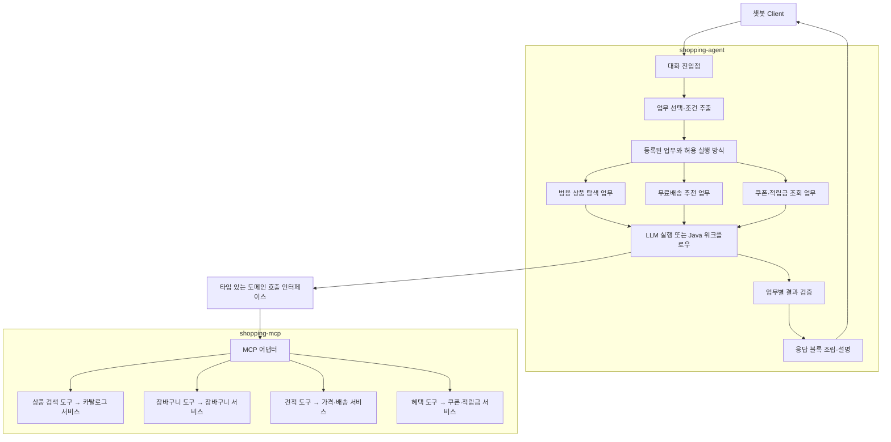

# 상품 검색 범용화와 에이전트·MCP 확장 구조 검토

> 후속 구현: [SOLID 적용과 구현 범위](2026-10-28-solid-and-implementation.md)를 참고하세요. 이 문서는 변경 전 코드를 기준으로 한 설계 검토 기록입니다.

- 작성일: 2026-10-28
- 상태: 설계 제안. 구현 코드·설정·기존 테스트 변경 없음.
- 검토 범위: 현재 PoC 코드, Spring 공식 설계 자료, MCP 도구 명세, 공개 쇼핑 구현 및 Shopify 공식 문서.
- 문서의 클래스·도구·상태 이름은 제안이며 현재 구현되어 있는 API가 아니다.

## 1. 제안하는 방향

`searchProducts`를 범용 상품 검색으로 바꾸려는 방향에 동의한다. 현재 도구는 이름과 달리 무료배송 추천을 위한 검색만 수행하므로, 일반 검색에 재사용하기 어렵다.

다만 **검색 함수에서 조건을 빼고 모든 조합을 하나의 에이전트 프롬프트로 옮기는 변경은 권하지 않는다.** 무료배송이라는 업무를 독립적인 실행 단위로 분리하고, 그 안에서 범용 상품 검색과 실제 배송 견적을 조합하는 것이 좋다.

권장 책임 분리는 다음과 같다.

| 계층 | 책임 | 무료배송 추천에서의 예 |
|---|---|---|
| 대화 에이전트 | 의도·조건 이해, 적합한 업무 선택, 사용자 질문과 설명 | 일반 검색인가 무료배송을 채우려는 요청인가 판단 |
| 업무 실행 계층 | 업무별 지침·제약·상태·검증, 에이전트/워크플로우 실행 방식 선택 | 부족 금액에 맞는 검색 조건 생성, 후보 검증 |
| 도메인 서비스 | 채널과 무관한 실제 가격·재고·배송 규칙과 권한 검증 | 같은 배송그룹인지, 실제 배송비가 0원인지 계산 |
| MCP 도구 | 도메인 기능의 명시적인 외부 계약과 호출 어댑터 | 상품 검색, 장바구니 조회, 배송 견적 |
| 화면 응답 조립 | 검증된 결과를 업무에 맞는 UI 데이터로 변환 | 일반 상품 카드와 무료배송 추천 카드 구분 |

**업무 실행 계층은 처음부터 별도 서버로 만들 필요가 없다.** 현재 `shopping-agent` 안의 Java 패키지/서비스로 시작한다. 기존 세 개의 실행 프로젝트를 유지하면서 내부 책임을 나누는 변경을 추천한다.

기능이 늘어도 코드와 규칙 자체는 늘어난다. 목표는 전체 복잡도가 전혀 늘지 않는 것이 아니라, 새 업무를 추가할 때 기존 에이전트·MCP 공통 코드를 계속 수정하지 않게 만드는 것이다.

## 2. 기존 자료와 사례에서 확인한 점

### 2.1 MCP 명세: 도구의 발견·호출 계약을 제공한다

MCP 도구 명세는 도구 이름, 설명, 입력/출력 스키마, 호출과 결과의 형식을 정의한다. 도구가 모델에 의해 선택될 수 있지만, 특정 사용자 인터페이스나 업무 오케스트레이션 위치를 강제하지는 않는다.

따라서 “업무이므로 MCP에 둘 수 없다” 또는 “MCP이므로 순수 CRUD만 있어야 한다”는 규칙은 없다. 범용 도메인 작업과 여러 작업을 합친 업무 도구 모두 가능하며, **재사용 범위와 규칙 소유권을 기준으로 선택**해야 한다.

근거: [MCP 도구 명세](https://modelcontextprotocol.io/specification/2025-06-18/server/tools).

### 2.2 Spring 공식 자료: 에이전트와 워크플로우는 함께 활용할 수 있다

Spring 공식 자료는 LLM이 다음 행동을 정하는 에이전트와 코드가 경로를 정하는 워크플로우를 구분하고, 작업이 명확할 때 워크플로우의 예측 가능성을 설명한다. 라우팅과 순차 실행도 공개 예제로 제공한다.

이 프로젝트에는 **업무를 선택하는 대화 계층과 업무를 실행하는 계층을 구분하고, 실행 방식만 교체하는 설계**로 적용하는 것이 적합하다는 판단이다. 모든 업무를 에이전트로 처리하거나 모든 업무를 고정 워크플로우로 만들 필요는 없다.

근거: [Spring 공식 Building Effective Agents](https://spring.io/blog/2025/01/21/spring-ai-agentic-patterns/), [공식 레퍼런스와 예제 연결](https://docs.spring.io/spring-ai/reference/api/effective-agents.html).

### 2.3 공개 Spring AI 쇼핑 예제: 도메인 도구와 중앙 에이전트를 구분한다

`spring-ai-shopping-agent`는 상품과 주문 도메인을 MCP 서버로 제공하고 중앙 Spring AI 에이전트가 도구를 조합하는 공개 구현이다. 도메인 기능을 분리하는 참고 사례다.

단, 메모리 데이터 기반 데모이며, 업무가 지속적으로 늘어날 때의 유지보수성이나 무료배송 추천의 상용 품질을 증명하는 사례는 아니다. 여기서 제안하는 업무 레지스트리·실패 전환 구조가 해당 프로젝트에 그대로 구현되어 있다는 의미도 아니다.

근거: [공개 저장소](https://github.com/dominikcebula/spring-ai-shopping-agent).

### 2.4 Shopify 공식 인터페이스: 상품 탐색과 장바구니 작업이 별도 기능이다

Shopify 공식 문서는 Catalog의 상품 탐색 도구와 Cart의 장바구니 기능을 구분한다. 상품 탐색이 특정 장바구니의 무료배송 여부를 전제로 하는 구조가 아니다. Cart 쪽에서는 유효한 라인 아이템과 예상 합계 등 장바구니의 결과를 다룬다.

이는 **카탈로그 검색은 범용 기능으로 유지하고, 장바구니·가격 판단은 해당 도메인 기능에 맡기는 경계**를 지지하는 참고 자료다. Spring AI 구현 사례나 이 프로젝트에 대한 직접적인 성능 검증은 아니다.

확인 시점의 Shopify 문서는 기존 Storefront MCP에서 UCP 기반 인터페이스로의 이전도 안내한다. 과거 도구 이름을 그대로 따라 하기보다 책임 분리 원칙만 참고하는 것이 좋다. 이 PoC에 UCP를 도입하자는 제안은 아니다.

근거: [Catalog](https://shopify.dev/docs/agents/catalog), [Cart MCP](https://shopify.dev/docs/agents/carts-and-checkout/cart-mcp), [기존 Storefront MCP 이전 안내](https://shopify.dev/docs/apps/build/storefront-mcp).

## 3. 경계를 어디에 둘 것인가

| 대안 | 장점 | 확장 시 비용 | 판단 |
|---|---|---|---|
| MCP에 무료배송 업무를 모두 구현 | 다른 MCP 클라이언트도 같은 결과 사용, 실행 일관성 | 업무마다 조합 도구가 늘고 에이전트의 추천 전략과 도메인 규칙이 섞일 수 있음 | 여러 채널이 같은 업무를 재사용할 때 선택 |
| 범용 MCP + 하나의 대형 에이전트 프롬프트 | 초기 변경이 작고 LLM이 유연하게 조합 | 업무별 프롬프트 충돌, 불필요한 도구 노출, 실패 원인과 상태 추적 어려움 | 현재 실험용으로 가능하지만 장기 구조로 비추천 |
| 범용 MCP + 업무별 실행 계층 | 도메인 재사용, 업무별 검증, 실행 방식 교체 가능 | 초기 인터페이스·업무 패키지 분리가 필요 | 현재 프로젝트에 권장 |
| 업무마다 별도 에이전트 서버/MCP 서버 | 조직·배포·보안 경계 독립 | 운영과 네트워크 복잡도 증가, 중복 규칙 발생 가능 | 팀/배포/보안 필요가 생겼을 때 검토 |

중요한 구분은 **배포 위치와 논리적 책임이 서로 다르다**는 점이다. 업무 실행 서비스가 나중에 MCP 도구로 노출되어도, 상품 검색 어댑터 내부에 무료배송 분기를 넣지 않고 별도 업무 서비스에 위임하면 책임 분리를 유지할 수 있다.

외부 클라이언트가 `recommendFreeShipping` 같은 완성된 업무를 필요로 하게 되면, 그때 업무 서비스의 얇은 MCP 어댑터를 추가할 수 있다. 에이전트 서버와 MCP 서버에 동일한 추천 로직을 각각 복제해서는 안 된다.

## 4. 현재 코드에서 함께 분리해야 하는 부분

| 현재 위치 | 결합된 내용 | 변경 방향 |
|---|---|---|
| `ShoppingTools.searchProducts` | scenario 장바구니 조회, 부족 금액, 중복 제외, 배송그룹, 기본 예산 | 입력으로 받은 일반 검색 조건만 적용 |
| `ShoppingTools.calculateShippingGap` | 배송 부족 금액과 추천용 +7,000원 정책 혼합 | 배송 계산과 추천 검색창 정책 분리 |
| `ShoppingTools.quoteAdditionalProduct` | 실제 배송비 계산과 추천 적격 여부/예산 혼합 | 도메인 견적과 업무 적격성 검증 구분 |
| `AgentService` 시스템 프롬프트 | 모든 문의에 무료배송 절차 노출 | 공통 지침과 업무별 지침 분리 |
| `AgentService.mock` | 대부분 질문을 무료배송 흐름으로 실행 | 선택한 업무의 Mock 실행으로 분리 |
| `ToolSession.invoke` | 도구 이름 비교로 최근 검색 예산 저장·덮어쓰기 | 공통 추적과 업무 상태 분리 |
| `ToolSession.cards` | 무료배송 견적 성공 상품만 카드 허용 | 업무별 결과 검증/카드 조립으로 이동 |
| `ChatDtos.Card` | 모든 상품에 추가 후 합계/배송비 요구 | 일반 상품 카드와 배송 견적 결과 구분 |

지금 `searchProducts`만 범용화하면 “텀블러 보여줘”라는 요청도 최종적으로 무료배송 검증이 없어서 카드를 만들지 못할 수 있다. 이 응답 경로까지 함께 설계해야 한다.

또한 현재 `ToolSession`은 최근 검색의 예산 하나만 기억한다. 한 요청에 여러 검색이 있으면 앞선 후보가 나중 검색의 상한으로 검증되거나, 이전에 검증된 후보가 새 제약에도 재사용될 가능성이 있다. 업무별 검색 조건과 결과의 연결을 명시해야 한다.

## 5. 제안 구조: 세 실행 프로젝트 유지, 내부 업무 경계 추가



위의 업무 실행 계층/레지스트리는 일반 Java 설계 제안이다. Spring AI에 이 이름의 완성된 기능이 기본 제공된다는 뜻은 아니다. 초기에는 Spring 빈 목록과 작은 인터페이스로 충분하다.

LLM 실행과 Java 워크플로우 모두 같은 도메인 호출 인터페이스와 실제 MCP 기능을 사용한다. 워크플로우에 별도의 Mock 데이터나 다른 가격 계산을 넣지 않는다.

## 6. 범용 상품 검색의 계약

예를 들어 다음처럼 검색 조건을 표현할 수 있다. 실제 스키마는 구현 시 확정한다.

```json
{
  "keyword": "텀블러",
  "minPrice": 0,
  "maxPrice": 30000,
  "category": null,
  "excludeProductIds": [],
  "shippingGroupIds": [],
  "inStockOnly": true,
  "sort": "PRICE_ASC",
  "limit": 10,
  "cursor": null
}
```

설계 원칙:

- 장바구니 ID나 `scenario`를 필수 입력으로 요구하지 않는다. 장바구니를 조회하지 않고도 검색할 수 있어야 한다.
- 가격 조건 생략은 그 방향의 가격 제한 없음이다. 일반 검색에 +7,000원 규칙을 암묵 적용하지 않는다.
- 기본 페이지 크기, 최대 limit, 입력 검증, 권한·공개 상품 필터는 검색 서비스가 책임진다.
- 장바구니 상품 제외는 업무가 조회한 ID를 `excludeProductIds`로 전달해서 구현한다. 일반 검색에서 장바구니 상품을 자동 제외하지 않는다.
- 배송그룹 필터는 카탈로그가 지원하는 일반 속성 필터다. 최종 무료배송 보장은 가격·배송 견적으로 확인한다.
- 단순한 설명 검색과 정확한 카테고리 필터를 구분한다. 사용자의 긴 문장을 그대로 문자열 일치 검색에 넣지 않는다.
- 알 수 없는 조건이나 하한 > 상한을 명확히 처리하고, 예산 부족 같은 업무상 불일치는 구조화 결과로 설명한다.
- 원화 단위와 가격 기준(표시가/할인 적용가)을 명시한다. 후보 검색 가격과 최종 인정 금액이 다르면 견적이 기준이다.

현재 Mock의 `scenario`는 도구 자체의 계약보다 Mock 데이터 선택 컨텍스트에 두는 편이 낫다. 실제 환경에서는 인증된 사용자·테넌트 정보를 서버 컨텍스트에서 가져오고, LLM이 생성한 사용자 ID만으로 접근을 허용하지 않는다.

## 7. 무료배송 추천 업무가 가져야 할 책임

### 7.1 의도 선택

“장바구니 확인해서 무료배송을 채울 상품을 추천해줘”는 무료배송 추천 업무로 보낸다.
“3만원 이하 텀블러 찾아줘”는 일반 상품 탐색 업무로 보낸다.

단순히 ‘무료배송’ 단어 포함 여부로 분기하지 않는다.

| 요청 | 선택할 처리 |
|---|---|
| 무료배송 조건이 뭐야? | 정책 조회 |
| 무료배송을 채울 상품 추천해줘 | 장바구니 기반 무료배송 추천 |
| 무료배송 여부와 상관없이 텀블러 검색해줘 | 일반 상품 검색 |
| 무료배송 상품만 보여줘 | 자체 무료배송 상품 검색인지 장바구니 합산인지 구분/필요 시 확인 |
| 쿠폰 확인하고 무료배송 추천도 해줘 | 두 업무를 분리하고 의존성 확인 |

모호한 요청은 후보 업무와 필요한 추가 질문을 반환한다. 모델이 반환하는 confidence 숫자 하나를 신뢰해 강제 실행하지 않는다. 업무 ID는 등록된 목록으로 제한한다.

### 7.2 업무별 타입 있는 조건

예시: `FreeShippingRequest(additionalBudgetMax, categoryPreference, cartRef)`.

`additionalBudgetMax`는 **추가 상품 가격의 상한**이다. 전체 주문 예산이나 무료배송 부족 금액과 구분한다. “전체 6만원 이내”는 장바구니 금액을 조회한 뒤 추가 구매 예산으로 변환해야 한다. 해석이 모호하면 사용자에게 확인한다.

명시적인 사용자 조건과 기본값을 구분해 저장한다.

```json
{
  "additionalBudgetMax": 30000,
  "budgetSource": "USER",
  "categoryPreference": null
}
```

예산이 없으면 `budgetSource=DEFAULT`로 두고, 장바구니 조회 이후 추천 정책에서 기본값을 계산한다. 없는 값과 0원을 같은 의미로 취급하지 않는다. 사용자 상한과 검색 정렬/선호 같은 조건도 구분한다.

### 7.3 검색 조건 생성과 결과 검증

무료배송 추천 업무 내부에서 다음을 수행한다.

1. 장바구니와 현재 배송 조건을 조회한다.
2. 가격·배송 서비스의 기준금액과 계산 결과로 부족 금액을 구한다.
3. 이미 무료배송이면 종료한다. 빈 장바구니는 별도 안내한다.
4. 검색 하한은 부족 금액으로 설정한다.
5. 사용자 예산이 있으면 그 금액을 상한으로 쓴다. 없을 때만 `부족 금액 + 7,000원`을 쓴다.
6. 장바구니 상품 ID, 배송그룹, 재고, 선호 조건으로 범용 상품 검색을 호출한다.
7. 후보를 추가한 가상 장바구니의 도메인 견적을 요청한다.
8. 명시 예산 충족, 중복 제외, 재고, 배송비 0원을 업무 검증기로 확인한다.
9. 검증된 상품 ID와 사실 데이터만 응답 조립기로 전달한다.

+7,000원은 쇼핑몰의 무료배송 자격 규정이 아니라 **추천의 기본 탐색 범위 정책**이다. 따라서 일반 상품 검색이나 배송비 계산 자체보다 `FreeShippingSearchPolicy` 같은 업무 정책에 둔다. 실제 무료배송 기준 50,000원과는 소유권을 나눈다.

현재 예시 정책:

| 부족 금액 | 사용자 추가 예산 상한 | 검색 범위 |
|---:|---:|---|
| 8,000원 | 없음 | 8,000~15,000원 |
| 8,000원 | 30,000원 | 8,000~30,000원 |
| 8,000원 | 10,000원 | 8,000~10,000원 |
| 8,000원 | 7,000원 | 단일 상품으로 충족 불가 안내 |

상한은 양 끝 포함이다. 후보가 없다는 이유로 사용자가 지정한 예산을 자동으로 올리지는 않는다.

여러 판매자·지역·쿠폰 적용이 생기면 부족 금액의 단순 뺄셈만으로 판단하지 않고, 도메인 견적 서비스가 합산 단위와 실제 배송비를 계산한다. 업무 계층에 할인·배송 규칙을 다시 구현하지 않는다.

## 8. 업무 실행 단위를 확장 지점으로 삼기

업무별로 입력, 사용 가능한 도구, 정책, 실행 방식, 검증기를 묶는다. 문서에서는 이를 ‘업무 모듈’이라고 부른다.

```text
업무 정의
  id / 설명 / 입력 스키마
  허용 도구 목록
  업무별 지침과 정책
  실행 방식: AGENT 또는 WORKFLOW
  선택적 fallback 정책
  결과 검증기 / 응답 변환기
```

예시 업무 ID: `catalog.search`, `cart.freeShippingRecommendation`, `benefits.summary`, 향후 `orders.track`.

대화 계층은 업무 ID와 구조화 조건을 선택한다. 각 업무는 계약이 맞는 결과를 반환한다. 중앙 `AgentService`에 업무별 if/else와 긴 프롬프트를 계속 추가하지 않는다.

업무 정의와 실행 방식은 서버의 허용 목록/등록 정보로 관리한다. LLM이 임의 클래스 이름, 외부 MCP 주소, 실행기를 생성해 선택하게 하지 않는다. 초기에는 별도 설정 언어나 플러그인 엔진을 만들지 않고 Spring 빈으로 등록한다.

### 도구가 늘어날 때

- 업무 카탈로그를 보고 관련 업무를 선택한 다음, 해당 업무의 도구만 LLM에 제공한다.
- 필요하면 카탈로그→주문→혜택처럼 도메인을 먼저 좁힌다. 처음부터 모든 도구 정의를 매 요청마다 보내지 않는다.
- 서로 다른 기능을 담은 `execute(action, payload)` 만능 도구는 피한다. 이름과 스키마가 의미 있는 도구를 유지한다.
- 도메인별 패키지와 작은 도구 클래스로 나눈다. 배포 서버를 도구 수에 비례해 늘릴 필요는 없다.
- 여러 업무가 필요한 요청은 작은 작업 목록과 의존성을 만든다. 관련 없는 조회는 병렬 실행할 수 있지만 결과에 의존하는 추천·변경은 순서를 지킨다.

## 9. 에이전트가 어려워하는 업무를 워크플로우로 보완하는 방식

처음에는 상품 탐색을 에이전트로, 무료배송 계산·검색·견적은 Java 워크플로우로 수행하는 구성을 추천한다. 자연어 해석과 추천 이유 작성에는 LLM을 계속 사용할 수 있다.

무료배송 업무도 도구를 자율 조합하는 실험을 유지하고 싶다면 **동일한 업무 입력/결과 계약을 가진 실행기 두 개**를 둔다. 운영 모드는 업무 등록 정보로 정하고, 예외적인 실패에만 제한적으로 fallback한다.

| 실행 결과 | 처리 |
|---|---|
| SUCCESS | 검증 후 응답 |
| NO_RESULTS | 정상적인 업무 결과. 조건 불충족 설명 |
| NEEDS_INPUT | 부족한 정보 질문 |
| PLAN_INVALID / RESULT_INVALID | 해당 업무에 등록된 워크플로우로 제한적 전환 |
| TOOL_TIMEOUT | 제한적 재시도/연결 오류 안내. 같은 장애를 워크플로우가 해결한다고 가정하지 않음 |
| UNAUTHORIZED | 권한 오류로 종료. 우회 실행 금지 |
| UNSUPPORTED | 지원 범위 안내 또는 다른 등록 업무 선택 |

“못 찾았습니다”라는 LLM 문장만 보고 fallback하지 않는다. 필수 조회 누락, 입력 제약 위반, 검증 실패, 호출/시간 한도 같은 프로그램이 확인 가능한 조건을 사용한다.

워크플로우는 검증된 사용자 조건에서 시작한다. 에이전트가 잘못 만든 `minPrice=maxPrice=8000` 같은 인자를 그대로 넘기면 같은 실패를 반복한다. 기본값 계산과 업무 검증기는 두 실행 방식이 공유한다.

실패 전환은 요청당 횟수·시간·토큰 예산을 제한하고 에이전트↔워크플로우 무한 재시도를 막는다. 조회 전용 작업부터 적용한다. 주문·쿠폰 사용·결제 같은 변경 기능이 생기면 단계별 완료 상태와 멱등성 키를 기록하고, 이미 실행된 변경을 처음부터 재실행하지 않는다.

## 10. 공통 런타임과 업무 상태의 분리

공통 런타임은 도구 조회/호출, 타임아웃, 추적, 호출 한도, 오류 정규화를 맡는다. 특정 도구 이름을 비교해 예산을 덮어쓰거나 상품 카드를 쌓는 코드는 업무 모듈로 이동한다.

업무 상태에는 요청 ID, 업무 ID, 조건 버전, 장바구니 버전, 검색 조건, 후보 ID 집합, 검증 결과를 둔다. 검색마다 `candidateSetId`와 제약 스냅샷을 연결하면 여러 검색 결과가 섞이는 문제를 줄일 수 있다. 이 ID는 서버가 관리하며 사용자 인증을 대신하지 않는다.

무료배송 검증기는 해당 후보가 어느 조건에서 검색·견적되었는지 확인한다. 예산을 30,000원에서 10,000원으로 바꾸면 이전 29,000원 상품의 검증 결과를 그대로 재사용하지 않는다.

가격·재고·정책에 유효시점/버전이 있으면 결과와 함께 기록하고, 구매 직전에는 다시 견적한다. LLM 설명과 장기 대화 메모리를 현재 장바구니의 원본 데이터로 사용하지 않는다.

## 11. 응답은 검증된 업무 결과에서 조립

일반 상품 검색에 무료배송 성공 조건을 강요하지 않도록 응답을 구분한다.

- 일반 상품 검색: 상품 ID, 이름, 현재 가격, 이미지/링크 등 `ProductList`.
- 무료배송 추천: `ProductList`와 후보별 추가 후 합계·배송비 등 `ShippingRecommendation`.
- 혜택 조회: 쿠폰·적립금 등 `BenefitsSummary`.
- 주문 조회: 주문 상태 등 `OrderStatus`.

공통 응답에는 메시지, 타입이 있는 결과 블록, 업무 실행 결과, 필요한 사용자 입력을 둔다. 모든 업무의 데이터를 하나의 필드가 많은 nullable DTO로 합치지는 않는다. 화면은 타입별 컴포넌트를 추가한다.

가격과 상품 속성은 서버가 도메인 결과에서 채운다. LLM이 만든 ID/가격을 그대로 렌더링하지 않는다. LLM은 허용된 사실을 설명하고 추천 이유를 작성한다. 중요한 합계/배송비 문장은 템플릿으로 생성하면 문장과 카드 사이의 수치 불일치를 줄일 수 있다.

## 12. 구현한다면 권장하는 패키지 수준의 출발점

```text
shopping-agent
  conversation/        대화 진입, 업무 선택, 조건 추출
  capabilities/
    catalog/           일반 탐색 지침·실행·결과 검증
    freeShipping/      추천 정책·실행기·검증·업무 상태
    benefits/          혜택 조회
  execution/           공통 도구 실행, 추적, 한도, 오류
  ports/               CatalogPort, CartPort, PricingPort 등
  adapters/mcp/        MCP 호출과 도메인 DTO 매핑
  response/            타입별 응답 조립

shopping-mcp
  tools/               CatalogTools, CartTools, PricingTools, BenefitsTools
  catalog/             상품 도메인 서비스
  cart/                장바구니 서비스
  pricing/             가격·배송 계산 서비스
  benefits/            쿠폰·적립금 서비스
  mock/                Mock 데이터와 fixture 선택
```

처음부터 모든 이름대로 클래스를 만드는 것은 필요 없다. 실제로 두 업무가 달라지는 부분부터 분리한다. 포트도 외부 시스템/도메인 경계별로 만들고 메서드마다 인터페이스를 만들지는 않는다. 신규 프레임워크·외부 워크플로우 엔진·멀티에이전트 도입은 현재 요구에 필수적이지 않다.

## 13. 단계적으로 변경할 때의 순서와 완료 기준

1. **업무 계약과 회귀 기준부터 확정**: 일반 검색, 무료배송 추천, 정책 조회, 혜택 조회를 구분하고 예산 규칙을 문서화한다.
2. **도메인과 추천 정책 분리**: 가격·배송 계산을 단일 서비스에 두고 +7,000원 탐색창을 무료배송 업무 정책으로 이동한다.
3. **범용 검색 추가와 응답 경로 분리**: 기존 전용 도구를 바로 덮어쓰지 않고 새 계약/버전으로 옮긴다. 일반 검색에서 기존 장바구니 상품·고가 상품을 정상 표시할 수 있어야 한다.
4. **무료배송 업무를 독립**: 같은 범용 검색을 명시적 필터로 호출하고 기존 추천 기능과 예산 동작을 보존한다.
5. **공통 ToolSession에서 업무 상태 제거**: 업무별 검증·후보 상태를 분리하고 타입 있는 결과를 조립한다.
6. **업무 라우팅과 실행 방식 선택 도입**: 처음에는 소수 업무를 등록한다. 검증이 어려운 무료배송 흐름에만 워크플로우를 적용한다.
7. **신규 업무로 구조 검증**: 주문 조회 하나를 추가할 때 기존 무료배송 정책이나 범용 검색의 코드를 수정할 필요가 없어야 한다.

계약을 바꿀 때 기존 프롬프트·MCP 스키마·Mock 모드·Stub 테스트·화면 DTO를 함께 점검한다. 새로운 설명만 배포하고 구버전 도구 계약을 유지하는 부분 변경을 피한다.

검증에 포함할 대표 사례:

| 사례 | 완료 기준 |
|---|---|
| 3만원 이하 텀블러 일반 검색 | 장바구니 조회 없이 P009 표시 |
| 기본 장바구니에 이미 있는 상품 일반 검색 | 요청하지 않은 중복 제외가 적용되지 않음 |
| 무료배송 추천, 예산 없음 | 8,000~15,000원, 중복/품절/다른 배송그룹 제외 |
| 무료배송 추천, 예산 30,000원 | 8,000~30,000원, P009도 적격 후보 |
| 무료배송 추천, 예산 7,000원 | 결과 없음 안내, 자동 예산 확대 없음 |
| 무료배송 조건만 질문 | 정책 조회만 수행하고 추천하지 않음 |
| “무료배송 상관없이” 상품 검색 | 무료배송 추천 업무로 오분류하지 않음 |
| 여러 검색/예산 변경 | 검색별 제약·후보·견적 연결 보존 |
| 도구 선택 오류 | 구조화 실패 판정 후 허용된 워크플로우 1회 전환 |
| 권한 오류/도메인 장애 | 우회하거나 빈 결과로 위장하지 않음 |
| 신규 주문 조회 업무 | 기존 상품 검색/무료배송 핵심 코드 변경 없이 등록 가능 |

금액·도메인 검증은 단위/계약 테스트로, 라우팅·조건 추출·설명 품질은 실제 모델 평가로 따로 확인한다. Stub 테스트는 실행 연결을 검증하며 실제 LLM의 판단 품질을 증명하지 않는다.

## 14. 최종 의견

현재 프로젝트에는 **범용 MCP 도구 + 도메인 서비스 + 에이전트 내부의 업무별 실행 계층**이 가장 균형 잡힌 출발점이다.

일반 상품 검색은 도메인 기능으로 만들고, 무료배송 추천은 그 기능을 조합하는 하나의 업무로 관리한다. 업무마다 에이전트 실행과 워크플로우 실행을 같은 계약 아래 선택할 수 있게 하면, 어려운 케이스를 보완하기 위해 전체 MCP나 중앙 프롬프트를 다시 설계할 필요가 줄어든다.

추후 같은 추천 업무를 여러 외부 에이전트가 재사용해야 할 때만, 해당 업무 서비스 자체를 별도 MCP 도구로 노출하는 방향으로 확장하는 것을 권한다. 그때도 도메인 규칙과 추천 로직의 단일 구현을 유지한다.
