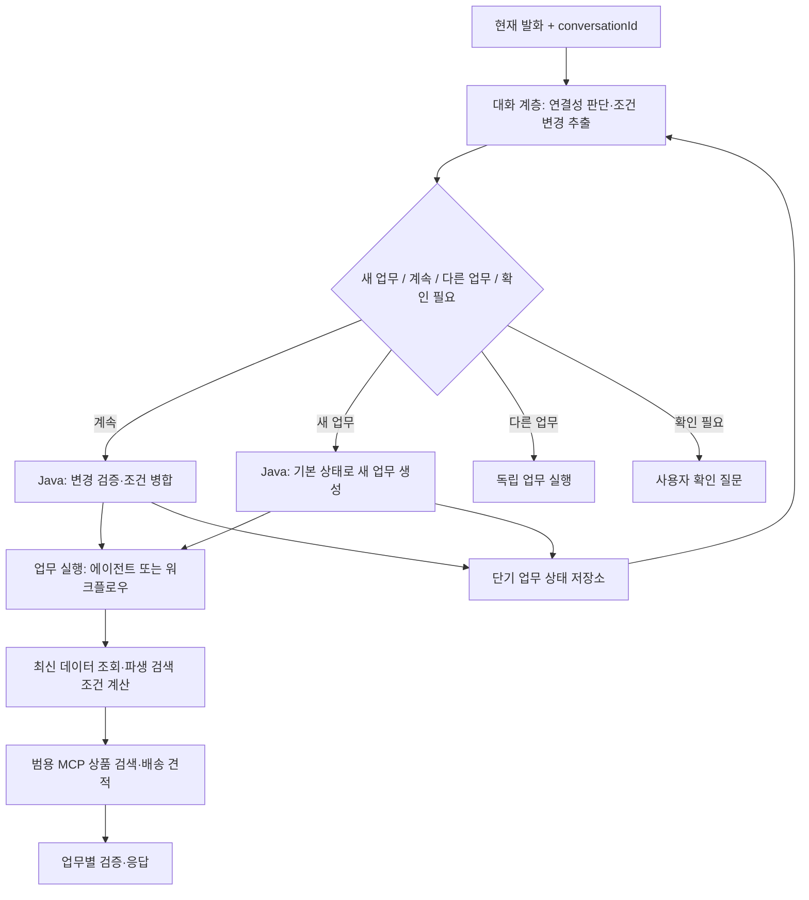

# 후속 검색 조건을 위한 단기 업무 상태 설계

> 후속 구현: [SOLID 적용과 구현 범위](2026-10-28-solid-and-implementation.md)를 참고하세요. 이 문서는 변경 전 코드를 기준으로 한 설계 검토 기록입니다.

- 작성일: 2026-10-28
- 상태: 설계 검토. 구현 코드 변경 없음.
- 연계 문서: [에이전트·MCP 책임 분리 검토](2026-10-28-agent-mcp-responsibility-review.md)

## 1. 의견

전체 대화를 매번 전달하는 대신, 현재 진행 중인 업무와 사용자 조건을 구조화하여 단기 보관하는 방향을 추천한다.

다만 직전 MCP 호출의 검색 인자만 저장하는 것으로는 부족하다. `minPrice=8000, maxPrice=15000`만으로는 그 상한이 사용자가 지정한 값인지, 무료배송 차액에서 계산한 기본값인지 구분할 수 없다. 현재 업무가 일반 검색인지 무료배송 추천인지도 사라진다.

따라서 다음 두 데이터를 구분한다.

- **보존할 업무 상태:** 업무 ID, 사용자 조건, 조건의 출처, 처리 중인 확인 질문.
- **실행할 때 재생성할 조건:** 최신 장바구니에서 계산한 차액, 기본 검색 상한, 제외 상품, 배송그룹, 견적 결과.

이것은 전체 대화 요약보다 **구조화된 단기 업무 상태(Task State)**에 가깝다. 대화 원문을 저장할 필요는 없고, 사용자가 무엇을 원했는지를 보존한다.

현재 프로젝트는 요청 DTO에 conversationId가 없고 매번 새 ToolSession을 만든다. 따라서 현재 구현만으로는 후속 발화를 이어 처리할 수 없다. 아래는 향후 변경 제안이다.

## 2. 질문 예시의 처리

첫 질문:

> 장바구니의 무료배송을 채울 상품을 추천해줘.

상태의 핵심:

```json
{
  "taskId": "task-1",
  "capabilityId": "cart.freeShippingRecommendation",
  "revision": 1,
  "constraints": {
    "categoryIds": [],
    "additionalBudgetMax": null,
    "budgetSource": "DEFAULT"
  }
}
```

장바구니가 42,000원이고 무료배송 기준이 50,000원이면 실행 시 검색 범위를 8,000~15,000원으로 계산한다.

두 번째 질문:

> 음료 카테고리에서만 추천해줘.

새 발화에서 전체 조건을 다시 만들지 않고, 다음 변경만 추출한다.

```json
{
  "relation": "CONTINUE",
  "targetTaskId": "task-1",
  "updates": {
    "categoryIds": { "operation": "SET", "value": ["beverages"] }
  }
}
```

서버는 무료배송 업무와 기존 예산 조건을 유지하고 카테고리만 교체한다. 최신 장바구니를 다시 확인한 뒤 범용 상품 검색에 다음 조건을 전달한다.

```json
{
  "minPrice": 8000,
  "maxPrice": 15000,
  "categoryIds": ["beverages"],
  "excludeProductIds": ["P001", "P002"],
  "shippingGroupIds": ["MALL"],
  "inStockOnly": true
}
```

검색된 상품은 다시 배송 견적을 검증한다. 두 번째 발화에 무료배송이라는 단어가 없더라도 이어지는 업무가 무료배송 추천이므로 해당 조건을 유지한다.

실제 첫 문장이 “무료배송 상품을 추천해줘”라면 자체 무료배송 상품 검색과 장바구니 합산 추천 사이에 모호함이 있다. 활성 업무나 화면 맥락으로 의미가 정해지지 않으면 먼저 확인한다.

## 3. 새 검색과 후속 검색의 구분

LLM에는 현재 발화와 간결한 활성 업무 상태를 제공하고, 다음 중 하나를 제안하게 한다. 업무 선택·필드 허용 여부·상태 갱신은 서버가 검증한다.

| 구분 | 예 | 처리 |
|---|---|---|
| CONTINUE | 음료에서만 / 예산은 3만원까지 / 가격순으로 | 같은 업무의 명시된 조건만 변경 |
| NEW_TASK | 이전 조건 빼고 새로 텀블러 찾아줘 | 새 taskId 생성, 이전 제약 상속 안 함 |
| OTHER_TASK | 적립금 얼마야? | 별도 조회, 진행 중 검색 상태는 덮어쓰지 않음 |
| NEEDS_CLARIFICATION | 그것 말고 다른 걸로 | 무엇을 바꿀지 확인 후 갱신 |

“새로 검색해줘”는 이전 조건 초기화인지 같은 조건으로 결과 새로고침인지 모호할 수 있다. 명확한 ‘조건 초기화’ UI를 함께 제공하는 것이 좋다.

새 검색이 되면 이전 상태를 새 조건 생성에 사용하지 않는다. 이전 업무의 짧은 메타데이터를 연결성 판단에 쓰는 것과, 그 업무의 예산/배송 조건을 실행에 상속하는 것은 구분한다.

“텀블러 추천해줘”처럼 자체적으로 완전해 보이는 요청도 상황에 따라 기존 추천의 선호 변경일 수 있다. 단어 포함 여부만으로 초기화하지 않는다. 모호할 때는 “무료배송 조건을 유지해서 찾을까요, 새로 검색할까요?”처럼 확인한다.

“앞서 찾던 무료배송 추천으로 돌아가서”까지 지원하려면 업무별 상태를 별도로 보관해야 한다. 초기에는 활성 상품 검색 업무 하나와 독립적인 단순 조회만 지원해도 충분하다. 여러 활성 업무가 있으면 targetTaskId 선택 규칙이 추가로 필요하다.

## 4. 조건 병합은 LLM 대신 Java에서 수행

LLM이 매 턴 전체 상태를 다시 작성하게 하면 말하지 않은 조건이 사라지거나 기본값으로 덮일 수 있다. LLM은 변경 제안만 만들고 서버가 다음 규칙으로 병합한다.

| 변경 | 의미 |
|---|---|
| 필드 없음 / KEEP | 기존 조건 유지 |
| SET | 해당 필드의 값 교체 |
| ADD / REMOVE | 카테고리·제외 항목 등 집합에 추가/삭제 |
| CLEAR | 사용자 지정 조건 제거, 업무 기본 정책으로 복귀 |

예:

- “식품 말고 음료만”: 카테고리 SET. 식품과 음료를 AND로 합치지 않는다.
- “음료도 포함”: 카테고리 ADD. 지원하는 카테고리 결합 의미를 명시한다.
- “예산은 3만원”: additionalBudgetMax SET(30000), budgetSource=USER.
- “예산 제한은 취소”: 사용자 예산 CLEAR. 무료배송 업무의 기본 상한 ‘현재 차액 + 7,000원’으로 복귀.
- “기본 제한도 없이 가격 상관없어”: 단순 CLEAR와 다르다. 가격 상한 없음 정책을 허용할지 별도 정의한다. 현재 기본 정책을 무조건 없애는 의미로 해석하지 않는다.
- “카테고리 제한 없애줘”: 카테고리만 CLEAR, 무료배송 목적과 예산은 유지.
- “무료배송 조건은 빼고 찾아줘”: 일반 검색 업무로 전환. 이전 검색의 어떤 사용자 조건을 유지할지 명시적 전환 규칙을 적용하고, 배송 전용 제약은 제거한다.

“무료배송 유지”, “품절 제외”, “장바구니 상품 제외” 같은 업무 불변 조건은 단순 카테고리 변경으로 해제되지 않는다. 일반 검색으로 전환하면 일반 검색의 계약을 사용한다.

카테고리 이름은 식별자로 정규화한다. 존재하지 않는 카테고리는 확인하고 상태에 바로 기록하지 않는다. 예산 0과 값 미지정도 구분한다.

## 5. 사용자 제약과 계산된 조건을 나누어야 하는 이유

| 데이터 | 상태 보존 여부 | 재사용 기준 |
|---|---|---|
| 무료배송 추천이라는 업무 목적 | 보존 | 업무 계속 시 유지 |
| 사용자가 정한 예산 30,000원 | 보존 | 명시 변경/해제 전까지 유지 |
| 카테고리·브랜드·선호 | 보존 | 필드별 병합 |
| 부족 금액 8,000원 | 원본 제약으로 보존하지 않음 | 최신 장바구니·정책에서 재계산 |
| 기본 상한 15,000원 | 계산 스냅샷으로만 보관 가능 | 최신 차액 + 7,000원 재계산 |
| 장바구니 상품 제외 ID | 재조회 | 장바구니 변경 반영 |
| 재고·가격·배송 견적 | 참고용 결과로만 보관 | 검색/추천 때 유효성 재확인 |

예를 들어 장바구니가 바뀌어 차액이 5,000원이 되면, 기본 상한은 12,000원으로 바뀌어야 한다. 이전에 사용자가 30,000원을 명시했다면 상한은 그대로 30,000원이다. 단순히 마지막 maxPrice를 저장하면 이 둘을 구분하지 못한다.

사용자가 예산을 7,000원으로 낮춰 차액 8,000원을 못 채우는 경우는 정상적인 NO_RESULTS다. 기존 조건을 몰래 완화하거나 이전 성공 결과를 다시 추천하면 안 된다. 유효한 사용자 조건은 결과가 없어도 보관한다.

## 6. 전체 기록 없이 지원할 수 있는 범위

조건 변경과 업무 연속성만 필요하다면 구조화 상태로 충분히 시작할 수 있다. 다만 다음 발화는 검색 조건만으로 처리할 수 없다.

- “그중 두 번째 상품”: 직전 결과 ID와 순서가 필요하다.
- “아까 추천한 상품 빼줘”: 최소한의 결과 참조가 필요하다.
- “왜 그걸 추천했어?”: 추천 근거/견적 참조가 필요하다.

이 기능까지 원한다면 전체 대화 대신 lastResultId, 표시 상품 ID 순서, 근거 참조를 짧게 저장한다. 오래된 결과를 참조한 구매 동작에서는 최신 가격·재고를 다시 확인한다. 초기 범위를 조건 수정으로 제한한다면 이런 발화에는 추가 확인을 요청할 수 있다.

분석·감사용 대화 이력 보관은 별도 결정이다. 업무 실행의 메모리에 원문 전체가 필요하다는 의미는 아니다.

## 7. 기존 설계와 연결할 위치



- **대화 계층:** 이어지는 발화인지, 어떤 필드를 바꾸는지 판단.
- **업무 계층:** 타입 있는 제약을 병합하고 업무 불변 조건을 유지.
- **공통 상태 저장소:** 업무별 타입과 버전 있는 상태를 단기 보관.
- **MCP:** 완성된 명시적 검색 조건을 받아 실행. 대화 세션·후속 발화 판별을 상품 도구 내부에 넣지 않는다.

에이전트 실행과 워크플로우 실행은 같은 Task State를 입력으로 받아야 한다. 실패 전환 때 전체 과거 대화를 다시 해석할 필요 없이 검증된 제약에서 시작한다.

## 8. Spring AI 메모리와 구현 방향

Spring AI의 ChatMemory는 메시지 기반의 맥락 보관을 위한 추상화다. 이 제안은 메시지보다 업무별 구조화 상태가 중심이므로 `TaskStateStore` 같은 애플리케이션 저장소를 별도로 두는 편을 추천한다. 전체 메시지를 저장하는 Advisor를 추가하는 것만으로 조건 병합과 초기화 규칙이 해결되는 것은 아니다.

모델 호출에는 현재 발화, 활성 업무 요약, 검증된 사용자 제약, 허용된 변경 스키마만 전달한다. 같은 요청 내부에서 실행되는 도구 호출/결과는 Spring AI의 도구 루프에 필요하지만, 과거 요청의 모든 도구 메시지를 장기 보존할 필요는 없다.

공식 문서도 Chat Memory와 전체 Chat History를 구분하고, conversationId별 격리를 설명한다. 이 문서의 TaskStateStore와 병합 프로토콜은 프로젝트용 설계 제안이며 Spring AI 기본 제공 API가 아니다. 온라인 문서는 현재 2.x이고 프로젝트는 1.1.2이므로 구현 시 API를 맞춰야 한다.

근거: [Spring AI Chat Memory 공식 문서](https://docs.spring.io/spring-ai/reference/api/chat-memory.html).

## 9. 저장·동시성·실패 처리

- 상태 키는 인증된 사용자/테넌트 + conversationId + taskId로 격리한다. 클라이언트가 보낸 임의 ID만으로 다른 사용자의 상태를 읽지 않는다.
- PoC는 프로세스 내 저장소와 비활성 TTL(예: 30분, 정책으로 조정)로 시작할 수 있다. 다중 서버 배포에서는 공유 저장소가 필요하다.
- 상태에는 revision과 schemaVersion을 둔다. 동시 발화가 같은 버전을 수정하면 충돌을 검출해 다시 병합하거나 순차 처리한다.
- clientMessageId로 중복 전송을 식별한다. 같은 ADD 변경을 두 번 적용하지 않는다.
- 유효한 사용자 제약은 결과가 없어도 보관한다. 실행 실패와 검색 결과 없음은 구분한다.
- 확인이 필요한 제약은 pending에 두고 기존 확정 조건을 덮어쓰지 않는다.
- 검색/견적 결과는 상태 revision에 연결한다. 예산 변경 전의 늦게 도착한 응답이 새 결과를 덮지 않게 한다.
- 새 검색은 새 taskId에서 시작하고, 만료된 상태에 “음료만” 같은 후속 발화가 오면 맥락이 만료됐다고 안내한다.
- 원문과 조건 변경 이력을 끝없이 쌓지 않는다. 상태와 짧은 결과 참조에는 수명과 정리 정책을 적용한다.

## 10. 도입 순서와 확인 기준

1. 현재 요청 DTO/Client에 대화 식별과 명시적 새 검색 동작을 추가하는 설계 확정.
2. 무료배송 업무의 사용자 제약 타입과 SET/CLEAR/KEEP 병합 규칙 정의.
3. 기존 지침에서 예산 추출을 구조화 변경 제안으로 분리.
4. 최신 장바구니에서 파생 검색 조건을 재생성하는 공통 실행 경로 정리.
5. 업무 상태 저장소와 TTL/revision 처리 도입.
6. 일반 검색/혜택 조회와 상태 전환 검증 후 다른 업무에 확장.

필수 평가 사례:

| 대화 | 기대 결과 |
|---|---|
| 무료배송 추천 → 음료만 | 무료배송 목적/예산 유지, 카테고리만 설정 |
| 무료배송 추천 → 예산 3만원 → 음료만 | 상한 30,000원 유지 |
| 무료배송 추천 → 예산 해제 | 최신 차액 + 7,000원으로 복귀 |
| 무료배송 추천 → 카테고리 변경 | 이전 카테고리 교체 |
| 무료배송 추천 → 조건 초기화 후 텀블러 | 무료배송 제약 상속 없음 |
| 무료배송 추천 → 적립금 조회 → 음료만 | 조회가 검색 상태를 덮어쓰지 않음 |
| 장바구니 변경 → 음료만 | 사용자 조건 유지, 차액/제외 상품/견적 재계산 |
| 예산이 차액보다 작음 | 결과 없음 설명, 예산 유지 |
| 상태 만료 → 음료만 | 확인 요청, 임의 업무 생성 안 함 |
| 다른 사용자/다른 대화 | 상태 혼합 없음 |
| 조건 변경 중 이전 응답 도착 | 이전 revision 결과로 최신 상태를 덮지 않음 |

이 설계라면 원문 전체를 기억하지 않고도 조건을 이어갈 수 있고, 동일한 사용자 제약을 에이전트와 워크플로우가 공유할 수 있다. 핵심은 ‘대화를 요약해 저장’하는 것이 아니라 ‘업무 의도와 제약을 버전 있는 구조로 관리’하는 것이다.
