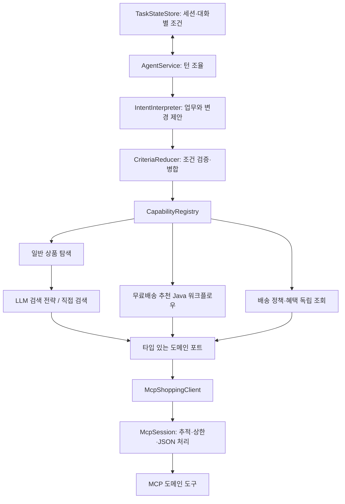

# 단순한 확장을 위한 SOLID 검토와 구현 결정

## 전제

SOLID나 패턴을 적용한 개수보다 **업무를 추가할 때 기존 코드를 얼마나 이해하고 수정해야 하는가**를 기준으로 삼았다.
기존 세 실행 프로젝트를 유지하고, 실제 역할이 달라진 부분만 패키지/객체로 분리했다.
앞선 두 검토 문서의 큰 방향을 구현하되, 외부 워크플로우 엔진·범용 플러그인 언어·멀티에이전트는 도입하지 않았다.

## SOLID를 적용한 지점

| 원칙 | 실제 적용 | 피한 과잉 설계 |
|---|---|---|
| SRP: 변경 이유 분리 | 조건 해석, 조건 병합, 상태 보관, 업무 실행, MCP 전송, 도메인 계산을 분리 | 업무 하나의 각 줄을 별도 클래스로 분리하지 않음 |
| OCP: 확장 지점 | `Capability` 빈을 등록하면 레지스트리가 업무 ID/설명을 수집하고 공통 진입점에서 실행 | 업무별 if/else를 중앙 `AgentService`에 누적하지 않음 |
| LSP: 교체 시 계약 유지 | 일반 탐색의 LLM/직접 검색 전략이 같은 검증된 검색 조건과 Product 결과 계약 사용 | 검색 결과 없음과 계획 오류/연결 오류를 같은 의미로 취급하지 않음 |
| ISP: 필요한 역할만 의존 | Catalog, CartPricing, Benefits 포트를 분리 | 모든 업무가 거대한 쇼핑 API 인터페이스에 의존하지 않음 |
| DIP: 외부 구현 분리 | 업무는 도메인 포트를 사용하고 MCP 어댑터가 외부 호출 구현 | 도메인 코드에 Spring AI ToolCallback/JSON 파싱을 넣지 않음 |

OCP는 기존 코드 수정을 절대로 금지한다는 의미가 아니다. 신규 도메인에 새 입력 타입이나 새 UI 결과가 필요하면 해당 계약을 명시적으로 확장해야 한다.
현재 `Criteria`는 상품 검색의 키워드·카테고리·추가 예산에 한정한다. 모든 미래 업무를 여기에 억지로 넣지 않는다.
Mock 해석기는 명시한 문장 예시만 처리하므로 새로운 표현/업무에는 별도 규칙이 필요하다.

## 적용한 패턴

- **Strategy:** `IntentInterpreter`의 GPT/Mock 구현, `CatalogSearchStrategy`의 LLM/직접 검색 구현.
- **Registry:** 등록한 `Capability`를 ID로 찾는다. 클래스 이름이나 실행 코드를 LLM에 생성시키지 않는다.
- **Adapter:** `McpShoppingClient`가 타입 있는 포트 호출을 MCP JSON 계약에 연결한다.
- **Repository 역할:** `TaskStateStore`가 TTL·용량·버전·세션 격리된 단기 상태를 보관한다. 아직 교체 구현이 없으므로 별도의 Store 인터페이스는 만들지 않았다.
- **명시적 상태 변환:** `CriteriaReducer`의 순수 SET/CLEAR/KEEP 병합. 이를 위해 Command 객체 계층이나 상태 머신 프레임워크를 추가하지 않았다.

상속 중심의 Template Method, 범용 Abstract Factory, 동적 워크플로우 DSL, 모든 결과의 무타입 Map 상태는 채택하지 않았다.
`Map`은 화면의 보조 조회 결과/디버깅 정보에만 사용하며, 보관할 사용자 제약과 도메인 포트 결과는 record로 표현한다.

## 이번에 구현한 실행 구조

### 일반 상품 검색

- MCP `CatalogTools.searchProducts(query)`는 장바구니/무료배송/기본 예산을 알지 않는다.
- 가격 범위, 카테고리, 제외 상품, 배송그룹은 명시적 필터다. 상한 생략은 제한 없음이다.
- GPT 모드의 기본 실행은 범용 상품 검색 도구 하나만 모델에 노출한다. 확정한 조건은 서버가 도구에 바인딩한다.
- 모델이 도구를 호출하지 않거나 존재하지 않는 상품 ID/잘못된 JSON을 반환한 경우 직접 검색 워크플로우로 한 번 전환한다.
- 인증/네트워크/MCP 장애를 계획 오류로 간주해 재실행하지 않는다.
- `shopping.catalog-execution=workflow`로 일반 검색도 처음부터 직접 실행할 수 있다.

### 무료배송 추천

- LLM은 의도와 명시 예산·카테고리를 해석한다. 조회·계산·검색·견적 순서는 Java 업무에서 고정한다.
- 실제 배송 기준은 MCP PricingTools, 추천의 기본 +7,000원 정책은 FreeShippingPolicy에 둔다.
- 기본 8,000~15,000원, 명시 예산 30,000원이면 8,000~30,000원을 검색한다.
- 매 실행마다 최신 장바구니·정책·기본 견적을 조회해 파생 검색 조건을 재생성한다.
- 후보별 배송 견적을 확인하고 예산·재고·배송그룹·중복 여부를 검증한다.
- 전체 업무의 자율 실행 후 fallback을 구현하기보다, 오류가 이미 관측된 금액/견적 경로는 처음부터 워크플로우로 선택했다.

### 단기 조건 메모리

- 원문 대화 이력을 저장하지 않는다. 활성 상품 검색 업무와 사용자 키워드·카테고리·명시 예산만 저장한다.
- 카테고리/예산 후속 발화는 해당 필드만 변경한다. CLEAR는 업무 기본값으로 복귀한다.
- 독립적인 혜택/정책 조회가 진행 중 검색을 덮어쓰지 않는다.
- 새 검색은 이전 조건을 상속하지 않는다. 화면 버튼은 새 conversationId를 만든다.
- 브라우저 세션 쿠키 + 탭별 conversationId로 분리하고, 기본 비활성 30분/최대 1,000대화로 제한한다.
- 대화별 동시 턴을 직렬화하고 expectedRevision 충돌을 409로 반환한다.
- 유효한 NO_RESULTS 조건도 보관한다. 인프라 실패 시 해당 턴은 커밋하지 않는다.

## 핵심 파일 읽는 순서

1. `shopping-agent/.../AgentService.java`: 전체 한 턴 흐름.
2. `conversation/ConversationModels.java`, `CriteriaReducer.java`: 사용자 조건과 병합 규칙.
3. `capabilities/FreeShippingCapability.java`, `FreeShippingPolicy.java`: 무료배송 업무.
4. `capabilities/CatalogCapability.java`, `CatalogSearchStrategy.java`: 일반 검색과 제한적 fallback.
5. `ports/ShoppingContracts.java`, `adapters/McpShoppingClient.java`: 도메인 호출 계약.
6. `execution/McpSession.java`: 업무와 무관한 MCP 실행.
7. `shopping-mcp/.../CatalogTools.java`, `PricingTools.java`: 실제 검색·견적.

## 확장 시 규칙

- 새 독립 조회 업무는 Capability와 설명·필요 포트를 추가한다. 중앙 dispatcher에 업무 분기를 넣지 않는다.
- 검색 조건이 늘면 타입/병합 규칙/도구 스키마/평가 사례를 함께 확장한다. 문자열 Map으로 우회하지 않는다.
- 여러 도메인에서 실제 사용하는 정책만 공통 객체로 추출한다. 이름이 비슷하다는 이유만으로 업무를 상속으로 묶지 않는다.
- 클래스가 늘어나는 것보다 한 업무를 읽을 때 여러 파일을 오가야 하는 비용도 고려한다. 짧은 검증은 해당 업무 메서드 안에 둔다.
- 변경 기능·복합 작업·장기 실행이 생기면 멱등성/단계 기록/공유 상태 저장소를 그 요구에 맞춰 추가한다.

## 이번 구현 범위 밖

이전 결과의 “두 번째 상품” 지칭, 여러 동시 활성 검색, 여러 업무의 자동 계획 실행, 주문/결제 변경,
공유 저장소/다중 서버 세션, 명시적 확인 질문의 pending 응답 병합, 메시지 ID 기반 중복 제거는 구현하지 않았다.
모호한 요청은 확인 질문을 하며, 사용자가 목적/조건을 명시해서 다시 요청한다.
프로덕션 로그인·권한 체계는 여전히 별도 구현이 필요하며, 현재 쿠키는 익명 데모 대화 격리용이다.
