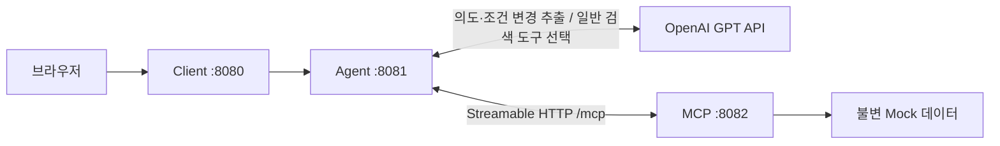

# 현재 서비스 구성과 처리 흐름

## 실행 서비스



Client는 브라우저와 같은 출처의 프록시이며, Agent 세션 쿠키를 전달합니다.
API 키는 브라우저에 보내지 않습니다. 프록시는 응답 상태와 Set-Cookie만 필요한 범위에서 전달하고
Transfer-Encoding 같은 hop-by-hop 헤더를 그대로 복사하지 않습니다.
모든 서비스의 기본 바인딩은 localhost입니다. 로그인·실제 구매는 구현하지 않습니다.

## Agent 한 턴의 흐름

1. 브라우저 세션과 conversationId로 단기 상태를 조회합니다.
2. GPT 또는 제한적인 Mock 해석기가 `NEW / REFINE / INDEPENDENT / CLARIFY`와 조건 변경을 제안합니다.
3. Java `CriteriaReducer`가 `SET / CLEAR / KEEP`를 검증하고 병합합니다.
4. 레지스트리에서 허용된 업무를 선택합니다. 레지스트리는 업무 빈의 ID·설명을 수집합니다.
5. 업무가 타입 있는 포트로 MCP를 호출하고, 검증된 결과를 조립합니다.
6. 성공/NO_RESULTS 조건을 저장하고 revision을 증가시킵니다. 인프라 실패는 이전 상태를 보존합니다.

무료배송 추천은 계산 오류를 줄이기 위해 고정 Java 워크플로우로 수행합니다.
일반 상품 탐색은 GPT 모드에서 검색 도구 하나만 노출하는 LLM 전략을 기본으로 사용합니다.
도구 미호출/잘못된 상품 ID/잘못된 최종 JSON 같은 계획 오류만 한 번의 직접 검색으로 보완합니다.
MCP 장애나 네트워크 오류는 같은 작업의 무조건 재실행으로 숨기지 않습니다.
`shopping.catalog-execution=workflow`로 일반 검색도 직접 실행하도록 선택할 수 있습니다.

## 경계

| 위치 | 책임 |
|---|---|
| conversation | 의도 해석, 조건 병합, TTL/용량/버전이 있는 단기 상태 |
| capabilities | 업무별 정책·실행·검증·결과 조립 |
| ports | Catalog / CartPricing / Benefits 도메인 계약 |
| adapters | 포트 호출과 MCP 도구 JSON의 매핑 |
| execution/McpSession | 도구 조회·호출·JSON 정규화·24회 상한·추적 |
| shopping-mcp | 카탈로그, 장바구니, 실제 배송 정책/견적, 혜택 |

`McpSession`에는 ‘마지막 검색 예산’, 무료배송 카드 상태, 도구 이름별 인자 덮어쓰기가 없습니다.
각 업무가 현재 제약을 명시적으로 생성하고 검증합니다.

## 무료배송 업무

장바구니 조회 → 배송 정책 조회 → 현재 견적 → 차액/검색 범위 생성 → 범용 검색 → 후보별 가상 견적.

- 기본 범위: 부족 금액 ~ 부족 금액 + 7,000원(포함).
- 사용자 예산이 있으면 높거나 낮더라도 그 예산을 상한으로 사용.
- 장바구니 상품 제외·같은 배송그룹·재고 필터는 업무에서 범용 검색에 명시적으로 전달.
- 카드마다 하나의 상품을 1개 추가하는 독립적인 대안이며 실제 장바구니는 바뀌지 않음.
- 실제 무료배송 기준은 MCP에, +7,000원 추천 기본 정책은 Agent의 FreeShippingPolicy에 위치.

## 단기 상태

원문 대화/과거 전체 도구 결과는 저장하지 않습니다. 활성 검색 업무 ID·키워드·카테고리·명시 예산만 보관합니다.
차액·기본 상한·제외 상품은 매 실행마다 최신 MCP 데이터에서 다시 생성합니다.
별도 혜택/정책 조회는 활성 검색을 유지하고, 새 검색은 이전 조건을 상속하지 않습니다.

Agent의 SHOPPING_SESSION 쿠키로 익명 브라우저 세션을 나누고, 탭별 conversationId로 대화를 구분합니다.
동일 conversationId라도 다른 쿠키 세션의 상태는 공유되지 않습니다. MCP 프로토콜 세션을 사용자 경계로 사용하지 않습니다.
상태는 Agent 프로세스 메모리에만 존재하며 재시작하면 사라집니다.
기본 비활성 TTL 30분/최대 1,000대화이며 설정으로 조정 가능합니다.
expectedRevision이 다르거나 상태 만료 후 과거 revision으로 요청하면 HTTP 409와 새 검색 안내를 반환합니다.
동일 대화 턴은 직렬화하고, 서로 다른 대화는 독립적으로 처리합니다.

## API

```json
{
  "message": "음료 카테고리에서만 추천해줘",
  "scenario": "standard",
  "conversationId": "browser-tab-uuid",
  "expectedRevision": 1,
  "newSearch": false
}
```

`POST /api/chat`에 전달합니다. conversationId/expectedRevision/newSearch는 생략할 수 있으나
멀티턴 Client에서는 명시적으로 사용합니다. 세션 쿠키도 유지해야 합니다.
`scenario`: standard / already-free / empty / no-match. 변경하면 기존 검색 조건을 초기화합니다.

응답 주요 필드:

- mode, message, action, outcome, execution: 동작과 결과.
- products: 검증된 상품 카드. 일반 검색의 shipping은 null, 무료배송 추천에는 합계/배송비 포함.
- details: 적용 검색 범위나 혜택 등의 업무별 사실 데이터.
- task: 활성 검색의 taskId, capabilityId, constraints.
- revision: 다음 요청에서 사용할 버전.
- toolCalls: 실제 MCP 호출 기록.

원본 API 오류나 키는 오류 응답에 포함하지 않습니다. 입력 오류 400 / 상태 충돌 409 / 상한 대화 수 503 / 처리 실패 502.
새 사용자 조건은 정상적인 NO_RESULTS에도 유지되며, 불명확하거나 잘못된 조건은 확정 상태를 덮어쓰지 않습니다.

## 확장 범위

새 업무는 Capability와 설명, 필요한 포트, 결과 계약을 추가합니다.
상품 검색이 아닌 새 도메인의 입력/응답은 해당 계약을 명시적으로 확장합니다.
각 기능을 별도 에이전트/MCP 서버로 배포하거나 모든 미래 업무를 위한 DSL을 만드는 구조는 아닙니다.

복합 업무 자동 계획, 변경 작업, 이전 결과 지칭, 여러 활성 검색, 공유 세션 저장소는 후속 확장 대상입니다.
상세 판단은 [SOLID 구현 결정](../doc_tasks/2026-10-28-solid-and-implementation.md)을 참고하세요.
